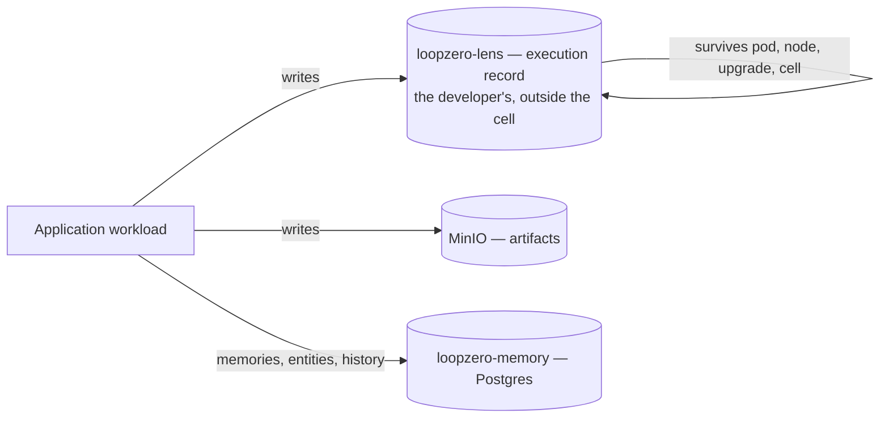

# D4 — What survives what

For a platform running **long-lived agents**, this is the drawing that defines the
product. An agent that loses its work to a pod restart is not a long-running agent.

| Event | App workload | Agent state (PIECE-2) | Execution record (PIECE-4) | Knowledge (PIECE-3) |
|---|---|---|---|---|
| pod crash | rescheduled | survives — Postgres | survives — Postgres | survives |
| node restart | rescheduled | survives | survives | survives |
| platform upgrade | **no Draining phase exists** | survives | survives | survives |
| cell destroyed | gone | **survives** — `loopzero-memory` | **survives** — `loopzero-lens` | **survives** — `loopzero-rag` |

## Measured

- **Postgres and MinIO are the two stores that hold agent-relevant state.** The narrower
  claim, corrected 2026-09-11: this said *"the only backends named in `charts/*/values.yaml`"*
  and that is false — `charts/loopzero-api/values.yaml:94,170` names a Redis
  (`loopzeroServiceAuthNonceRedisAddr`). Nonces carry no agent state, so no row of the table above
  changes; the sentence simply measured less than it asserted.
- `PIECE-4 Execution record` and `PIECE-2 Agent state` are **separate pieces**, so the
  product already treats them as different things.

## Decided

- **The execution record is durable.** It is in Postgres, which survives everything
  above the cell.

## Corrected 2026-09-11 by the design panel — a destroyed cell does not take the data plane

The table said a destroyed cell takes everything. **It takes the workload and nothing else**,
and the correction is the same fact D4 already established one row up: the state was never in
the cell.

Measured: `loopzero-lens` appears in **no cell composition**. It is reached by `loopzero-cloud` over
`LENS_BASE_URL` as a Model-B broker
(`infra/helmfile/values/dev-public/loopzero-cloud.yaml.gotmpl:124-128`), and `loopzero-memory` and
`loopzero-rag` are consumed the same way — the developer's own services, outside the cell. A cell
is where the workload runs, not where its state lives.

**And that exposed a second defect in this drawing, which the panel caught as a contradiction
with D2:** the `pg[(Postgres — execution record)]` node here and the `pg[(Postgres)]` in
`trust.md` are **different databases with the same label** — ours holds tenants, releases and
metering; the execution record is `loopzero-lens`'s. Two drawings using one name for two stores is
how a reader concludes the wrong thing about both, so the node is renamed below.

## Resolved 2026-09-11 — agent state is durable

**`PIECE-2` is not in this repository.** It lives in `loopzero-memory`, a sibling repo in
the same ecosystem — which is why nothing in `loopzero`'s charts or its 48-table schema
established where agent state is written. Looking for it here was looking in the wrong
repository.

Measured in `loopzero-memory`:

| Evidence | Value |
|---|---|
| Store | Postgres, via Drizzle (`drizzle.config.ts`) |
| Migrations | 34 |
| Tables holding agent state | `memories`, `entities`, `entity_edges`, `memory_entities`, `history`, `consolidation_history`, `recall_cache`, `recall_traces`, `reflection_counters` |

So a pod crash, a node restart and a platform upgrade all leave agent state intact: it
was never in the pod. The blast radius of a pod eviction is the in-flight turn, not the
agent's memory.

## Still open

- **What is lost mid-turn?** Memory is durable at rest; whether an in-flight turn is
  checkpointed before it completes was not established, and that is the remaining
  question for a long-running agent.
- **No `Draining` phase still stands** (D1). Agent state surviving an upgrade does not
  mean the workload does.

## Related

- [`../decisions/agent-state-never-lives-in-the-pod.md`](../decisions/agent-state-never-lives-in-the-pod.md) — the invariant this drawing's open questions resolved into

- [`states.md`](states.md) — D1, the phases whose state this outlives
- [`system-map.md`](system-map.md) — D5, where the store appears
- [`sign-off.md`](sign-off.md) — D4 was answered on 2026-09-11: **yes**, and the evidence lives in
  `loopzero-memory`, which is ours and is treated as ready
- [`../product/trd.md`](../product/trd.md) — `REQ-5`, the promise that rests on that edge
