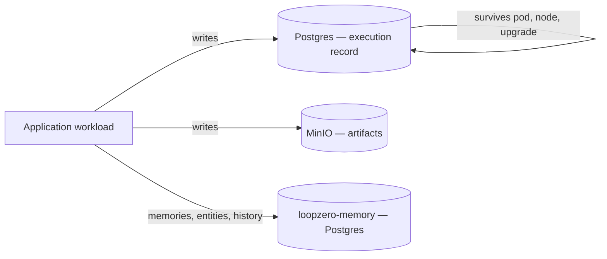

# D4 — What survives what

For a platform running **long-lived agents**, this is the drawing that defines the
product. An agent that loses its work to a pod restart is not a long-running agent.

| Event | App workload | Agent state (PIECE-2) | Execution record (PIECE-4) | Knowledge (PIECE-3) |
|---|---|---|---|---|
| pod crash | rescheduled | survives — Postgres | survives — Postgres | survives |
| node restart | rescheduled | survives | survives | survives |
| platform upgrade | **no Draining phase exists** | survives | survives | survives |
| cell destroyed | gone | gone | gone | gone |

## Measured

- **Postgres and MinIO are the two stores** — the only backends named in
  `charts/*/values.yaml`.
- `PIECE-4 Execution record` and `PIECE-2 Agent state` are **separate pieces**, so the
  product already treats them as different things.

## Decided

- **The execution record is durable.** It is in Postgres, which survives everything
  above the cell.

## Resolved 2026-09-11 — agent state is durable

**`PIECE-2` is not in this repository.** It lives in `loopzero-memory`, a sibling repo in
the same ecosystem — which is why nothing in `loopzero`'s charts or its 48-table schema
established where agent state is written. Looking for it here was looking in the wrong
repository.

Measured in `loopzero-memory`:

| Evidence | Value |
|---|---|
| Store | Postgres, via Drizzle (`drizzle.config.ts`) |
| Migrations | 34 |
| Tables holding agent state | `memories`, `entities`, `entity_edges`, `memory_entities`, `history`, `consolidation_history`, `recall_cache`, `recall_traces`, `reflection_counters` |

So a pod crash, a node restart and a platform upgrade all leave agent state intact: it
was never in the pod. The blast radius of a pod eviction is the in-flight turn, not the
agent's memory.

## Still open

- **The `loopzero` ↔ `loopzero-memory` edge is cross-repo.** This drawing now asserts a
  durability property whose evidence lives in a repository this one does not build.
  A change there reaches every agent here and no gate in `loopzero` would see it.
- **What is lost mid-turn?** Memory is durable at rest; whether an in-flight turn is
  checkpointed before it completes was not established, and that is the remaining
  question for a long-running agent.
- **No `Draining` phase still stands** (D1). Agent state surviving an upgrade does not
  mean the workload does.

## Related

- [`states.md`](states.md) — D1, the phases whose state this outlives
- [`system-map.md`](system-map.md) — D5, where the store appears
- [`sign-off.md`](sign-off.md) — D4 was answered on 2026-09-11: **yes**, and the evidence lives in
  `loopzero-memory`, a repository `loopzero` does not build
- [`../product/trd.md`](../product/trd.md) — `REQ-5`, the promise that rests on that edge
