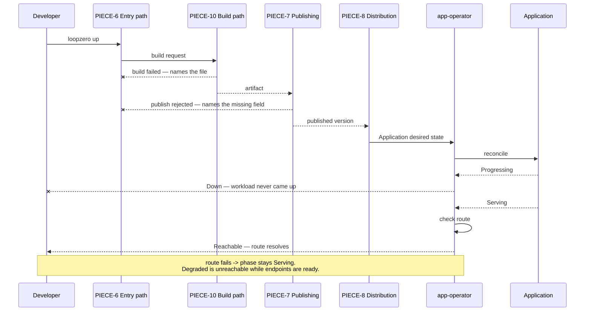

# D3 — From nothing to running, including what fails

`PIECE-6` states the requirement this drawing exists to hold: *"that the route from
nothing to running is **one** route with no fork, and that every failure along it names
what she must change."* So the failure paths are the point here, not the decoration.

## Decided

- **One route, no fork.** Every failure returns to the developer naming what to change,
  rather than surfacing as a phase they have to interpret.
- **`Serving` is not the end.** The sequence continues to the route check, because an
  app that is up and unreachable is not delivered.

**Corrected 2026-09-11 by the design panel.** This drawing had the route failure reporting
`Degraded`. It does not. `computePhase`
(`operators/internal/app/application_controller.go:387-404`) tests in strict order —
`Status.Reachable` first, then `Status.EndpointsReady`, and only then the conditions. So a
workload whose endpoints are ready and whose route is broken returns **`Serving`**, and the
`Degraded` branch is unreachable in that state.

**That is a finding about the product, not only about the drawing.** The developer whose app
is up and unreachable sees a phase that says it is serving. `PIECE-6` requires *"every failure
names what she must change"*, and this failure names nothing. Whether the fix is a new phase, a
condition surfaced separately, or `EndpointsReady` ceasing to outrank a failed route is a
product decision — recorded below as open rather than drawn as settled.

## Open — for the sign-off to resolve

- **An app that is up and unreachable reports `Serving`.** Measured above. `PIECE-6` promises
  a failure that names the fix, and this one is silent in the phase. Which of the three fixes
  is right was not decided.

- **Where does build run?** `PIECE-10` is a piece; whether it executes in the customer's
  cell or on platform infrastructure was not established. It decides whether a heavy
  build can starve a running agent.
- **Is `loopzero up` the only entry?** The drawing assumes one. A second path — a CI push,
  an API call — would break the no-fork requirement and is worth naming if it exists.

## Related

- [`trust.md`](trust.md) — D2, the boundary these calls cross
- [`durability.md`](durability.md) — D4, what survives a failed step
- [`sign-off.md`](sign-off.md) — D3 was answered on 2026-09-11: the build runs on the customer's
  infrastructure, decided by C1 of the extraction RFC
