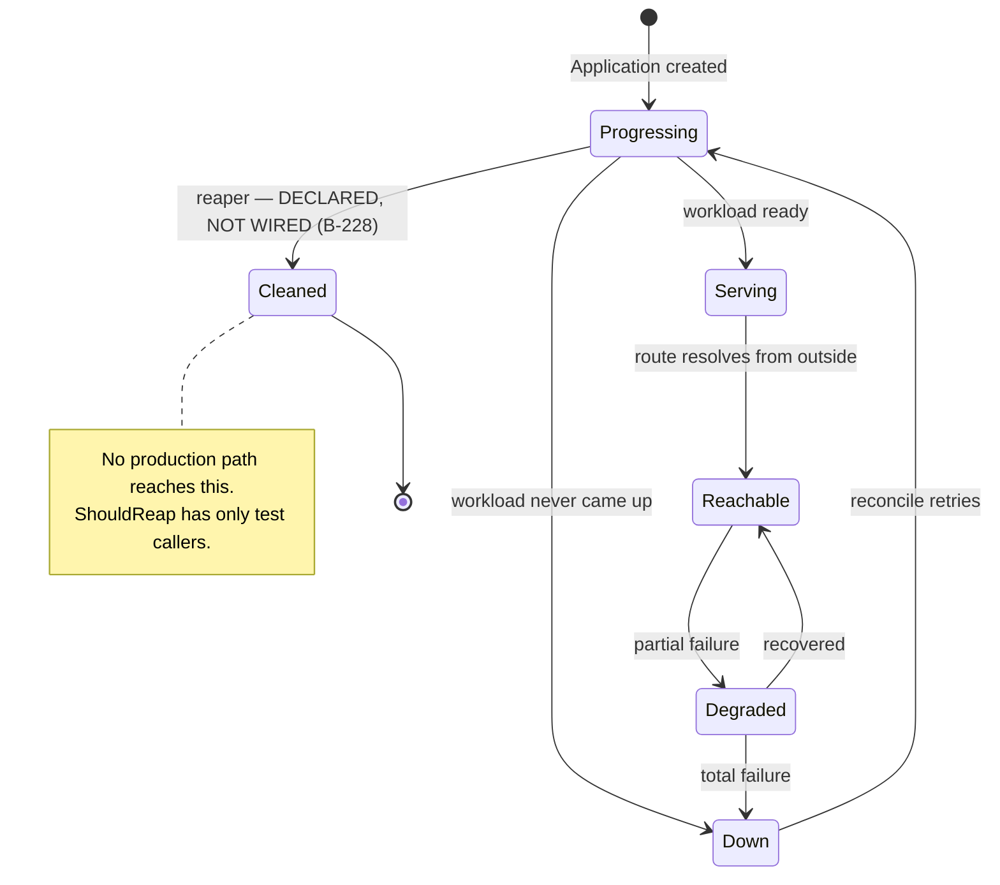

# D1 — The lifecycle of an Application

The central object is `Application` (`operators/api/v1/application_types.go`). Everything
the platform does to a customer's agentic app is a transition here.



## Measured

The six phases are read from the CRD, not invented:

Counted with this, and the command is written down because a number nobody can reproduce is
a claim:

```bash
grep -rho "ApplicationPhase<Phase>\b" operators/internal --include="*.go" | wc -l
```

Occurrences of the qualified constant, **test files included** — they are where the phase
contract is asserted, so excluding them measures less than the phase is used.

| Phase | Written by (occurrences in `operators/internal`) |
|---|---|
| `Cleaned` | 6 |
| `Progressing` | 5 |
| `Serving` | 3 |
| `Reachable` | 3 |
| `Down` | 2 |
| `Degraded` | 2 |

`Serving` and `Reachable` are **separate phases**, and that separation is the design:
a workload can be up and not yet reachable from outside. Collapsing them would report
an app as available before its route resolves.

## Decided

- **`Cleaned` is the only terminal phase.** Everything else can be re-entered by a
  reconcile.
- **`Down` is recoverable, not terminal.** The controller retries; an app that failed
  to come up is not an app that is finished.

## Corrected 2026-09-11 by the design panel — twice

**Round 1 — `Cleaned` is reachable from `Progressing` and from nowhere else.** This drawing had
`Reachable --> Cleaned` and `Down --> Cleaned`, both labelled *deleted*. `ShouldReap`
(`operators/internal/app/application_reaper.go:80-84`) refuses every other phase by name.

**Round 2 — and that edge is not wired at all.** The external seat checked whether the
corrected transition actually happens, and it does not:

```bash
grep -rn "ShouldReap\|MarkAsCleaned" --include="*.go" . | grep -v _test.go
# the definition, the signature, and comments. Zero call sites.
```

`application_controller.go` mentions `Reap`, `Cleaned` and `orphan` **zero times**, while the
reaper's own header (`:19-21`) asserts the opposite in words: *"The reaper is invoked from the
existing application controller's reconcile path… Each reconcile evaluates `ShouldReap()`."*

So `ApplicationPhaseCleaned` is declared in the CRD and **no production path reaches it**. The
edge stays on the diagram, marked, because a reader who finds the phase in the CRD will look
for it here — and removing it would hide the gap rather than name it. Registered as **`B-228`**.

**The grace-period label was also wrong** and is now gone. It read *"manifest gone past grace
period"*; `application_reaper.go:86` is `age := now.Sub(app.CreationTimestamp.Time)` — the age
of the **CR**, not time since the manifest disappeared. The manifest check is a separate
condition that runs after it.

## Open — for the sign-off to resolve

- **A `Reachable` app whose manifest leaves the source has no transition.** The reaper only
  takes `Progressing`. Whether that app should be reaped, alerted on, or left standing was
  never decided — found 2026-09-11 by correcting the two deletion edges above.

- **Is there a suspended state?** Nothing in the CRD carries one. For long-running
  agents this is the question that decides whether an idle agent costs money.
- **What happens to a running app during a platform upgrade?** No `Draining` phase
  exists. Either upgrades do not touch running workloads, or the gap is real.

## Related

- [`../decisions/agent-state-never-lives-in-the-pod.md`](../decisions/agent-state-never-lives-in-the-pod.md) — the invariant this drawing's open questions resolved into

- [`trust.md`](trust.md) — D2, the boundary these phases cross
- [`durability.md`](durability.md) — D4, what survives a phase change
- [`sign-off.md`](sign-off.md) — the open questions this drawing leaves
