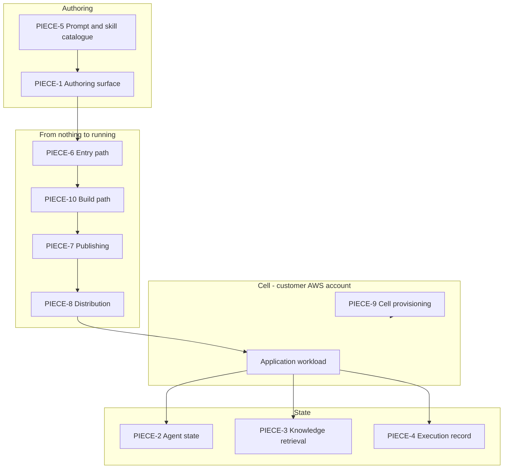

# D5 — Components, derived from D1–D4

**Drawn last, on purpose.** A component map produced before the four decisions looks
like design happened and forces no choice. This one is a summary of them, and every
`PIECE-N` from `technical-pieces.md` has a place in it.

## What the map says that the list did not

- **`PIECE-9 Cell provisioning` sits beside the path, not on it.** A cell is brought
  into existence once; an app is deployed many times. Drawing them in sequence would
  put a one-time act on the hot path.
- **The three state pieces are one subgraph and three components.** D4 shows why: they
  have different durability answers, and two of them are open questions.
- **`PIECE-5` feeds `PIECE-1` and nothing else.** The catalogue is an authoring input.
  If it is also read at runtime, this edge is missing and the map is wrong.

## Coverage

Ten pieces declared, ten placed. `check_design_completeness.py` verifies this rather
than trusting the drawing.

## Related

- [`states.md`](states.md) · [`trust.md`](trust.md) · [`sequence.md`](sequence.md) ·
  [`durability.md`](durability.md) — the four decisions this map is DERIVED from
- [`../product/technical-pieces.md`](../product/technical-pieces.md) — the `PIECE-N` this covers
- [`../architecture/paved-road.md`](../architecture/paved-road.md) — the same ground at the AWS target
