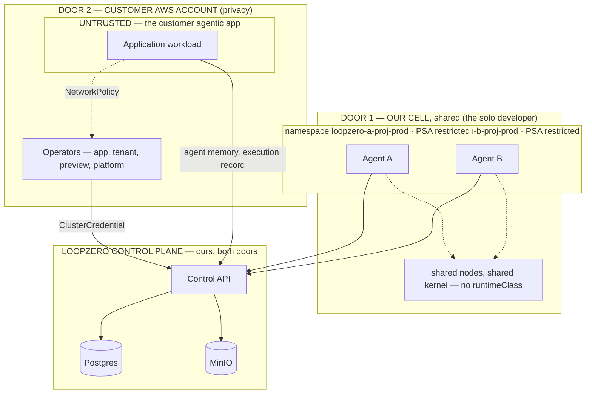

# D2 — Where customer code stops

## Two doors, and they are not isolated the same way

**Decided 2026-09-11** — [`../decisions/two-doors-managed-and-byoc.md`](../decisions/two-doors-managed-and-byoc.md).
This drawing carried only door 2 until then, which made the platform look like one shape.

| | what separates two CUSTOMERS |
|---|---|
| door 1 · managed | a namespace label and PodSecurity `restricted`. **Same kernel, same nodes** |
| door 2 · BYOC | an AWS account. Nothing is shared |

The control plane is ours on both, so the boundary that moves is the workload's, not the API's.

**Door 1 is where the open question lives.** `runtimeClass` appears in zero files — no gVisor, no
Kata, no Firecracker — and `nodeSelector` is used only for platform deployments, never to pin a
tenant. That is ordinary Kubernetes soft multi-tenancy and it is the right default for most
platforms. This one runs agents: LLM-generated code calling tools for someone nobody met. Whether
that is the same surface as a web app is a product decision, and choosing otherwise later means
re-platforming door 1.

## Measured

- **The cell runs inside the customer's own AWS account** — `PIECE-9` states it:
  *"bringing a cell into existence inside the customer's AWS account… reproducibly from
  a declared ClusterClass."* The trust boundary is therefore an account boundary, not
  only a namespace one.
- `NetworkPolicy` and `securityContext` are exercised by chart tests —
  `charts/loopzero-api/tests/networkpolicy_test.yaml`,
  `charts/loopzero-api/tests/security-context_test.yaml`,
  `charts/loopzero-tenant-operator/tests/networkpolicy_test.yaml`.
- `ClusterCredential` is one of the eight CRDs, which is how a cell authenticates
  rather than a shared secret.

## Decided

- **The customer's code is the Application workload, and nothing else.** Operators,
  API and storage are the platform's.
- **The credential crossing the boundary is per-cell**, carried by a CRD rather than
  configured by hand.

## Open — for the sign-off to resolve

- **Egress from the customer's agentic app.** No allowlist was found. An agent that
  can reach anything is a different product than one that cannot.
- **Can one tenant's app observe another's?** `tenant-operator` exists; whether the
  isolation is namespace, node or cell was not established from the charts.

## Related

- [`states.md`](states.md) — D1, the phases that cross this boundary
- [`sequence.md`](sequence.md) — D3, the calls that cross it
- [`sign-off.md`](sign-off.md) — the open questions this drawing leaves
