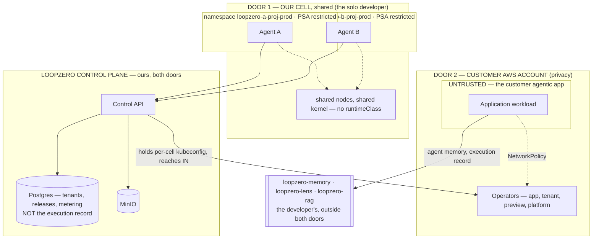

# D2 — Where customer code stops

## Corrected 2026-09-11 by the design panel — the credential points the other way

This drawing had `ops -->|ClusterCredential| api`: the cell's operators handing a credential
outward. **The code does the opposite.** `ClusterCredential` CRDs live on the **management
cluster** (`api/internal/placement/k8s_cell_store.go:24-27` — *"reads CellConfigs from
ClusterCredential CRDs on the management cluster"*), the router resolves a per-cell kubeconfig
Secret (`api/internal/placement/router.go:23-26`), and the control plane submits TokenReview
**to that cluster's API server** (`api/internal/middleware/auth/cross_cluster_token_review.go:12-16`).

So the control plane **holds** the credential and **reaches in**. That is the mechanism the
market research names as contested — see below — and drawing it outward hid exactly the thing
that is under question.

**The Postgres node is also relabelled, and one more edge was wrong.** The control plane's
Postgres holds tenants, releases and metering; the execution record is `loopzero-lens`'s and lives
outside the cell (`durability.md`). Two drawings were using one name for two databases.

The edge `app --> api` labelled *"agent memory, execution record"* was wrong for the same
reason: **the Control API has no memory, lens or rag route at all** — `ls api/internal/routes/`
returns none — and `loopzero-cloud` reaches those services over `MEMORY_/RAG_/LENS_BASE_URL`
brokers. The workload writes to the developer's data plane, not through us. Found while
correcting the credential direction, which is what a redraw is for.

## Open — for the sign-off to resolve

- **Does the control plane assume a role inward, or does an egress-only agent reach out?**
  This is the question this drawing omitted while the other four each carried one, and it is
  the one [`../decisions/byoc-as-the-only-mode-has-no-precedent.md`](../decisions/byoc-as-the-only-mode-has-no-precedent.md)
  ranks highest: WarpStream asks *"wouldn't it be better if external access wasn't required at
  all?"*, and Nuon reports that least privilege *"prohibits most day-to-day debugging"*. Both
  propose an agent inside the customer account with **no inbound path**. The record calls it
  *"the finding with the most leverage, because the mechanism is not yet built"* — and changing
  it later means changing a live trust relationship in every customer account.

- **Is there an egress allowlist for the customer's app?** Registered as `B-226`: the platform's
  own namespace excludes RFC1918 and `169.254/16`; the tenant's does not.

## Two doors, and they are not isolated the same way

**Decided 2026-09-11** — [`../decisions/two-doors-managed-and-byoc.md`](../decisions/two-doors-managed-and-byoc.md).
This drawing carried only door 2 until then, which made the platform look like one shape.

| | what separates two CUSTOMERS |
|---|---|
| door 1 · managed | a namespace label and PodSecurity `restricted`. **Same kernel, same nodes** |
| door 2 · BYOC | an AWS account. Nothing is shared |

The control plane is ours on both, so the boundary that moves is the workload's, not the API's.

**Door 1 shares a kernel, and that is decided** —
[`../decisions/shared-kernel-on-the-managed-door.md`](../decisions/shared-kernel-on-the-managed-door.md),
2026-09-11. `runtimeClass` appears in zero files and will stay that way: no gVisor, no Kata, no
Firecracker.

The pod is already at the ceiling of what Kubernetes offers without touching the kernel —
`runAsNonRoot`, uid 1000, `seccompProfile: RuntimeDefault`, `readOnlyRootFilesystem`,
`allowPrivilegeEscalation=false`, no service-account token, and PSA `restricted` on the namespace.
What remains is the shared kernel, and the decision is to carry it, because door 1 runs **the image
she built from her code** rather than code generated at runtime.

That is where Heroku, Railway, Supabase and PlanetScale sit, and it is the line Vercel draws in its
own documentation by shipping a Firecracker-backed product BESIDE its platform rather than inside
it. The exit condition is written in the decision: reopen the day LoopZero executes agent-generated code
as a platform capability.
- [`../decisions/agent-state-never-lives-in-the-pod.md`](../decisions/agent-state-never-lives-in-the-pod.md) — where the tenant egress policy is decided
