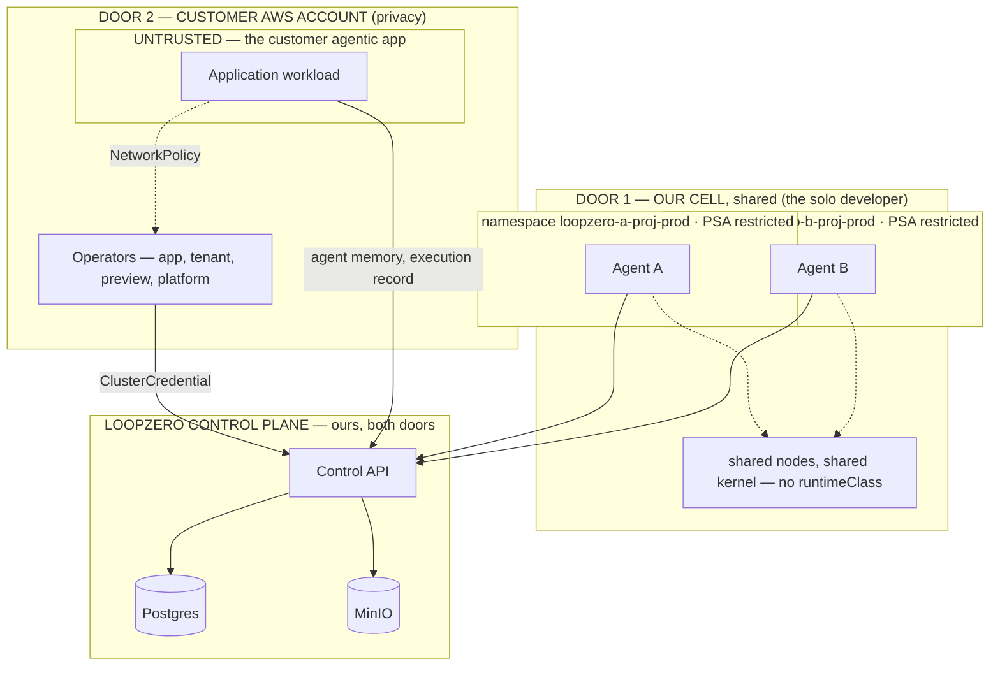

# D2 — Where customer code stops

## Two doors, and they are not isolated the same way

**Decided 2026-09-11** — [`../decisions/two-doors-managed-and-byoc.md`](../decisions/two-doors-managed-and-byoc.md).
This drawing carried only door 2 until then, which made the platform look like one shape.

| | what separates two CUSTOMERS |
|---|---|
| door 1 · managed | a namespace label and PodSecurity `restricted`. **Same kernel, same nodes** |
| door 2 · BYOC | an AWS account. Nothing is shared |

The control plane is ours on both, so the boundary that moves is the workload's, not the API's.

**Door 1 shares a kernel, and that is decided** —
[`../decisions/shared-kernel-on-the-managed-door.md`](../decisions/shared-kernel-on-the-managed-door.md),
2026-09-11. `runtimeClass` appears in zero files and will stay that way: no gVisor, no Kata, no
Firecracker.

The pod is already at the ceiling of what Kubernetes offers without touching the kernel —
`runAsNonRoot`, uid 1000, `seccompProfile: RuntimeDefault`, `readOnlyRootFilesystem`,
`allowPrivilegeEscalation=false`, no service-account token, and PSA `restricted` on the namespace.
What remains is the shared kernel, and the decision is to carry it, because door 1 runs **the image
she built from her code** rather than code generated at runtime.

That is where Heroku, Railway, Supabase and PlanetScale sit, and it is the line Vercel draws in its
own documentation by shipping a Firecracker-backed product BESIDE its platform rather than inside
it. The exit condition is written in the decision: reopen the day LoopZero executes agent-generated code
as a platform capability.
