# What it is

One PostgreSQL database holds every user-visible fact the platform knows. **48 tables, 445
columns, 158 table-level constraints and 42 foreign keys**, read from
`api/internal/db/schema.gen.sql` — a generated dump built by golang-migrate from
`api/internal/db/migrations/`. Migrations are forward-only.

One of those 48 is `schema_migrations`, golang-migrate's own bookkeeping rather than domain data,
which is why the map's component description for the datastore says **47**. Both counts are
right about different things; this document counts every table in the dump.

`tenants` is the hub: **20 of the 48 tables carry a foreign key to it**, far more than any other
parent — the next largest fan-in is `releases` with four.

# Schema

| Table | Columns | Constraints | Tier | Anchor |
|---|---|---|---|---|
| [`accounts`](#accounts) | 6 | 3 | — | `api/internal/db/schema.gen.sql:203` |
| [`app_scaling_config`](#app-scaling-config) | 12 | 7 | — | `api/internal/db/schema.gen.sql:214` |
| [`audit_log`](#audit-log) | 9 | 1 | — | `api/internal/db/schema.gen.sql:238` |
| [`build_apps`](#build-apps) | 10 | 3 | — | `api/internal/db/schema.gen.sql:268` |
| [`builds`](#builds) | 19 | 2 | — | `api/internal/db/schema.gen.sql:283` |
| [`cells`](#cells) | 8 | 4 | — | `api/internal/db/schema.gen.sql:310` |
| [`circuit_breakers`](#circuit-breakers) | 8 | 2 | — | `api/internal/db/schema.gen.sql:326` |
| [`cost_counters`](#cost-counters) | 7 | 4 | 3-derived | `api/internal/db/schema.gen.sql:340` |
| [`custom_domains`](#custom-domains) | 20 | 5 | — | `api/internal/db/schema.gen.sql:356` |
| [`deploy_events`](#deploy-events) | 10 | 5 | — | `api/internal/db/schema.gen.sql:386` |
| [`environment_targets`](#environment-targets) | 11 | 4 | — | `api/internal/db/schema.gen.sql:418` |
| [`github_installations`](#github-installations) | 6 | 2 | — | `api/internal/db/schema.gen.sql:437` |
| [`github_webhook_deliveries`](#github-webhook-deliveries) | 3 | 1 | — | `api/internal/db/schema.gen.sql:450` |
| [`idempotency_keys`](#idempotency-keys) | 8 | 1 | — | `api/internal/db/schema.gen.sql:458` |
| [`leader_generations`](#leader-generations) | 6 | 1 | — | `api/internal/db/schema.gen.sql:473` |
| [`lens_alert_rules`](#lens-alert-rules) | 17 | 11 | — | `api/internal/db/schema.gen.sql:484` |
| [`lens_dashboards`](#lens-dashboards) | 7 | 3 | — | `api/internal/db/schema.gen.sql:516` |
| [`lens_fired_alerts`](#lens-fired-alerts) | 11 | 5 | — | `api/internal/db/schema.gen.sql:529` |
| [`lens_saved_views`](#lens-saved-views) | 6 | 4 | — | `api/internal/db/schema.gen.sql:547` |
| [`memory_exports`](#memory-exports) | 9 | 3 | — | `api/internal/db/schema.gen.sql:562` |
| [`memory_webhook_deliveries`](#memory-webhook-deliveries) | 12 | 3 | — | `api/internal/db/schema.gen.sql:579` |
| [`memory_webhooks`](#memory-webhooks) | 9 | 5 | — | `api/internal/db/schema.gen.sql:597` |
| [`metering_config`](#metering-config) | 2 | 2 | — | `api/internal/db/schema.gen.sql:616` |
| [`metering_cursor`](#metering-cursor) | 4 | 1 | 2-validated | `api/internal/db/schema.gen.sql:624` |
| [`plan_limits`](#plan-limits) | 4 | 1 | — | `api/internal/db/schema.gen.sql:635` |
| [`preview_environments`](#preview-environments) | 17 | 7 | — | `api/internal/db/schema.gen.sql:644` |
| [`preview_slot`](#preview-slot) | 7 | 3 | — | `api/internal/db/schema.gen.sql:671` |
| [`project_repositories`](#project-repositories) | 11 | 4 | — | `api/internal/db/schema.gen.sql:686` |
| [`projects`](#projects) | 6 | 4 | — | `api/internal/db/schema.gen.sql:704` |
| [`release_app_attestations`](#release-app-attestations) | 13 | 7 | — | `api/internal/db/schema.gen.sql:717` |
| [`releases`](#releases) | 21 | 3 | — | `api/internal/db/schema.gen.sql:741` |
| [`schema_migrations`](#schema-migrations) | 2 | 1 | — | `api/internal/db/schema.gen.sql:770` |
| [`secrets`](#secrets) | 9 | 2 | — | `api/internal/db/schema.gen.sql:777` |
| [`sse_events`](#sse-events) | 5 | 1 | — | `api/internal/db/schema.gen.sql:793` |
| [`storage_objects`](#storage-objects) | 8 | 4 | — | `api/internal/db/schema.gen.sql:816` |
| [`subscriptions`](#subscriptions) | 14 | 6 | — | `api/internal/db/schema.gen.sql:831` |
| [`tenant_members`](#tenant-members) | 5 | 4 | — | `api/internal/db/schema.gen.sql:854` |
| [`tenant_tombstones`](#tenant-tombstones) | 8 | 1 | — | `api/internal/db/schema.gen.sql:867` |
| [`tenants`](#tenants) | 8 | 3 | — | `api/internal/db/schema.gen.sql:882` |
| [`tenants_pending_deletion`](#tenants-pending-deletion) | 9 | 2 | — | `api/internal/db/schema.gen.sql:897` |
| [`loopzero_api_keys`](#loopzero-api-keys) | 14 | 6 | — | `api/internal/db/schema.gen.sql:913` |
| [`usage_records`](#usage-records) | 8 | 2 | 4-served-external | `api/internal/db/schema.gen.sql:936` |
| [`user_identity_map`](#user-identity-map) | 3 | 2 | — | `api/internal/db/schema.gen.sql:951` |
| [`users`](#users) | 8 | 2 | — | `api/internal/db/schema.gen.sql:959` |
| [`webhook_events`](#webhook-events) | 8 | 1 | — | `api/internal/db/schema.gen.sql:972` |
| [`work_queue`](#work-queue) | 12 | 1 | — | `api/internal/db/schema.gen.sql:985` |
| [`workspace_webhook_deliveries`](#workspace-webhook-deliveries) | 16 | 4 | — | `api/internal/db/schema.gen.sql:1015` |
| [`workspace_webhooks`](#workspace-webhooks) | 9 | 5 | — | `api/internal/db/schema.gen.sql:1039` |

## Foreign keys

```mermaid
erDiagram
    users }o--|| accounts : "referenced by"
    builds }o--|| build_apps : "referenced by"
    tenants }o--|| cost_counters : "referenced by"
    tenants }o--|| custom_domains : "referenced by"
    tenants }o--|| deploy_events : "referenced by"
    releases }o--|| environment_targets : "referenced by"
    tenants }o--o| github_installations : "referenced by"
    tenants }o--|| lens_alert_rules : "referenced by"
    workspace_webhooks }o--|| lens_alert_rules : "referenced by"
    tenants }o--|| lens_dashboards : "referenced by"
    lens_alert_rules }o--|| lens_fired_alerts : "referenced by"
    tenants }o--|| lens_fired_alerts : "referenced by"
    tenants }o--|| lens_saved_views : "referenced by"
    tenants }o--|| memory_exports : "referenced by"
    memory_webhooks }o--|| memory_webhook_deliveries : "referenced by"
    tenants }o--|| memory_webhooks : "referenced by"
    builds }o--o| preview_environments : "referenced by"
    releases }o--o| preview_environments : "referenced by"
    tenants }o--|| preview_environments : "referenced by"
    releases }o--o| preview_slot : "referenced by"
    github_installations }o--|| project_repositories : "referenced by"
    tenants }o--|| project_repositories : "referenced by"
    users }o--|| projects : "referenced by"
    tenants }o--|| projects : "referenced by"
    releases }o--|| release_app_attestations : "referenced by"
    builds }o--|| releases : "referenced by"
    accounts }o--|| subscriptions : "referenced by"
    tenants }o--|| subscriptions : "referenced by"
    tenants }o--|| tenant_members : "referenced by"
    users }o--|| tenant_members : "referenced by"
    accounts }o--|| tenants : "referenced by"
    users }o--|| tenants : "referenced by"
    tenants }o--|| tenants_pending_deletion : "referenced by"
    accounts }o--|| loopzero_api_keys : "referenced by"
    loopzero_api_keys }o--o| loopzero_api_keys : "referenced by"
    tenants }o--|| loopzero_api_keys : "referenced by"
    tenants }o--|| usage_records : "referenced by"
    users }o--|| user_identity_map : "referenced by"
    tenants }o--o| users : "referenced by"
    workspace_webhooks }o--|| workspace_webhook_deliveries : "referenced by"
    tenants }o--|| workspace_webhooks : "referenced by"
```

| Child | Column → parent | On delete |
|---|---|---|
| `accounts` | `accounts.owner_id -> users.id` | RESTRICT |
| `build_apps` | `build_apps.build_id -> builds.id` | CASCADE |
| `cost_counters` | `cost_counters.tenant_id -> tenants.id` | CASCADE |
| `custom_domains` | `custom_domains.tenant_id -> tenants.id` | RESTRICT |
| `deploy_events` | `deploy_events.tenant_id -> tenants.id` | CASCADE |
| `environment_targets` | `environment_targets.active_release_id -> releases.id` | RESTRICT |
| `environment_targets` | `environment_targets.desired_release_id -> releases.id` | RESTRICT |
| `github_installations` | `github_installations.tenant_id -> tenants.id` | SET NULL |
| `lens_alert_rules` | `lens_alert_rules.tenant_id -> tenants.id` | CASCADE |
| `lens_alert_rules` | `lens_alert_rules.webhook_id -> workspace_webhooks.id` | CASCADE |
| `lens_dashboards` | `lens_dashboards.tenant_id -> tenants.id` | CASCADE |
| `lens_fired_alerts` | `lens_fired_alerts.rule_id -> lens_alert_rules.id` | CASCADE |
| `lens_fired_alerts` | `lens_fired_alerts.tenant_id -> tenants.id` | CASCADE |
| `lens_saved_views` | `lens_saved_views.tenant_id -> tenants.id` | CASCADE |
| `memory_exports` | `memory_exports.tenant_id -> tenants.id` | CASCADE |
| `memory_webhook_deliveries` | `memory_webhook_deliveries.webhook_id -> memory_webhooks.id` | CASCADE |
| `memory_webhooks` | `memory_webhooks.tenant_id -> tenants.id` | CASCADE |
| `preview_environments` | `preview_environments.build_id -> builds.id` | SET NULL |
| `preview_environments` | `preview_environments.release_id -> releases.id` | SET NULL |
| `preview_environments` | `preview_environments.tenant_id -> tenants.id` | CASCADE |
| `preview_slot` | `preview_slot.active_release_id -> releases.id` | SET NULL |
| `project_repositories` | `project_repositories.installation_id -> github_installations.id` | RESTRICT |
| `project_repositories` | `project_repositories.tenant_id -> tenants.id` | CASCADE |
| `projects` | `projects.created_by -> users.id` | RESTRICT |
| `projects` | `projects.tenant_id -> tenants.id` | RESTRICT |
| `release_app_attestations` | `release_app_attestations.release_id -> releases.id` | CASCADE |
| `releases` | `releases.build_id -> builds.id` | RESTRICT |
| `subscriptions` | `subscriptions.account_id -> accounts.id` | CASCADE |
| `subscriptions` | `subscriptions.tenant_id -> tenants.id` | RESTRICT |
| `tenant_members` | `tenant_members.tenant_id -> tenants.id` | CASCADE |
| `tenant_members` | `tenant_members.user_id -> users.id` | CASCADE |
| `tenants` | `tenants.account_id -> accounts.id` | RESTRICT |
| `tenants` | `tenants.owner_id -> users.id` | RESTRICT |
| `tenants_pending_deletion` | `tenants_pending_deletion.tenant_id -> tenants.id` | CASCADE |
| `loopzero_api_keys` | `loopzero_api_keys.account_id -> accounts.id` | CASCADE |
| `loopzero_api_keys` | `loopzero_api_keys.rotated_from -> loopzero_api_keys.id` | SET NULL |
| `loopzero_api_keys` | `loopzero_api_keys.tenant_id -> tenants.id` | CASCADE |
| `usage_records` | `usage_records.tenant_id -> tenants.id` | RESTRICT |
| `user_identity_map` | `user_identity_map.user_id -> users.id` | CASCADE |
| `users` | `users.active_tenant_id -> tenants.id` | SET NULL |
| `workspace_webhook_deliveries` | `workspace_webhook_deliveries.webhook_id -> workspace_webhooks.id` | CASCADE |
| `workspace_webhooks` | `workspace_webhooks.tenant_id -> tenants.id` | CASCADE |

The `ON DELETE` column is the part worth reading closely. `RESTRICT` on `projects.tenant_id`,
`releases.build_id`, `environment_targets.*_release_id` and `usage_records.tenant_id` means those
parents cannot be deleted while the children exist — billing history and the active release
pointer are deliberately not cascade-deletable. `loopzero_api_keys.rotated_from` is a self-reference
with `SET NULL`, which is how key rotation keeps a chain without pinning the predecessor.

## Four tables carry a quality tier

`metering_cursor`, `cost_counters` and `usage_records` are tiers 2, 3 and 4 of the billing
promotion chain; the raw capture above them is never stored. The full contract, including the
five predicates that hold the cursor, is
[`/entities/metering-ledger.md`](/entities/metering-ledger.md).

# Relationships

- Reached through the `pgxpool` and sqlc layer in
  [`/components/persistence.md`](/components/persistence.md).
- `builds` and `releases` are written under the environment advisory lock — see
  [`/flows/deploy-container-app.md`](/flows/deploy-container-app.md).
- `tenants.cell_id` is the canonical placement decision, written once by
  [`/flows/tenant-cell-placement.md`](/flows/tenant-cell-placement.md).
- `sse_events` **is** the event bus — there is no broker; see
  [`/components/event-stream.md`](/components/event-stream.md).
- `deploy_events` is a transactional outbox drained by the extracted `../loopzero-cloud` repository
  and never read back here — [`/components/release-delivery.md`](/components/release-delivery.md).
- `audit_log` is the table the unwired enum in
  [`/components/audit-package.md`](/components/audit-package.md) was written to protect.
- `builds.status` carries a CHECK constraint enumerating the same seven values as the
  [`Build` state machine](/entities/state-machine-build.md). A state added to the machine and not
  to the CHECK is a runtime constraint violation — which has happened before, for the rollback
  states.

# Table detail

## accounts

| Column | Type | Constraints |
|---|---|---|
| `id` | `text` | PRIMARY KEY; NOT NULL |
| `display_name` | `text` | NOT NULL |
| `plan` | `text` | NOT NULL; DEFAULT 'starter'::text |
| `owner_id` | `text` | NOT NULL; UNIQUE |
| `created_at` | `timestamp with time zone` | NOT NULL; DEFAULT now() |
| `updated_at` | `timestamp with time zone` | NOT NULL; DEFAULT now() |

Table constraints: `accounts_owner_id_key`, `accounts_pkey`, `accounts_owner_id_fkey`.

## app_scaling_config

| Column | Type | Constraints |
|---|---|---|
| `id` | `uuid` | PRIMARY KEY; NOT NULL; DEFAULT gen_random_uuid() |
| `tenant_id` | `text` | NOT NULL; UNIQUE |
| `project_id` | `text` | NOT NULL; UNIQUE |
| `environment` | `text` | NOT NULL; UNIQUE |
| `app_name` | `text` | NOT NULL; UNIQUE |
| `min_replicas` | `integer` | NOT NULL |
| `max_replicas` | `integer` | NOT NULL |
| `target_cpu_pct` | `integer` | — |
| `scale_to_zero` | `boolean` | NOT NULL; DEFAULT false |
| `updated_at` | `timestamp with time zone` | NOT NULL; DEFAULT now() |
| `updated_by` | `text` | NOT NULL; DEFAULT ''::text |
| `config_hash` | `text` | NOT NULL; DEFAULT ''::text |

Table constraints: `app_scaling_config_check`, `app_scaling_config_environment_syntax_check`, `app_scaling_config_min_replicas_check`, `app_scaling_config_target_cpu_pct_check`, `chk_scale_to_zero_requires_min_zero`, `app_scaling_config_pkey`, `app_scaling_config_tenant_id_project_id_environment_app_nam_key`.

## audit_log

| Column | Type | Constraints |
|---|---|---|
| `id` | `integer` | PRIMARY KEY; NOT NULL |
| `tenant_id` | `text` | NOT NULL |
| `action` | `text` | NOT NULL |
| `actor` | `text` | NOT NULL |
| `resource_type` | `text` | NOT NULL |
| `resource_id` | `text` | NOT NULL |
| `correlation_id` | `text` | — |
| `metadata` | `jsonb` | — |
| `created_at` | `timestamp with time zone` | NOT NULL; DEFAULT now() |

Table constraints: `audit_log_pkey`.

## build_apps

| Column | Type | Constraints |
|---|---|---|
| `id` | `uuid` | PRIMARY KEY; NOT NULL; DEFAULT gen_random_uuid() |
| `build_id` | `text` | NOT NULL; UNIQUE |
| `app_name` | `text` | NOT NULL; UNIQUE |
| `status` | `text` | NOT NULL; DEFAULT 'PENDING'::text |
| `duration_ms` | `integer` | — |
| `error` | `text` | — |
| `image_digest` | `text` | — |
| `url` | `text` | — |
| `created_at` | `timestamp with time zone` | NOT NULL; DEFAULT now() |
| `updated_at` | `timestamp with time zone` | NOT NULL; DEFAULT now() |

Table constraints: `build_apps_build_id_app_name_key`, `build_apps_pkey`, `build_apps_build_id_fkey`.

## builds

| Column | Type | Constraints |
|---|---|---|
| `id` | `text` | PRIMARY KEY; NOT NULL |
| `tenant_id` | `text` | NOT NULL |
| `project_id` | `text` | NOT NULL |
| `environment` | `text` | NOT NULL |
| `status` | `text` | NOT NULL |
| `correlation_id` | `text` | NOT NULL |
| `created_by` | `text` | NOT NULL |
| `commit_sha` | `text` | — |
| `apps_spec` | `jsonb` | — |
| `workflow_id` | `text` | — |
| `error_message` | `text` | — |
| `duration_seconds` | `integer` | — |
| `cell_id` | `text` | NOT NULL |
| `processing_by` | `text` | — |
| `processing_since` | `timestamp with time zone` | — |
| `created_at` | `timestamp with time zone` | NOT NULL; DEFAULT now() |
| `started_at` | `timestamp with time zone` | — |
| `finished_at` | `timestamp with time zone` | — |
| `bundle_digest` | `text` | — |

Table constraints: `builds_status_check`, `builds_pkey`.

## cells

| Column | Type | Constraints |
|---|---|---|
| `cell_id` | `text` | PRIMARY KEY; NOT NULL |
| `display_name` | `text` | NOT NULL |
| `status` | `text` | NOT NULL; DEFAULT 'active'::text |
| `region` | `text` | NOT NULL; DEFAULT 'unknown'::text |
| `capacity_tenants_max` | `integer` | — |
| `notes` | `text` | NOT NULL; DEFAULT ''::text |
| `created_at` | `timestamp with time zone` | NOT NULL; DEFAULT now() |
| `updated_at` | `timestamp with time zone` | NOT NULL; DEFAULT now() |

Table constraints: `cells_capacity_tenants_max_check`, `cells_cell_id_check`, `cells_status_check`, `cells_pkey`.

## circuit_breakers

| Column | Type | Constraints |
|---|---|---|
| `key` | `text` | PRIMARY KEY; NOT NULL |
| `state` | `text` | NOT NULL; DEFAULT 'closed'::text |
| `failure_count` | `integer` | NOT NULL; DEFAULT 0 |
| `success_count` | `integer` | NOT NULL; DEFAULT 0 |
| `last_failure` | `timestamp with time zone` | — |
| `last_success` | `timestamp with time zone` | — |
| `opened_at` | `timestamp with time zone` | — |
| `updated_at` | `timestamp with time zone` | NOT NULL; DEFAULT now() |

Table constraints: `circuit_breakers_state_check`, `circuit_breakers_pkey`.

## cost_counters

**Tier `3-derived`.** DERIVED tier — the billing truth. Written only from the delta the validated cursor produced, via metering_cost(millicores, elapsed), accumulating with ON CONFLICT DO UPDATE on (tenant_id, metric, period_start). This is what enforcement.CostStore reads to decide whether a build is allowed, and its read path is deliberately FAIL-OPEN: a missing row means 'no usage yet this period' and a DB error means allow, because a degraded aggregator must never block traffic.

| Column | Type | Constraints |
|---|---|---|
| `tenant_id` | `text` | PRIMARY KEY; NOT NULL |
| `plan_tier` | `text` | NOT NULL |
| `metric` | `text` | PRIMARY KEY; NOT NULL |
| `period_start` | `timestamp with time zone` | PRIMARY KEY; NOT NULL |
| `period_end` | `timestamp with time zone` | NOT NULL |
| `value` | `bigint` | NOT NULL; DEFAULT 0 |
| `updated_at` | `timestamp with time zone` | NOT NULL; DEFAULT now() |

Table constraints: `cost_counters_metric_check`, `cost_counters_plan_tier_check`, `cost_counters_pkey`, `cost_counters_tenant_id_fkey`.

## custom_domains

| Column | Type | Constraints |
|---|---|---|
| `id` | `text` | PRIMARY KEY; NOT NULL |
| `tenant_id` | `text` | NOT NULL |
| `project_name` | `text` | NOT NULL |
| `app_name` | `text` | NOT NULL |
| `environment` | `text` | NOT NULL |
| `domain` | `text` | NOT NULL |
| `status` | `text` | NOT NULL; DEFAULT 'pending_verification'::text |
| `verification_token` | `text` | NOT NULL |
| `verified_at` | `timestamp with time zone` | — |
| `tls_status` | `text` | DEFAULT 'pending'::text |
| `tls_expires_at` | `timestamp with time zone` | — |
| `failure_reason` | `text` | — |
| `last_cname_check` | `timestamp with time zone` | — |
| `cname_consecutive_failures` | `integer` | NOT NULL; DEFAULT 0 |
| `cf_zone_id` | `text` | — |
| `cf_zone_status` | `text` | DEFAULT 'none'::text |
| `cf_nameservers` | `text[]` | — |
| `dns_records_imported` | `boolean` | NOT NULL; DEFAULT false |
| `created_at` | `timestamp with time zone` | NOT NULL; DEFAULT now() |
| `updated_at` | `timestamp with time zone` | NOT NULL; DEFAULT now() |

Table constraints: `custom_domains_cf_zone_status_check`, `custom_domains_status_check`, `custom_domains_tls_status_check`, `custom_domains_pkey`, `custom_domains_tenant_id_fkey`.

## deploy_events

| Column | Type | Constraints |
|---|---|---|
| `id` | `bigint` | PRIMARY KEY; NOT NULL |
| `transition_id` | `text` | NOT NULL; UNIQUE |
| `event_type` | `text` | NOT NULL |
| `tenant_id` | `text` | NOT NULL |
| `project_id` | `text` | NOT NULL |
| `deploy_id` | `text` | NOT NULL |
| `correlation_id` | `text` | — |
| `payload` | `jsonb` | NOT NULL |
| `occurred_at` | `timestamp with time zone` | NOT NULL; DEFAULT now() |
| `drained_at` | `timestamp with time zone` | — |

Table constraints: `deploy_events_event_type_check`, `deploy_events_payload_check`, `deploy_events_pkey`, `deploy_events_transition_id_key`, `deploy_events_tenant_id_fkey`.

## environment_targets

| Column | Type | Constraints |
|---|---|---|
| `tenant_id` | `text` | PRIMARY KEY; NOT NULL |
| `project_id` | `text` | PRIMARY KEY; NOT NULL |
| `environment` | `text` | PRIMARY KEY; NOT NULL |
| `desired_release_id` | `text` | NOT NULL |
| `active_release_id` | `text` | — |
| `updated_by` | `text` | NOT NULL |
| `correlation_id` | `text` | NOT NULL |
| `updated_at` | `timestamp with time zone` | NOT NULL; DEFAULT now() |
| `kind` | `text` | NOT NULL; DEFAULT 'permanent'::text |
| `last_replicas_ready_value` | `integer` | — |
| `last_replicas_ready_at` | `timestamp with time zone` | — |

Table constraints: `environment_targets_kind_check`, `environment_targets_pkey`, `environment_targets_active_release_id_fkey`, `environment_targets_desired_release_id_fkey`.

## github_installations

| Column | Type | Constraints |
|---|---|---|
| `id` | `bigint` | PRIMARY KEY; NOT NULL |
| `account_login` | `text` | NOT NULL |
| `account_type` | `text` | NOT NULL; DEFAULT 'User'::text |
| `tenant_id` | `text` | — |
| `created_at` | `timestamp with time zone` | NOT NULL; DEFAULT now() |
| `updated_at` | `timestamp with time zone` | NOT NULL; DEFAULT now() |

Table constraints: `github_installations_pkey`, `github_installations_tenant_id_fkey`.

## github_webhook_deliveries

| Column | Type | Constraints |
|---|---|---|
| `delivery_id` | `text` | PRIMARY KEY; NOT NULL |
| `event_type` | `text` | NOT NULL |
| `received_at` | `timestamp with time zone` | NOT NULL; DEFAULT now() |

Table constraints: `github_webhook_deliveries_pkey`.

## idempotency_keys

| Column | Type | Constraints |
|---|---|---|
| `key` | `text` | PRIMARY KEY; NOT NULL |
| `tenant_id` | `text` | PRIMARY KEY; NOT NULL |
| `endpoint` | `text` | NOT NULL |
| `request_hash` | `text` | NOT NULL |
| `response_status` | `integer` | NOT NULL |
| `response_body` | `jsonb` | NOT NULL |
| `created_at` | `timestamp with time zone` | NOT NULL; DEFAULT now() |
| `expires_at` | `timestamp with time zone` | NOT NULL |

Table constraints: `idempotency_keys_pkey`.

## leader_generations

| Column | Type | Constraints |
|---|---|---|
| `name` | `text` | PRIMARY KEY; NOT NULL |
| `cell_id` | `text` | PRIMARY KEY; NOT NULL; DEFAULT 'cell-0'::text |
| `holder` | `text` | NOT NULL |
| `generation_id` | `bigint` | NOT NULL; DEFAULT 1 |
| `acquired_at` | `timestamp with time zone` | NOT NULL; DEFAULT now() |
| `heartbeat_at` | `timestamp with time zone` | NOT NULL; DEFAULT now() |

Table constraints: `leader_generations_pkey`.

## lens_alert_rules

| Column | Type | Constraints |
|---|---|---|
| `id` | `text` | PRIMARY KEY; NOT NULL |
| `subject` | `text` | NOT NULL |
| `tenant_id` | `text` | NOT NULL |
| `name` | `text` | NOT NULL |
| `metric` | `text` | NOT NULL |
| `comparator` | `text` | NOT NULL |
| `threshold` | `double precision` | NOT NULL |
| `window_seconds` | `integer` | NOT NULL |
| `webhook_id` | `text` | NOT NULL |
| `enabled` | `boolean` | NOT NULL; DEFAULT true |
| `status` | `text` | NOT NULL; DEFAULT 'OK'::text |
| `last_evaluated_at` | `timestamp with time zone` | — |
| `last_triggered_at` | `timestamp with time zone` | — |
| `renotify_interval_seconds` | `integer` | — |
| `created_at` | `timestamp with time zone` | NOT NULL; DEFAULT now() |
| `monitor_id` | `text` | — |
| `prompt_name` | `text` | — |

Table constraints: `lens_alert_rules_comparator_check`, `lens_alert_rules_metric_check`, `lens_alert_rules_monitor_pairing_check`, `lens_alert_rules_name_check`, `lens_alert_rules_prompt_pairing_check`, `lens_alert_rules_renotify_interval_seconds_check`, `lens_alert_rules_status_check`, `lens_alert_rules_window_seconds_check`, `lens_alert_rules_pkey`, `lens_alert_rules_tenant_id_fkey`, `lens_alert_rules_webhook_id_fkey`.

## lens_dashboards

| Column | Type | Constraints |
|---|---|---|
| `id` | `text` | PRIMARY KEY; NOT NULL |
| `tenant_id` | `text` | NOT NULL |
| `created_by` | `text` | NOT NULL |
| `name` | `text` | NOT NULL |
| `config` | `jsonb` | NOT NULL |
| `created_at` | `timestamp with time zone` | NOT NULL; DEFAULT now() |
| `updated_at` | `timestamp with time zone` | NOT NULL; DEFAULT now() |

Table constraints: `lens_dashboards_name_check`, `lens_dashboards_pkey`, `lens_dashboards_tenant_id_fkey`.

## lens_fired_alerts

| Column | Type | Constraints |
|---|---|---|
| `id` | `text` | PRIMARY KEY; NOT NULL |
| `rule_id` | `text` | NOT NULL |
| `tenant_id` | `text` | NOT NULL |
| `metric` | `text` | NOT NULL |
| `comparator` | `text` | NOT NULL |
| `threshold` | `double precision` | NOT NULL |
| `value` | `double precision` | NOT NULL |
| `fired_at` | `timestamp with time zone` | NOT NULL |
| `transition_id` | `text` | NOT NULL |
| `delivery_id` | `text` | NOT NULL |
| `created_at` | `timestamp with time zone` | NOT NULL; DEFAULT now() |

Table constraints: `lens_fired_alerts_comparator_check`, `lens_fired_alerts_metric_check`, `lens_fired_alerts_pkey`, `lens_fired_alerts_rule_id_fkey`, `lens_fired_alerts_tenant_id_fkey`.

## lens_saved_views

| Column | Type | Constraints |
|---|---|---|
| `id` | `text` | PRIMARY KEY; NOT NULL |
| `subject` | `text` | NOT NULL |
| `tenant_id` | `text` | NOT NULL |
| `name` | `text` | NOT NULL |
| `query_string` | `text` | NOT NULL |
| `created_at` | `timestamp with time zone` | NOT NULL; DEFAULT now() |

Table constraints: `lens_saved_views_name_check`, `lens_saved_views_query_string_check`, `lens_saved_views_pkey`, `lens_saved_views_tenant_id_fkey`.

## memory_exports

| Column | Type | Constraints |
|---|---|---|
| `id` | `text` | PRIMARY KEY; NOT NULL |
| `subject` | `text` | NOT NULL |
| `tenant_id` | `text` | NOT NULL |
| `display_name` | `text` | — |
| `status` | `text` | NOT NULL |
| `file_path` | `text` | — |
| `error_message` | `text` | — |
| `created_at` | `timestamp with time zone` | NOT NULL; DEFAULT now() |
| `completed_at` | `timestamp with time zone` | — |

Table constraints: `memory_exports_status_check`, `memory_exports_pkey`, `memory_exports_tenant_id_fkey`.

## memory_webhook_deliveries

| Column | Type | Constraints |
|---|---|---|
| `id` | `text` | PRIMARY KEY; NOT NULL |
| `webhook_id` | `text` | NOT NULL |
| `event_type` | `text` | NOT NULL |
| `payload` | `jsonb` | NOT NULL |
| `status` | `text` | NOT NULL |
| `attempt_count` | `integer` | NOT NULL; DEFAULT 0 |
| `next_attempt_at` | `timestamp with time zone` | — |
| `last_response_status` | `integer` | — |
| `last_response_body` | `text` | — |
| `last_error_message` | `text` | — |
| `created_at` | `timestamp with time zone` | NOT NULL; DEFAULT now() |
| `completed_at` | `timestamp with time zone` | — |

Table constraints: `memory_webhook_deliveries_status_check`, `memory_webhook_deliveries_pkey`, `memory_webhook_deliveries_webhook_id_fkey`.

## memory_webhooks

| Column | Type | Constraints |
|---|---|---|
| `id` | `text` | PRIMARY KEY; NOT NULL |
| `subject` | `text` | NOT NULL |
| `tenant_id` | `text` | NOT NULL |
| `url` | `text` | NOT NULL |
| `label` | `text` | NOT NULL |
| `events` | `jsonb` | NOT NULL |
| `created_at` | `timestamp with time zone` | NOT NULL; DEFAULT now() |
| `revoked_at` | `timestamp with time zone` | — |
| `secret` | `text` | — |

Table constraints: `memory_webhooks_events_check`, `memory_webhooks_label_check`, `memory_webhooks_url_check`, `memory_webhooks_pkey`, `memory_webhooks_tenant_id_fkey`.

## metering_config

| Column | Type | Constraints |
|---|---|---|
| `id` | `boolean` | PRIMARY KEY; NOT NULL; DEFAULT true |
| `enabled` | `boolean` | NOT NULL; DEFAULT false |

Table constraints: `metering_config_singleton`, `metering_config_pkey`.

## metering_cursor

**Tier `2-validated`.** VALIDATED tier — the gate everything downstream depends on. metering_cursor advances only inside a single data-modifying CTE under five simultaneous predicates: an expected-value CAS (last_metered_at = @expected), monotonicity (now() > last_metered_at), a same-period check (metering_period_of(now()) = metering_period_of(@expected)), and a leader-generation fence against leader_generations. If any predicate fails the cursor is HELD, the CTE yields zero rows, and NOTHING is written to the tiers below. A held cursor is the system declining to bill rather than billing a guess.

| Column | Type | Constraints |
|---|---|---|
| `tenant_id` | `text` | PRIMARY KEY; NOT NULL |
| `metric` | `text` | PRIMARY KEY; NOT NULL |
| `cell_id` | `text` | PRIMARY KEY; NOT NULL |
| `last_metered_at` | `timestamp with time zone` | NOT NULL |

Table constraints: `metering_cursor_pkey`.

## plan_limits

| Column | Type | Constraints |
|---|---|---|
| `plan` | `text` | PRIMARY KEY; NOT NULL |
| `metric` | `text` | PRIMARY KEY; NOT NULL |
| `hard_limit` | `integer` | — |
| `soft_limit` | `integer` | — |

Table constraints: `plan_limits_pkey`.

## preview_environments

| Column | Type | Constraints |
|---|---|---|
| `id` | `text` | PRIMARY KEY; NOT NULL |
| `tenant_id` | `text` | NOT NULL |
| `project_id` | `text` | NOT NULL |
| `pr_number` | `integer` | NOT NULL |
| `branch` | `text` | NOT NULL |
| `commit_sha` | `text` | NOT NULL |
| `status` | `text` | NOT NULL; DEFAULT 'creating'::text |
| `url` | `text` | — |
| `build_id` | `text` | — |
| `release_id` | `text` | — |
| `repo_full_name` | `text` | — |
| `installation_id` | `bigint` | — |
| `expires_at` | `timestamp with time zone` | NOT NULL |
| `cell_id` | `text` | NOT NULL |
| `created_at` | `timestamp with time zone` | NOT NULL; DEFAULT now() |
| `updated_at` | `timestamp with time zone` | NOT NULL; DEFAULT now() |
| `deleted_at` | `timestamp with time zone` | — |

Table constraints: `preview_environments_id_format`, `preview_environments_pr_number_check`, `preview_environments_status_check`, `preview_environments_pkey`, `preview_environments_build_id_fkey`, `preview_environments_release_id_fkey`, `preview_environments_tenant_id_fkey`.

## preview_slot

| Column | Type | Constraints |
|---|---|---|
| `tenant_id` | `text` | PRIMARY KEY; NOT NULL |
| `project_id` | `text` | PRIMARY KEY; NOT NULL |
| `active_pr_number` | `integer` | — |
| `active_branch` | `text` | — |
| `active_release_id` | `text` | — |
| `url` | `text` | — |
| `updated_at` | `timestamp with time zone` | NOT NULL; DEFAULT now() |

Table constraints: `preview_slot_all_or_nothing`, `preview_slot_pkey`, `preview_slot_active_release_id_fkey`.

## project_repositories

| Column | Type | Constraints |
|---|---|---|
| `id` | `text` | PRIMARY KEY; NOT NULL |
| `tenant_id` | `text` | NOT NULL |
| `project_name` | `text` | NOT NULL |
| `provider` | `text` | NOT NULL; DEFAULT 'github'::text |
| `repo_full_name` | `text` | NOT NULL; UNIQUE |
| `repo_id` | `bigint` | — |
| `installation_id` | `bigint` | NOT NULL |
| `default_branch` | `text` | NOT NULL; DEFAULT 'main'::text |
| `auto_deploy` | `boolean` | NOT NULL; DEFAULT true |
| `created_at` | `timestamp with time zone` | NOT NULL; DEFAULT now() |
| `updated_at` | `timestamp with time zone` | NOT NULL; DEFAULT now() |

Table constraints: `project_repositories_pkey`, `project_repositories_repo_full_name_key`, `project_repositories_installation_id_fkey`, `project_repositories_tenant_id_fkey`.

## projects

| Column | Type | Constraints |
|---|---|---|
| `id` | `text` | PRIMARY KEY; NOT NULL |
| `tenant_id` | `text` | NOT NULL; UNIQUE |
| `name` | `text` | NOT NULL; UNIQUE |
| `created_by` | `text` | NOT NULL |
| `created_at` | `timestamp with time zone` | NOT NULL; DEFAULT now() |
| `updated_at` | `timestamp with time zone` | NOT NULL; DEFAULT now() |

Table constraints: `projects_pkey`, `projects_tenant_id_name_key`, `projects_created_by_fkey`, `projects_tenant_id_fkey`.

## release_app_attestations

| Column | Type | Constraints |
|---|---|---|
| `id` | `text` | PRIMARY KEY; NOT NULL |
| `release_id` | `text` | NOT NULL; UNIQUE |
| `tenant_id` | `text` | NOT NULL |
| `app_name` | `text` | NOT NULL; UNIQUE |
| `image_digest` | `text` | NOT NULL |
| `image_signature` | `text` | — |
| `signed_at` | `timestamp with time zone` | — |
| `sbom_s3_key` | `text` | — |
| `sbom_format` | `text` | — |
| `sbom_component_count` | `integer` | — |
| `cell_id` | `text` | NOT NULL |
| `created_at` | `timestamp with time zone` | NOT NULL; DEFAULT now() |
| `updated_at` | `timestamp with time zone` | NOT NULL; DEFAULT now() |

Table constraints: `release_app_attestations_digest_format`, `release_app_attestations_id_format`, `release_app_attestations_sbom_count_nonneg`, `release_app_attestations_sbom_format_value`, `release_app_attestations_pkey`, `release_app_attestations_unique_app`, `release_app_attestations_release_id_fkey`.

## releases

| Column | Type | Constraints |
|---|---|---|
| `id` | `text` | PRIMARY KEY; NOT NULL |
| `build_id` | `text` | NOT NULL |
| `tenant_id` | `text` | NOT NULL |
| `project_id` | `text` | NOT NULL |
| `environment` | `text` | NOT NULL |
| `status` | `text` | NOT NULL |
| `correlation_id` | `text` | NOT NULL |
| `created_by` | `text` | NOT NULL |
| `git_commit` | `text` | — |
| `git_mirror_status` | `text` | NOT NULL; DEFAULT 'pending'::text |
| `artifacts` | `jsonb` | — |
| `side_effects` | `jsonb` | — |
| `apps` | `jsonb` | — |
| `cell_id` | `text` | NOT NULL |
| `processing_by` | `text` | — |
| `processing_since` | `timestamp with time zone` | — |
| `image_digest` | `text` | — |
| `image_signature` | `text` | — |
| `image_signed_at` | `timestamp with time zone` | — |
| `created_at` | `timestamp with time zone` | NOT NULL; DEFAULT now() |
| `image_attestation_rekor_url` | `text` | — |

Table constraints: `releases_status_check`, `releases_pkey`, `releases_build_id_fkey`.

## schema_migrations

| Column | Type | Constraints |
|---|---|---|
| `version` | `bigint` | PRIMARY KEY; NOT NULL |
| `dirty` | `boolean` | NOT NULL |

Table constraints: `schema_migrations_pkey`.

## secrets

| Column | Type | Constraints |
|---|---|---|
| `id` | `text` | PRIMARY KEY; NOT NULL |
| `tenant_id` | `text` | NOT NULL; UNIQUE |
| `project_id` | `text` | NOT NULL; DEFAULT ''::text; UNIQUE |
| `environment` | `text` | NOT NULL; DEFAULT ''::text; UNIQUE |
| `app` | `text` | NOT NULL; DEFAULT ''::text; UNIQUE |
| `name` | `text` | NOT NULL; UNIQUE |
| `encrypted_value` | `bytea` | NOT NULL |
| `created_at` | `timestamp with time zone` | NOT NULL; DEFAULT now() |
| `updated_at` | `timestamp with time zone` | NOT NULL; DEFAULT now() |

Table constraints: `secrets_pkey`, `secrets_tenant_id_project_id_environment_app_name_key`.

## sse_events

| Column | Type | Constraints |
|---|---|---|
| `id` | `bigint` | PRIMARY KEY; NOT NULL |
| `build_id` | `text` | NOT NULL |
| `event_type` | `text` | NOT NULL |
| `data` | `jsonb` | NOT NULL |
| `created_at` | `timestamp with time zone` | NOT NULL; DEFAULT now() |

Table constraints: `sse_events_pkey`.

## storage_objects

| Column | Type | Constraints |
|---|---|---|
| `id` | `uuid` | PRIMARY KEY; NOT NULL; DEFAULT gen_random_uuid() |
| `tenant_id` | `text` | NOT NULL; UNIQUE |
| `name` | `text` | NOT NULL; UNIQUE |
| `size_bytes` | `bigint` | NOT NULL |
| `mime_type` | `text` | NOT NULL; DEFAULT 'application/octet-stream'::text |
| `status` | `text` | NOT NULL; DEFAULT 'pending'::text |
| `created_at` | `timestamp with time zone` | NOT NULL; DEFAULT now() |
| `updated_at` | `timestamp with time zone` | NOT NULL; DEFAULT now() |

Table constraints: `storage_objects_size_bytes_check`, `storage_objects_status_check`, `storage_objects_pkey`, `storage_objects_tenant_name_uniq`.

## subscriptions

| Column | Type | Constraints |
|---|---|---|
| `id` | `text` | PRIMARY KEY; NOT NULL |
| `tenant_id` | `text` | NOT NULL |
| `stripe_customer_id` | `text` | — |
| `stripe_subscription_id` | `text` | — |
| `plan` | `text` | NOT NULL; DEFAULT 'starter'::text |
| `status` | `text` | NOT NULL; DEFAULT 'active'::text |
| `current_period_start` | `timestamp with time zone` | — |
| `current_period_end` | `timestamp with time zone` | — |
| `created_at` | `timestamp with time zone` | NOT NULL; DEFAULT now() |
| `updated_at` | `timestamp with time zone` | NOT NULL; DEFAULT now() |
| `stripe_subscription_item_id` | `text` | — |
| `account_id` | `text` | NOT NULL; UNIQUE |
| `amount_minor` | `bigint` | — |
| `currency` | `text` | — |

Table constraints: `subscriptions_plan_check`, `subscriptions_status_check`, `subscriptions_account_id_key`, `subscriptions_pkey`, `subscriptions_account_id_fkey`, `subscriptions_tenant_id_fkey`.

## tenant_members

| Column | Type | Constraints |
|---|---|---|
| `tenant_id` | `text` | PRIMARY KEY; NOT NULL |
| `user_id` | `text` | PRIMARY KEY; NOT NULL |
| `role` | `text` | NOT NULL; DEFAULT 'member'::text |
| `created_at` | `timestamp with time zone` | NOT NULL; DEFAULT now() |
| `updated_at` | `timestamp with time zone` | NOT NULL; DEFAULT now() |

Table constraints: `tenant_members_role_check`, `tenant_members_pkey`, `tenant_members_tenant_id_fkey`, `tenant_members_user_id_fkey`.

## tenant_tombstones

| Column | Type | Constraints |
|---|---|---|
| `tenant_id` | `text` | PRIMARY KEY; NOT NULL |
| `tenant_slug` | `text` | NOT NULL |
| `deleted_at` | `timestamp with time zone` | NOT NULL; DEFAULT now() |
| `requested_by` | `text` | NOT NULL |
| `reason` | `text` | NOT NULL |
| `resources_cleaned` | `jsonb` | NOT NULL; DEFAULT '{}'::jsonb |
| `resources_failed` | `jsonb` | — |
| `anonymized_at` | `timestamp with time zone` | — |

Table constraints: `tenant_tombstones_pkey`.

## tenants

| Column | Type | Constraints |
|---|---|---|
| `id` | `text` | PRIMARY KEY; NOT NULL |
| `display_name` | `text` | NOT NULL; DEFAULT ''::text |
| `slug` | `text` | NOT NULL |
| `owner_id` | `text` | NOT NULL |
| `cell_id` | `text` | NOT NULL; DEFAULT 'cell-0'::text |
| `created_at` | `timestamp with time zone` | NOT NULL; DEFAULT now() |
| `updated_at` | `timestamp with time zone` | NOT NULL; DEFAULT now() |
| `account_id` | `text` | NOT NULL |

Table constraints: `tenants_pkey`, `tenants_account_id_fkey`, `tenants_owner_id_fkey`.

## tenants_pending_deletion

| Column | Type | Constraints |
|---|---|---|
| `tenant_id` | `text` | PRIMARY KEY; NOT NULL |
| `requested_at` | `timestamp with time zone` | NOT NULL; DEFAULT now() |
| `requested_by` | `text` | NOT NULL |
| `reason` | `text` | NOT NULL |
| `grace_until` | `timestamp with time zone` | — |
| `force` | `boolean` | NOT NULL; DEFAULT false |
| `attempt_count` | `integer` | NOT NULL; DEFAULT 0 |
| `last_error` | `text` | — |
| `last_error_at` | `timestamp with time zone` | — |

Table constraints: `tenants_pending_deletion_pkey`, `tenants_pending_deletion_tenant_id_fkey`.

## loopzero_api_keys

| Column | Type | Constraints |
|---|---|---|
| `id` | `text` | PRIMARY KEY; NOT NULL |
| `subject` | `text` | NOT NULL |
| `tenant_id` | `text` | NOT NULL |
| `key_name` | `text` | NOT NULL |
| `key_hash` | `text` | NOT NULL |
| `key_prefix` | `text` | NOT NULL |
| `scopes` | `jsonb` | NOT NULL |
| `expires_at` | `timestamp with time zone` | — |
| `last_used_at` | `timestamp with time zone` | — |
| `created_at` | `timestamp with time zone` | NOT NULL; DEFAULT now() |
| `revoked_at` | `timestamp with time zone` | — |
| `bff_minted` | `boolean` | NOT NULL; DEFAULT false |
| `rotated_from` | `text` | — |
| `account_id` | `text` | NOT NULL |

Table constraints: `loopzero_api_keys_key_name_check`, `loopzero_api_keys_scopes_check`, `loopzero_api_keys_pkey`, `loopzero_api_keys_account_id_fkey`, `loopzero_api_keys_rotated_from_fkey`, `loopzero_api_keys_tenant_id_fkey`.

## usage_records

**Tier `4-served-external`.** SERVED tier — the external feed. The same bounded quantity is threaded into usage_records in the SAME transaction that advanced the cursor, so the external number can never diverge from the internal one. This is the row Stripe is reported from. Its conflict target is the (tenant, metric, period_start) unique index and NOT the id primary key — a fresh UUID per tick would never collide on id, so the second write of a period would hard-error on the unique index instead of accumulating.

| Column | Type | Constraints |
|---|---|---|
| `id` | `text` | PRIMARY KEY; NOT NULL |
| `tenant_id` | `text` | NOT NULL |
| `metric` | `text` | NOT NULL |
| `quantity` | `bigint` | NOT NULL; DEFAULT 0 |
| `period_start` | `timestamp with time zone` | NOT NULL |
| `period_end` | `timestamp with time zone` | NOT NULL |
| `reported_to_stripe` | `boolean` | NOT NULL; DEFAULT false |
| `created_at` | `timestamp with time zone` | NOT NULL; DEFAULT now() |

Table constraints: `usage_records_pkey`, `usage_records_tenant_id_fkey`.

## user_identity_map

| Column | Type | Constraints |
|---|---|---|
| `kratos_identity_id` | `text` | PRIMARY KEY; NOT NULL |
| `user_id` | `text` | NOT NULL |
| `created_at` | `timestamp with time zone` | NOT NULL; DEFAULT now() |

Table constraints: `user_identity_map_pkey`, `user_identity_map_user_id_fkey`.

## users

| Column | Type | Constraints |
|---|---|---|
| `id` | `text` | PRIMARY KEY; NOT NULL |
| `email` | `text` | NOT NULL |
| `github_id` | `bigint` | — |
| `display_name` | `text` | NOT NULL; DEFAULT ''::text |
| `username` | `text` | NOT NULL |
| `created_at` | `timestamp with time zone` | NOT NULL; DEFAULT now() |
| `updated_at` | `timestamp with time zone` | NOT NULL; DEFAULT now() |
| `active_tenant_id` | `text` | — |

Table constraints: `users_pkey`, `users_active_tenant_id_fkey`.

## webhook_events

| Column | Type | Constraints |
|---|---|---|
| `event_id` | `text` | PRIMARY KEY; NOT NULL |
| `event_type` | `text` | NOT NULL |
| `status` | `text` | NOT NULL; DEFAULT 'processed'::text |
| `received_at` | `timestamp with time zone` | NOT NULL; DEFAULT now() |
| `processed_at` | `timestamp with time zone` | NOT NULL; DEFAULT now() |
| `last_error` | `text` | — |
| `attempt_count` | `integer` | NOT NULL; DEFAULT 1 |
| `payload_hash` | `text` | — |

Table constraints: `webhook_events_pkey`.

## work_queue

| Column | Type | Constraints |
|---|---|---|
| `id` | `bigint` | PRIMARY KEY; NOT NULL |
| `queue` | `text` | NOT NULL |
| `payload` | `jsonb` | NOT NULL |
| `status` | `text` | NOT NULL; DEFAULT 'pending'::text |
| `attempts` | `integer` | NOT NULL; DEFAULT 0 |
| `max_attempts` | `integer` | NOT NULL; DEFAULT 3 |
| `claimed_by` | `text` | — |
| `claimed_at` | `timestamp with time zone` | — |
| `completed_at` | `timestamp with time zone` | — |
| `error` | `text` | — |
| `created_at` | `timestamp with time zone` | NOT NULL; DEFAULT now() |
| `updated_at` | `timestamp with time zone` | NOT NULL; DEFAULT now() |

Table constraints: `work_queue_pkey`.

## workspace_webhook_deliveries

| Column | Type | Constraints |
|---|---|---|
| `id` | `text` | PRIMARY KEY; NOT NULL |
| `webhook_id` | `text` | NOT NULL; UNIQUE |
| `transition_id` | `text` | NOT NULL; UNIQUE |
| `tenant_id` | `text` | NOT NULL |
| `event_type` | `text` | NOT NULL |
| `payload` | `jsonb` | NOT NULL |
| `status` | `text` | NOT NULL |
| `attempt_count` | `integer` | NOT NULL; DEFAULT 0 |
| `next_attempt_at` | `timestamp with time zone` | — |
| `claimed_at` | `timestamp with time zone` | — |
| `claimed_by` | `text` | — |
| `last_response_status` | `integer` | — |
| `last_response_body` | `text` | — |
| `last_error_message` | `text` | — |
| `created_at` | `timestamp with time zone` | NOT NULL; DEFAULT now() |
| `completed_at` | `timestamp with time zone` | — |

Table constraints: `workspace_webhook_deliveries_status_check`, `workspace_webhook_deliveries_pkey`, `workspace_webhook_deliveries_webhook_id_transition_id_key`, `workspace_webhook_deliveries_webhook_id_fkey`.

## workspace_webhooks

| Column | Type | Constraints |
|---|---|---|
| `id` | `text` | PRIMARY KEY; NOT NULL |
| `subject` | `text` | NOT NULL |
| `tenant_id` | `text` | NOT NULL |
| `url` | `text` | NOT NULL |
| `label` | `text` | NOT NULL |
| `events` | `jsonb` | NOT NULL |
| `secret` | `text` | NOT NULL |
| `created_at` | `timestamp with time zone` | NOT NULL; DEFAULT now() |
| `revoked_at` | `timestamp with time zone` | — |

Table constraints: `workspace_webhooks_events_check`, `workspace_webhooks_label_check`, `workspace_webhooks_url_check`, `workspace_webhooks_pkey`, `workspace_webhooks_tenant_id_fkey`.

# Evidence

[^db-schema]: `api/internal/db/schema.gen.sql:283`
[^db-tenants]: `api/internal/db/schema.gen.sql:882`
[^db-releases]: `api/internal/db/schema.gen.sql:741`
[^db-cursor]: `api/internal/db/schema.gen.sql:624`
[^db-usage]: `api/internal/db/schema.gen.sql:936`
[^db-sse]: `api/internal/db/schema.gen.sql:793`
[^db-audit]: `api/internal/db/schema.gen.sql:238`
