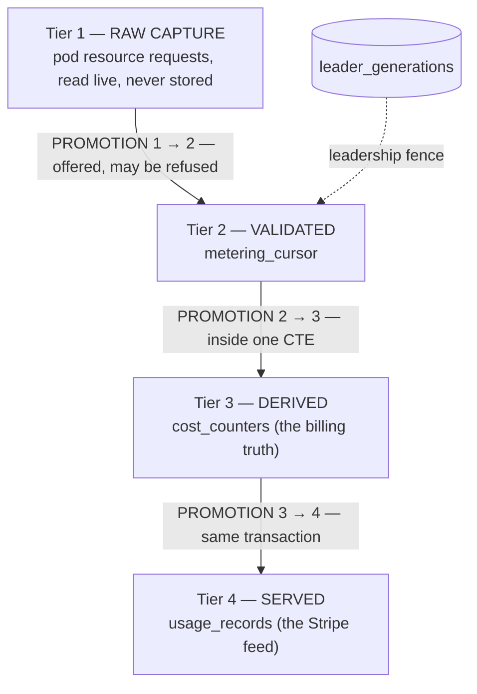

# What it is

A four-tier promotion chain with **one gate**. Data moves up only when the gate advances, and the
gate refuses far more readily than it permits.

# Schema

## Tier 1 — raw capture, never persisted

`PodLister.ListPods → []corev1.Pod → sumComputeRequests`.[^ml-capture] The platform bills the
**reservation**, not observed consumption, and uses `component-helpers/resource.PodRequests` so
the init/sidecar arithmetic `max(max(init), sum(regular) + sum(native-sidecar))` is the upstream
one rather than hand-rolled.[^ml-pods]

The trust rule is stated in the code as SC-3: **a list failure on any namespace short-circuits
with a typed error and zero totals, and the caller must not meter.** A read failure is never
swallowed into `sum = 0` — doing so would advance the cursor over an unmeasured interval and
silently under-bill.[^ml-capture]

## Tier 2 — the gate

`metering_cursor` advances only inside a single data-modifying CTE, under **five simultaneous
predicates**:[^ml-cursor][^ml-p12]

| # | Predicate | What it refuses |
|---|---|---|
| 1 | expected-value CAS — `last_metered_at = @expected` | a second writer that moved the cursor since this worker read it |
| 2 | monotonicity — `now() > last_metered_at` | a clock that went backwards |
| 3 | same period — `metering_period_of(now()) = metering_period_of(@expected)` | an interval straddling a billing-period boundary |
| 4 | leader fence — subquery against `leader_generations` | a worker that lost leadership and does not know it[^ml-fence] |
| 5 | the tier-1 read succeeded | metering over a failed Kubernetes list |

If any predicate fails the cursor is **HELD**, the CTE yields zero rows, and nothing is written
to the tiers below. A held cursor is the system declining to bill rather than billing a guess.

## Tier 3 — the billing truth

`cost_counters` is written only from the delta the validated cursor produced, through
`metering_cost(millicores, elapsed)`, accumulating with `ON CONFLICT DO UPDATE` on
`(tenant_id, metric, period_start)`.[^ml-cost][^ml-p23]

This is what `pkg/enforcement`'s `CostStore` reads to decide whether a build is allowed, and that
read path is deliberately **FAIL-OPEN**: a missing row means *no usage yet this period*, and a
database error means *allow*. A degraded aggregator must never block traffic. Note the asymmetry
and that it is deliberate — the write path fails closed, the read path fails open.

## Tier 4 — the external feed

`usage_records` receives the same bounded quantity in the **same transaction** that advanced the
cursor, so the external number can never diverge from the internal one.[^ml-usage][^ml-p34]

Its conflict target is the `(tenant, metric, period_start)` unique index and **not** the `id`
primary key. A fresh UUID per tick would never collide on `id`, so the second write of a period
would hard-error on the unique index instead of accumulating — the kind of bug that shows up as
a billing gap rather than as an exception.

# Relationships

- The worker that drives tier 1 is in
  [`/components/metering-and-billing.md`](/components/metering-and-billing.md); it reads every
  cell through the clients in
  [`/components/multi-cell-routing.md`](/components/multi-cell-routing.md).
- The leadership fence is backed by `api/internal/leader` in
  [`/components/persistence.md`](/components/persistence.md).
- All four tables are in [`/entities/database-schema.md`](/entities/database-schema.md).
- `pkg/enforcement` is the reader — see
  [`/components/shared-go-libraries.md`](/components/shared-go-libraries.md).
- Stripe is reported from tier 4 by the **extracted** `../loopzero-cloud` repository, not from here.

## Why this is not a medallion architecture

The tier names look like one and the analogy stops there. This is a **billing ledger with one
monotonic cursor**, not a staged data lake: there is no bronze landing zone, no reprocessing from
raw (tier 1 is never stored), and no batch promotion — every tier moves inside one transaction.
The cartography probe for a medallion layout checked and found no staged-data vocabulary in the
schema at all; that absence is recorded in the bundle's own `## Known gaps` section as a
**verified absence** rather than as a region nobody examined.

# Evidence

[^ml-capture]: `api/internal/metering/collect.go:34`
[^ml-cursor]: `api/internal/db/schema.gen.sql:624`
[^ml-cost]: `api/internal/db/schema.gen.sql:340`
[^ml-usage]: `api/internal/db/schema.gen.sql:936`
[^ml-p12]: `api/internal/metering/worker.go:222`
[^ml-p23]: `api/internal/db/queries/cost.sql:59`
[^ml-p34]: `api/internal/db/queries/cost.sql:166`
[^ml-fence]: `api/internal/db/queries/cost.sql:55`
[^ml-pods]: `api/internal/metering/collect.go:39`
