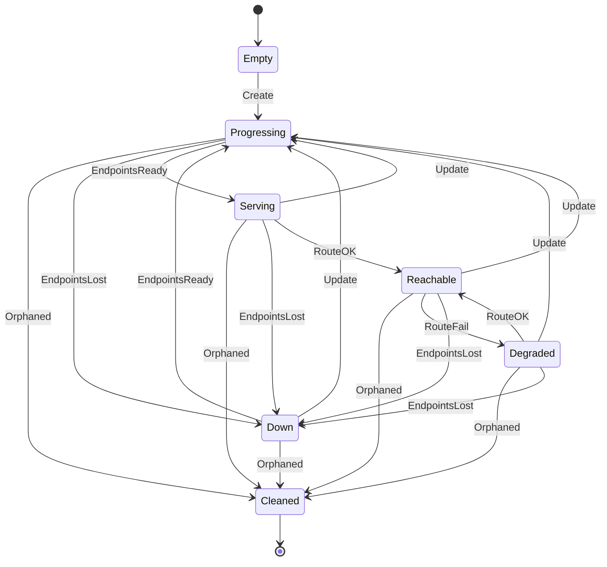

# What it is

The `LoopZeroApplication` machine: **7 states, 19 transitions, 1 terminal**.
Declared in `pkg/statemachine/application.go` with a `*_typed.go` companion.[^sm-file]

Status is never assigned directly — a transition goes through `Transition(event)`, and an
**invalid transition panics**, because it is a programming error rather than a runtime condition.

Seven states over the workload's observed reachability: `Progressing`, `Serving`, `Reachable`,
`Degraded`, `Down`, `Cleaned`, plus the empty entry. `Update` from any live state returns to
`Progressing`, and `Orphaned` from any live state lands on `Cleaned`.

**The doc comment contradicts itself.** `pkg/statemachine/application.go` says *"No terminal
state"* 49 lines after saying `Cleaned` **is** terminal — and the code declares `Cleaned`
terminal.[^sm-contradiction] The code is what runs; the comment is what a reader believes.

# Schema

## States

| State | Go constant | Kind | Anchor |
|---|---|---|---|
| `(empty phase)` | `ApplicationEmpty State = ""` | entry | `pkg/statemachine/application.go:30` |
| `Cleaned` | `ApplicationCleaned State = "Cleaned"` | **terminal** | `pkg/statemachine/application.go:36` |
| `Degraded` | `ApplicationDegraded State = "Degraded"` | — | `pkg/statemachine/application.go:34` |
| `Down` | `ApplicationDown State = "Down"` | — | `pkg/statemachine/application.go:35` |
| `Progressing` | `ApplicationProgressing State = "Progressing"` | — | `pkg/statemachine/application.go:31` |
| `Reachable` | `ApplicationReachable State = "Reachable"` | — | `pkg/statemachine/application.go:33` |
| `Serving` | `ApplicationServing State = "Serving"` | — | `pkg/statemachine/application.go:32` |

## Transitions

| From | To | Event |
|---|---|---|
| `Degraded` | `Cleaned` | `Orphaned` |
| `Degraded` | `Down` | `EndpointsLost` |
| `Degraded` | `Progressing` | `Update` |
| `Degraded` | `Reachable` | `RouteOK` |
| `Down` | `Cleaned` | `Orphaned` |
| `Down` | `Progressing` | `EndpointsReady` |
| `Down` | `Progressing` | `Update` |
| `Empty` | `Progressing` | `Create` |
| `Progressing` | `Cleaned` | `Orphaned` |
| `Progressing` | `Down` | `EndpointsLost` |
| `Progressing` | `Serving` | `EndpointsReady` |
| `Reachable` | `Cleaned` | `Orphaned` |
| `Reachable` | `Degraded` | `RouteFail` |
| `Reachable` | `Down` | `EndpointsLost` |
| `Reachable` | `Progressing` | `Update` |
| `Serving` | `Cleaned` | `Orphaned` |
| `Serving` | `Down` | `EndpointsLost` |
| `Serving` | `Progressing` | `Update` |
| `Serving` | `Reachable` | `RouteOK` |

# Relationships

- Declared in `pkg/statemachine`, described in
  [`/components/shared-go-libraries.md`](/components/shared-go-libraries.md) — 6,951 lines over
  48 files, imported by the API, the operators and the ops binary.
- The other ten machines: [`Build`](/entities/state-machine-build.md), [`Domain`](/entities/state-machine-domain.md), [`Environment`](/entities/state-machine-environment.md), [`ExposedRoute`](/entities/state-machine-exposedroute.md), [`PlatformBootstrap`](/entities/state-machine-platformbootstrap.md), [`PreviewEnvironment`](/entities/state-machine-preview.md), [`Promotion`](/entities/state-machine-promotion.md), [`Release`](/entities/state-machine-release.md), [`Rollback`](/entities/state-machine-rollback.md), [`Tenant`](/entities/state-machine-tenant.md).

# Evidence

[^sm-file]: `pkg/statemachine/application.go:36`
[^s-cleaned]: `pkg/statemachine/application.go:36`
[^s-degraded]: `pkg/statemachine/application.go:34`
[^s-down]: `pkg/statemachine/application.go:35`
[^s-empty-phase]: `pkg/statemachine/application.go:30`
[^s-progressing]: `pkg/statemachine/application.go:31`
[^s-reachable]: `pkg/statemachine/application.go:33`
[^sm-contradiction]: `pkg/statemachine/application.go:64`
