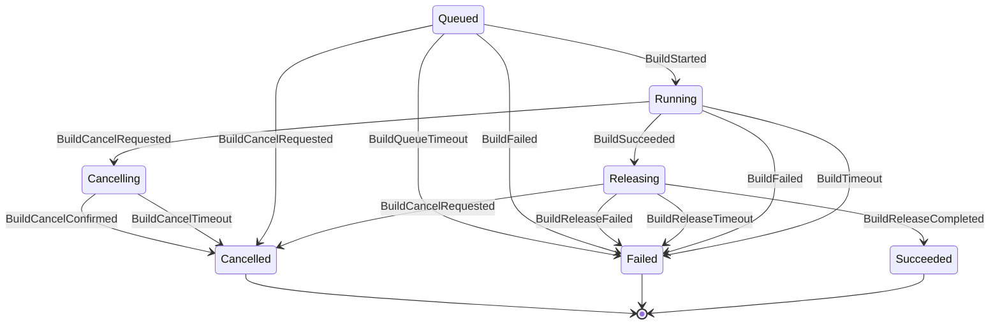

# What it is

The `Build` machine: **7 states, 14 transitions, 3 terminal**.
Declared in `pkg/statemachine/build.go` with a `*_typed.go` companion.[^sm-file]

Status is never assigned directly — a transition goes through `Transition(event)`, and an
**invalid transition panics**, because it is a programming error rather than a runtime condition.

The lock boundary is what this machine encodes. `QUEUED → RUNNING` happens through a
**conditional UPDATE** — a lock-free compare-and-set — because by then the environment lock has
already been released; if the CAS finds another writer ahead of it, the reconcile loop owns the
build from that point.[^sm-note]

`CANCELLING` is the only non-terminal state with a timeout constant of its own
(`BuildCancellingTimeout`, reason `CANCEL_TIMEOUT`), and both of its edges land on `CANCELLED` —
a cancel that times out is still a cancel.

# Schema

## States

| State | Go constant | Kind | Anchor |
|---|---|---|---|
| `CANCELLED` | `BuildCancelled State = "CANCELLED"` | **terminal** | `pkg/statemachine/build.go:21` |
| `CANCELLING` | `BuildCancelling State = "CANCELLING"` | — | `pkg/statemachine/build.go:20` |
| `FAILED` | `BuildFailed State = "FAILED"` | **terminal** | `pkg/statemachine/build.go:19` |
| `QUEUED` | `BuildQueued State = "QUEUED"` | — | `pkg/statemachine/build.go:15` |
| `RELEASING` | `BuildReleasing State = "RELEASING"` | — | `pkg/statemachine/build.go:17` |
| `RUNNING` | `BuildRunning State = "RUNNING"` | — | `pkg/statemachine/build.go:16` |
| `SUCCEEDED` | `BuildSucceeded State = "SUCCEEDED"` | **terminal** | `pkg/statemachine/build.go:18` |

## Transitions

| From | To | Event |
|---|---|---|
| `Cancelling` | `Cancelled` | `BuildCancelConfirmed` |
| `Cancelling` | `Cancelled` | `BuildCancelTimeout` |
| `Queued` | `Cancelled` | `BuildCancelRequested` |
| `Queued` | `Failed` | `BuildQueueTimeout` |
| `Queued` | `Failed` | `BuildFailed` |
| `Queued` | `Running` | `BuildStarted` |
| `Releasing` | `Cancelled` | `BuildCancelRequested` |
| `Releasing` | `Failed` | `BuildReleaseFailed` |
| `Releasing` | `Failed` | `BuildReleaseTimeout` |
| `Releasing` | `Succeeded` | `BuildReleaseCompleted` |
| `Running` | `Cancelling` | `BuildCancelRequested` |
| `Running` | `Failed` | `BuildFailed` |
| `Running` | `Failed` | `BuildTimeout` |
| `Running` | `Releasing` | `BuildSucceeded` |

# Relationships

- Declared in `pkg/statemachine`, described in
  [`/components/shared-go-libraries.md`](/components/shared-go-libraries.md) — 6,951 lines over
  48 files, imported by the API, the operators and the ops binary.
- The other ten machines: [`LoopZeroApplication`](/entities/state-machine-application.md), [`Domain`](/entities/state-machine-domain.md), [`Environment`](/entities/state-machine-environment.md), [`ExposedRoute`](/entities/state-machine-exposedroute.md), [`PlatformBootstrap`](/entities/state-machine-platformbootstrap.md), [`PreviewEnvironment`](/entities/state-machine-preview.md), [`Promotion`](/entities/state-machine-promotion.md), [`Release`](/entities/state-machine-release.md), [`Rollback`](/entities/state-machine-rollback.md), [`Tenant`](/entities/state-machine-tenant.md).

# Evidence

[^sm-file]: `pkg/statemachine/build.go:21`
[^s-cancelled]: `pkg/statemachine/build.go:21`
[^s-cancelling]: `pkg/statemachine/build.go:20`
[^s-failed]: `pkg/statemachine/build.go:19`
[^s-queued]: `pkg/statemachine/build.go:15`
[^s-releasing]: `pkg/statemachine/build.go:17`
[^s-running]: `pkg/statemachine/build.go:16`
[^sm-note]: `api/internal/builds/build_orchestrator_submit.go:58`
