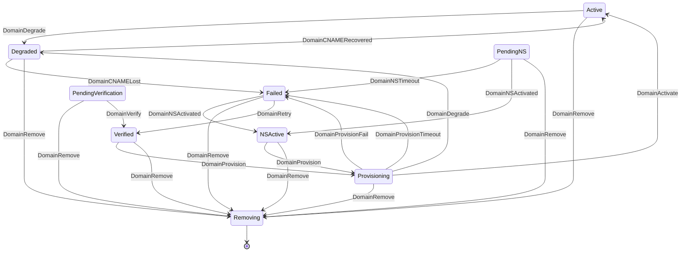

# What it is

The `Domain` machine: **9 states, 22 transitions, 1 terminal**.
Declared in `pkg/statemachine/domain.go` with a `*_typed.go` companion.[^sm-file]

Status is never assigned directly — a transition goes through `Transition(event)`, and an
**invalid transition panics**, because it is a programming error rather than a runtime condition.

Nine states carrying **two generations of the custom-domain flow at once**. The v2 path is
nameserver delegation — `pending_ns → ns_active → provisioning → active`. The v1 path is TXT
verification — `pending_verification → verified → provisioning` — kept for backward compatibility,
and its HTTP endpoint now answers with a deprecation message rather than a 404.

`DomainRemove` is an edge from every non-terminal state to `removing`, the same always-wins shape
the Release machine gives `ProjectDeleted`.

# Schema

## States

| State | Go constant | Kind | Anchor |
|---|---|---|---|
| `active` | `DomainActive State = "active"` | — | `pkg/statemachine/domain.go:19` |
| `degraded` | `DomainDegraded State = "degraded"` | — | `pkg/statemachine/domain.go:20` |
| `failed` | `DomainFailed State = "failed"` | — | `pkg/statemachine/domain.go:21` |
| `ns_active` | `DomainNSActive State = "ns_active"` | — | `pkg/statemachine/domain.go:15` |
| `pending_ns` | `DomainPendingNS State = "pending_ns"` | — | `pkg/statemachine/domain.go:14` |
| `pending_verification` | `DomainPendingVerification State = "pending_verification"` | — | `pkg/statemachine/domain.go:10` |
| `provisioning` | `DomainProvisioning State = "provisioning"` | — | `pkg/statemachine/domain.go:18` |
| `removing` | `DomainRemoving State = "removing"` | **terminal** | `pkg/statemachine/domain.go:22` |
| `verified` | `DomainVerified State = "verified"` | — | `pkg/statemachine/domain.go:11` |

## Transitions

| From | To | Event |
|---|---|---|
| `Active` | `Degraded` | `DomainDegrade` |
| `Active` | `Removing` | `DomainRemove` |
| `Degraded` | `Active` | `DomainCNAMERecovered` |
| `Degraded` | `Failed` | `DomainCNAMELost` |
| `Degraded` | `Removing` | `DomainRemove` |
| `Failed` | `NSActive` | `DomainNSActivated` |
| `Failed` | `Removing` | `DomainRemove` |
| `Failed` | `Verified` | `DomainRetry` |
| `NSActive` | `Provisioning` | `DomainProvision` |
| `NSActive` | `Removing` | `DomainRemove` |
| `PendingNS` | `Failed` | `DomainNSTimeout` |
| `PendingNS` | `NSActive` | `DomainNSActivated` |
| `PendingNS` | `Removing` | `DomainRemove` |
| `PendingVerification` | `Removing` | `DomainRemove` |
| `PendingVerification` | `Verified` | `DomainVerify` |
| `Provisioning` | `Active` | `DomainActivate` |
| `Provisioning` | `Degraded` | `DomainDegrade` |
| `Provisioning` | `Failed` | `DomainProvisionFail` |
| `Provisioning` | `Failed` | `DomainProvisionTimeout` |
| `Provisioning` | `Removing` | `DomainRemove` |
| `Verified` | `Provisioning` | `DomainProvision` |
| `Verified` | `Removing` | `DomainRemove` |

# Relationships

- Declared in `pkg/statemachine`, described in
  [`/components/shared-go-libraries.md`](/components/shared-go-libraries.md) — 6,951 lines over
  48 files, imported by the API, the operators and the ops binary.
- The other ten machines: [`LoopZeroApplication`](/entities/state-machine-application.md), [`Build`](/entities/state-machine-build.md), [`Environment`](/entities/state-machine-environment.md), [`ExposedRoute`](/entities/state-machine-exposedroute.md), [`PlatformBootstrap`](/entities/state-machine-platformbootstrap.md), [`PreviewEnvironment`](/entities/state-machine-preview.md), [`Promotion`](/entities/state-machine-promotion.md), [`Release`](/entities/state-machine-release.md), [`Rollback`](/entities/state-machine-rollback.md), [`Tenant`](/entities/state-machine-tenant.md).

# Evidence

[^sm-file]: `pkg/statemachine/domain.go:19`
[^s-active]: `pkg/statemachine/domain.go:19`
[^s-degraded]: `pkg/statemachine/domain.go:20`
[^s-failed]: `pkg/statemachine/domain.go:21`
[^s-ns_active]: `pkg/statemachine/domain.go:15`
[^s-pending_ns]: `pkg/statemachine/domain.go:14`
[^s-pending_verification]: `pkg/statemachine/domain.go:10`
