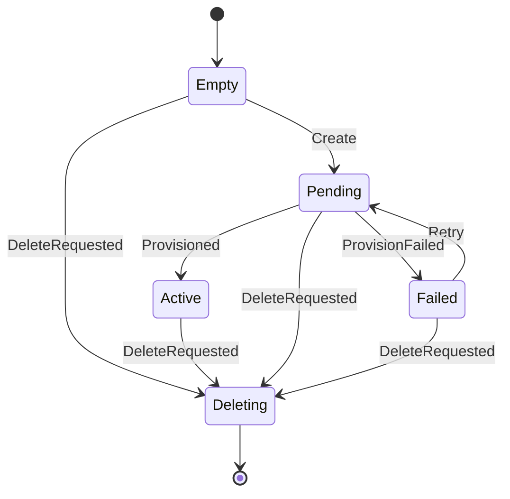

# What it is

The `Environment` machine: **5 states, 8 transitions, 1 terminal**.
Declared in `pkg/statemachine/environment.go` with a `*_typed.go` companion.[^sm-file]

Status is never assigned directly — a transition goes through `Transition(event)`, and an
**invalid transition panics**, because it is a programming error rather than a runtime condition.

Five states, and the reconciler that drives them is traced step by step in
[`/flows/environment-reconcile-loop.md`](/flows/environment-reconcile-loop.md). `Failed → Pending`
on `Retry` is what makes a transient provisioning error recoverable without deleting the CR.

`Deleting` is reachable from every other state including the empty phase — a CR deleted before it
ever reconciled still runs its finalizer path.

# Schema

## States

| State | Go constant | Kind | Anchor |
|---|---|---|---|
| `(empty phase)` | `EnvironmentEmpty State = ""` | entry | `pkg/statemachine/environment.go:9` |
| `Active` | `EnvironmentActive State = "Active"` | — | `pkg/statemachine/environment.go:11` |
| `Deleting` | `EnvironmentDeleting State = "Deleting"` | **terminal** | `pkg/statemachine/environment.go:13` |
| `Failed` | `EnvironmentFailed State = "Failed"` | — | `pkg/statemachine/environment.go:12` |
| `Pending` | `EnvironmentPending State = "Pending"` | — | `pkg/statemachine/environment.go:10` |

## Transitions

| From | To | Event |
|---|---|---|
| `Active` | `Deleting` | `DeleteRequested` |
| `Empty` | `Deleting` | `DeleteRequested` |
| `Empty` | `Pending` | `Create` |
| `Failed` | `Deleting` | `DeleteRequested` |
| `Failed` | `Pending` | `Retry` |
| `Pending` | `Active` | `Provisioned` |
| `Pending` | `Deleting` | `DeleteRequested` |
| `Pending` | `Failed` | `ProvisionFailed` |

# Relationships

- Declared in `pkg/statemachine`, described in
  [`/components/shared-go-libraries.md`](/components/shared-go-libraries.md) — 6,951 lines over
  48 files, imported by the API, the operators and the ops binary.
- The other ten machines: [`LoopZeroApplication`](/entities/state-machine-application.md), [`Build`](/entities/state-machine-build.md), [`Domain`](/entities/state-machine-domain.md), [`ExposedRoute`](/entities/state-machine-exposedroute.md), [`PlatformBootstrap`](/entities/state-machine-platformbootstrap.md), [`PreviewEnvironment`](/entities/state-machine-preview.md), [`Promotion`](/entities/state-machine-promotion.md), [`Release`](/entities/state-machine-release.md), [`Rollback`](/entities/state-machine-rollback.md), [`Tenant`](/entities/state-machine-tenant.md).

# Evidence

[^sm-file]: `pkg/statemachine/environment.go:11`
[^s-active]: `pkg/statemachine/environment.go:11`
[^s-deleting]: `pkg/statemachine/environment.go:13`
[^s-empty-phase]: `pkg/statemachine/environment.go:9`
[^s-failed]: `pkg/statemachine/environment.go:12`
[^s-pending]: `pkg/statemachine/environment.go:10`
