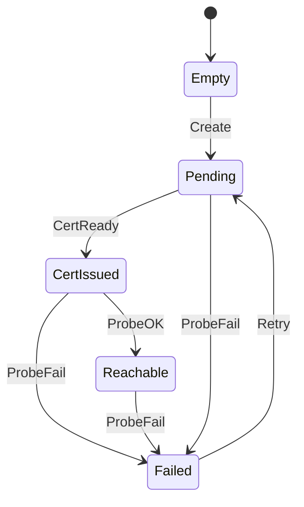

# What it is

The `ExposedRoute` machine: **5 states, 7 transitions, 0 terminal**.
Declared in `pkg/statemachine/exposedroute.go` with a `*_typed.go` companion.[^sm-file]

Status is never assigned directly — a transition goes through `Transition(event)`, and an
**invalid transition panics**, because it is a programming error rather than a runtime condition.

Probe-driven rather than declared. `Pending → CertIssued` waits on the certificate; `CertIssued →
Reachable` waits on an actual probe. A failing probe returns any state to `Failed`, and `Retry`
sends it back to `Pending` — so route health is continuously re-established rather than asserted
once.

# Schema

## States

| State | Go constant | Kind | Anchor |
|---|---|---|---|
| `(empty phase)` | `ExposedRouteEmpty State = ""` | entry | `pkg/statemachine/exposedroute.go:20` |
| `CertIssued` | `ExposedRouteCertIssued State = "CertIssued"` | — | `pkg/statemachine/exposedroute.go:22` |
| `Failed` | `ExposedRouteFailed State = "Failed"` | — | `pkg/statemachine/exposedroute.go:24` |
| `Pending` | `ExposedRoutePending State = "Pending"` | — | `pkg/statemachine/exposedroute.go:21` |
| `Reachable` | `ExposedRouteReachable State = "Reachable"` | — | `pkg/statemachine/exposedroute.go:23` |

## Transitions

| From | To | Event |
|---|---|---|
| `CertIssued` | `Failed` | `ProbeFail` |
| `CertIssued` | `Reachable` | `ProbeOK` |
| `Empty` | `Pending` | `Create` |
| `Failed` | `Pending` | `Retry` |
| `Pending` | `CertIssued` | `CertReady` |
| `Pending` | `Failed` | `ProbeFail` |
| `Reachable` | `Failed` | `ProbeFail` |

# Relationships

- Declared in `pkg/statemachine`, described in
  [`/components/shared-go-libraries.md`](/components/shared-go-libraries.md) — 6,951 lines over
  48 files, imported by the API, the operators and the ops binary.
- The other ten machines: [`LoopZeroApplication`](/entities/state-machine-application.md), [`Build`](/entities/state-machine-build.md), [`Domain`](/entities/state-machine-domain.md), [`Environment`](/entities/state-machine-environment.md), [`PlatformBootstrap`](/entities/state-machine-platformbootstrap.md), [`PreviewEnvironment`](/entities/state-machine-preview.md), [`Promotion`](/entities/state-machine-promotion.md), [`Release`](/entities/state-machine-release.md), [`Rollback`](/entities/state-machine-rollback.md), [`Tenant`](/entities/state-machine-tenant.md).

# Evidence

[^sm-file]: `pkg/statemachine/exposedroute.go:22`
[^s-certissued]: `pkg/statemachine/exposedroute.go:22`
[^s-empty-phase]: `pkg/statemachine/exposedroute.go:20`
[^s-failed]: `pkg/statemachine/exposedroute.go:24`
[^s-pending]: `pkg/statemachine/exposedroute.go:21`
[^s-reachable]: `pkg/statemachine/exposedroute.go:23`
