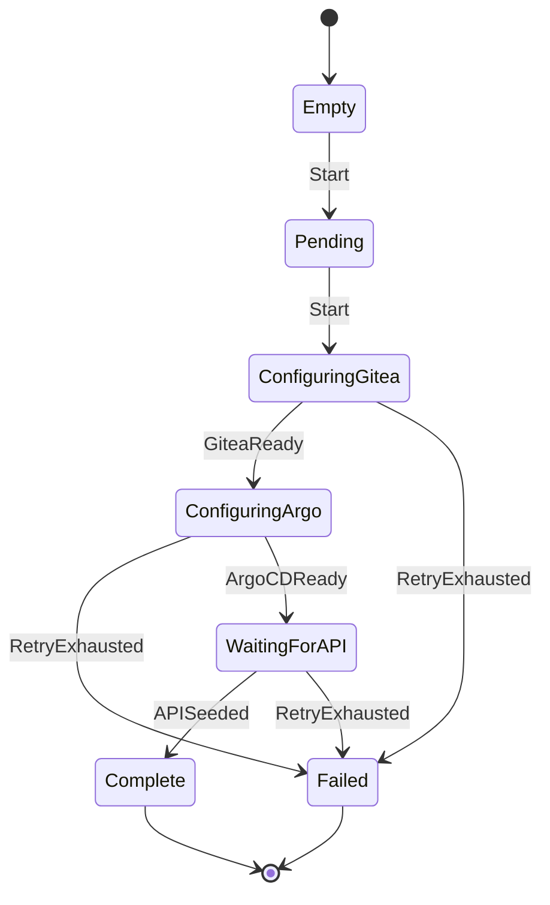

# What it is

The `PlatformBootstrap` machine: **7 states, 8 transitions, 2 terminal**.
Declared in `pkg/statemachine/platformbootstrap.go` with a `*_typed.go` companion.[^sm-file]

Status is never assigned directly — a transition goes through `Transition(event)`, and an
**invalid transition panics**, because it is a programming error rather than a runtime condition.

Strictly sequential — Gitea, then ArgoCD, then the API seed — and each of the three working
states has exactly one failure edge, `RetryExhausted`. There is no partial success: bootstrap
either reaches `BootstrapComplete` or stops at the step that ran out of retries, which is what
makes a failed bootstrap diagnosable from the phase alone.

# Schema

## States

| State | Go constant | Kind | Anchor |
|---|---|---|---|
| `(empty phase)` | `PlatformBootstrapEmpty State = ""` | entry | `pkg/statemachine/platformbootstrap.go:9` |
| `BootstrapComplete` | `PlatformBootstrapComplete State = "BootstrapComplete"` | **terminal** | `pkg/statemachine/platformbootstrap.go:14` |
| `ConfiguringArgoCD` | `PlatformBootstrapConfiguringArgo State = "ConfiguringArgoCD"` | — | `pkg/statemachine/platformbootstrap.go:12` |
| `ConfiguringGitea` | `PlatformBootstrapConfiguringGitea State = "ConfiguringGitea"` | — | `pkg/statemachine/platformbootstrap.go:11` |
| `Failed` | `PlatformBootstrapFailed State = "Failed"` | **terminal** | `pkg/statemachine/platformbootstrap.go:15` |
| `Pending` | `PlatformBootstrapPending State = "Pending"` | — | `pkg/statemachine/platformbootstrap.go:10` |
| `WaitingForAPI` | `PlatformBootstrapWaitingForAPI State = "WaitingForAPI"` | — | `pkg/statemachine/platformbootstrap.go:13` |

## Transitions

| From | To | Event |
|---|---|---|
| `ConfiguringArgo` | `Failed` | `RetryExhausted` |
| `ConfiguringArgo` | `WaitingForAPI` | `ArgoCDReady` |
| `ConfiguringGitea` | `ConfiguringArgo` | `GiteaReady` |
| `ConfiguringGitea` | `Failed` | `RetryExhausted` |
| `Empty` | `Pending` | `Start` |
| `Pending` | `ConfiguringGitea` | `Start` |
| `WaitingForAPI` | `Complete` | `APISeeded` |
| `WaitingForAPI` | `Failed` | `RetryExhausted` |

# Relationships

- Declared in `pkg/statemachine`, described in
  [`/components/shared-go-libraries.md`](/components/shared-go-libraries.md) — 6,951 lines over
  48 files, imported by the API, the operators and the ops binary.
- The other ten machines: [`LoopZeroApplication`](/entities/state-machine-application.md), [`Build`](/entities/state-machine-build.md), [`Domain`](/entities/state-machine-domain.md), [`Environment`](/entities/state-machine-environment.md), [`ExposedRoute`](/entities/state-machine-exposedroute.md), [`PreviewEnvironment`](/entities/state-machine-preview.md), [`Promotion`](/entities/state-machine-promotion.md), [`Release`](/entities/state-machine-release.md), [`Rollback`](/entities/state-machine-rollback.md), [`Tenant`](/entities/state-machine-tenant.md).

# Evidence

[^sm-file]: `pkg/statemachine/platformbootstrap.go:14`
[^s-bootstrapcomplete]: `pkg/statemachine/platformbootstrap.go:14`
[^s-configuringargocd]: `pkg/statemachine/platformbootstrap.go:12`
[^s-configuringgitea]: `pkg/statemachine/platformbootstrap.go:11`
[^s-empty-phase]: `pkg/statemachine/platformbootstrap.go:9`
[^s-failed]: `pkg/statemachine/platformbootstrap.go:15`
[^s-pending]: `pkg/statemachine/platformbootstrap.go:10`
