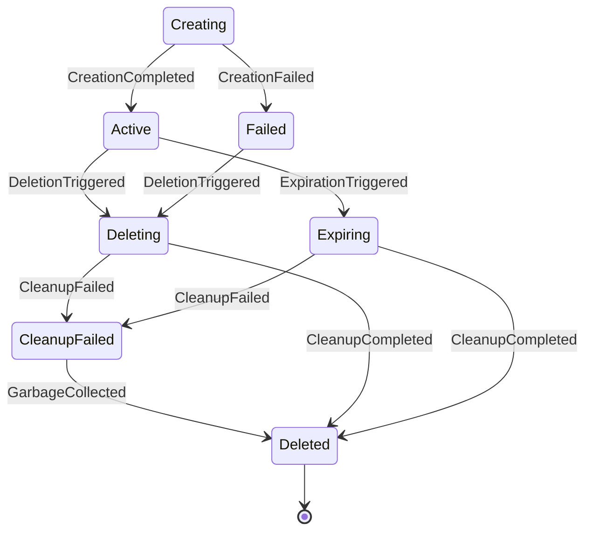

# What it is

The `PreviewEnvironment` machine: **7 states, 10 transitions, 1 terminal**.
Declared in `pkg/statemachine/preview.go` with a `*_typed.go` companion.[^sm-file]

Status is never assigned directly — a transition goes through `Transition(event)`, and an
**invalid transition panics**, because it is a programming error rather than a runtime condition.

`CleanupFailed` is what distinguishes this machine from the others: deletion can fail, and when
it does the CR does not silently disappear. It is reachable from both `Deleting` and `Expiring`,
and it leaves only by `GarbageCollected`.

`Expiring` and `Deleting` are separate states with identical exits — a preview that ran out of
time and a preview someone deleted are the same cleanup with different provenance, and the
machine keeps the distinction.

# Schema

## States

| State | Go constant | Kind | Anchor |
|---|---|---|---|
| `Active` | `PreviewActive State = "Active"` | — | `pkg/statemachine/preview.go:15` |
| `CleanupFailed` | `PreviewCleanupFailed State = "CleanupFailed"` | — | `pkg/statemachine/preview.go:20` |
| `Creating` | `PreviewCreating State = "Creating"` | — | `pkg/statemachine/preview.go:14` |
| `Deleted` | `PreviewDeleted State = "Deleted"` | **terminal** | `pkg/statemachine/preview.go:17` |
| `Deleting` | `PreviewDeleting State = "Deleting"` | — | `pkg/statemachine/preview.go:19` |
| `Expiring` | `PreviewExpiring State = "Expiring"` | — | `pkg/statemachine/preview.go:16` |
| `Failed` | `PreviewFailed State = "Failed"` | — | `pkg/statemachine/preview.go:18` |

## Transitions

| From | To | Event |
|---|---|---|
| `Active` | `Deleting` | `DeletionTriggered` |
| `Active` | `Expiring` | `ExpirationTriggered` |
| `CleanupFailed` | `Deleted` | `GarbageCollected` |
| `Creating` | `Active` | `CreationCompleted` |
| `Creating` | `Failed` | `CreationFailed` |
| `Deleting` | `CleanupFailed` | `CleanupFailed` |
| `Deleting` | `Deleted` | `CleanupCompleted` |
| `Expiring` | `CleanupFailed` | `CleanupFailed` |
| `Expiring` | `Deleted` | `CleanupCompleted` |
| `Failed` | `Deleting` | `DeletionTriggered` |

# Relationships

- Declared in `pkg/statemachine`, described in
  [`/components/shared-go-libraries.md`](/components/shared-go-libraries.md) — 6,951 lines over
  48 files, imported by the API, the operators and the ops binary.
- The other ten machines: [`LoopZeroApplication`](/entities/state-machine-application.md), [`Build`](/entities/state-machine-build.md), [`Domain`](/entities/state-machine-domain.md), [`Environment`](/entities/state-machine-environment.md), [`ExposedRoute`](/entities/state-machine-exposedroute.md), [`PlatformBootstrap`](/entities/state-machine-platformbootstrap.md), [`Promotion`](/entities/state-machine-promotion.md), [`Release`](/entities/state-machine-release.md), [`Rollback`](/entities/state-machine-rollback.md), [`Tenant`](/entities/state-machine-tenant.md).

# Evidence

[^sm-file]: `pkg/statemachine/preview.go:15`
[^s-active]: `pkg/statemachine/preview.go:15`
[^s-cleanupfailed]: `pkg/statemachine/preview.go:20`
[^s-creating]: `pkg/statemachine/preview.go:14`
[^s-deleted]: `pkg/statemachine/preview.go:17`
[^s-deleting]: `pkg/statemachine/preview.go:19`
[^s-expiring]: `pkg/statemachine/preview.go:16`
