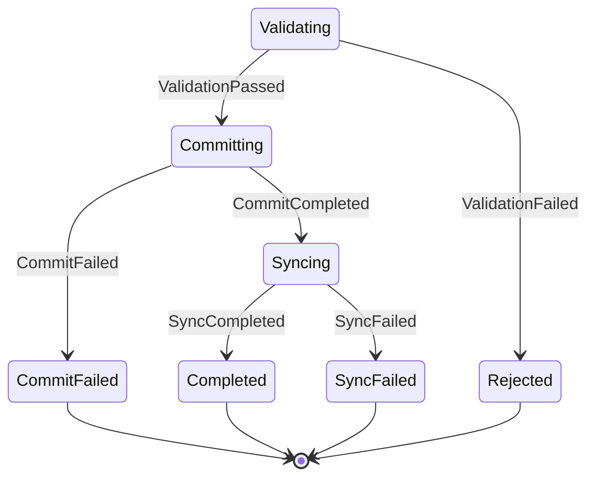

# What it is

The `Promotion` machine: **7 states, 6 transitions, 4 terminal**.
Declared in `pkg/statemachine/promotion.go` with a `*_typed.go` companion.[^sm-file]

Status is never assigned directly — a transition goes through `Transition(event)`, and an
**invalid transition panics**, because it is a programming error rather than a runtime condition.

A short, strictly linear machine — `VALIDATING → COMMITTING → SYNCING → COMPLETED` — where each
step has exactly one failure state of its own. There is no retry edge: a failed promotion is
terminal and a new one is started.

# Schema

## States

| State | Go constant | Kind | Anchor |
|---|---|---|---|
| `COMMITTING` | `PromotionCommitting State = "COMMITTING"` | — | `pkg/statemachine/promotion.go:9` |
| `COMMIT_FAILED` | `PromotionCommitFailed State = "COMMIT_FAILED"` | **terminal** | `pkg/statemachine/promotion.go:13` |
| `COMPLETED` | `PromotionCompleted State = "COMPLETED"` | **terminal** | `pkg/statemachine/promotion.go:11` |
| `REJECTED` | `PromotionRejected State = "REJECTED"` | **terminal** | `pkg/statemachine/promotion.go:12` |
| `SYNCING` | `PromotionSyncing State = "SYNCING"` | — | `pkg/statemachine/promotion.go:10` |
| `SYNC_FAILED` | `PromotionSyncFailed State = "SYNC_FAILED"` | **terminal** | `pkg/statemachine/promotion.go:14` |
| `VALIDATING` | `PromotionValidating State = "VALIDATING"` | — | `pkg/statemachine/promotion.go:8` |

## Transitions

| From | To | Event |
|---|---|---|
| `Committing` | `CommitFailed` | `CommitFailed` |
| `Committing` | `Syncing` | `CommitCompleted` |
| `Syncing` | `Completed` | `SyncCompleted` |
| `Syncing` | `SyncFailed` | `SyncFailed` |
| `Validating` | `Committing` | `ValidationPassed` |
| `Validating` | `Rejected` | `ValidationFailed` |

# Relationships

- Declared in `pkg/statemachine`, described in
  [`/components/shared-go-libraries.md`](/components/shared-go-libraries.md) — 6,951 lines over
  48 files, imported by the API, the operators and the ops binary.
- The other ten machines: [`LoopZeroApplication`](/entities/state-machine-application.md), [`Build`](/entities/state-machine-build.md), [`Domain`](/entities/state-machine-domain.md), [`Environment`](/entities/state-machine-environment.md), [`ExposedRoute`](/entities/state-machine-exposedroute.md), [`PlatformBootstrap`](/entities/state-machine-platformbootstrap.md), [`PreviewEnvironment`](/entities/state-machine-preview.md), [`Release`](/entities/state-machine-release.md), [`Rollback`](/entities/state-machine-rollback.md), [`Tenant`](/entities/state-machine-tenant.md).

# Evidence

[^sm-file]: `pkg/statemachine/promotion.go:13`
[^s-commit_failed]: `pkg/statemachine/promotion.go:13`
[^s-committing]: `pkg/statemachine/promotion.go:9`
[^s-completed]: `pkg/statemachine/promotion.go:11`
[^s-rejected]: `pkg/statemachine/promotion.go:12`
[^s-sync_failed]: `pkg/statemachine/promotion.go:14`
[^s-syncing]: `pkg/statemachine/promotion.go:10`
