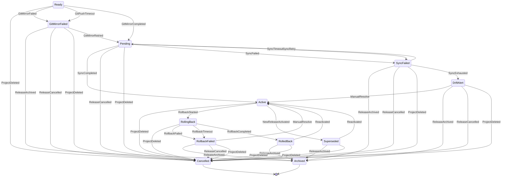

# What it is

The `Release` machine: **12 states, 39 transitions, 2 terminal**.
Declared in `pkg/statemachine/release.go` with a `*_typed.go` companion.[^sm-file]

Status is never assigned directly — a transition goes through `Transition(event)`, and an
**invalid transition panics**, because it is a programming error rather than a runtime condition.

The largest machine in the system: **12 states, 39 edges**. Five of them are failure states with
distinct recovery paths, which is the point — `GIT_MIRROR_FAILED` retries the push,
`SYNC_FAILED` retries the sync and then escalates to `DRIFT_ALERT` when the retries are
exhausted, and `ROLLBACK_FAILED` waits for a human `ManualResolve`.

`DRIFT_ALERT` is reachable only from `SYNC_FAILED` via `SyncExhausted`, and leaves only by
manual resolution, cancellation or archival. It is the state that says *the desired and the
actual have diverged and automation has given up*.

`ProjectDeleted` is an edge from **every** non-terminal state to `CANCELLED` — the one event
that always wins.

# Schema

## States

| State | Go constant | Kind | Anchor |
|---|---|---|---|
| `ACTIVE` | `ReleaseActive State = "ACTIVE"` | — | `pkg/statemachine/release.go:22` |
| `ARCHIVED` | `ReleaseArchived State = "ARCHIVED"` | **terminal** | `pkg/statemachine/release.go:36` |
| `CANCELLED` | `ReleaseCancelled State = "CANCELLED"` | **terminal** | `pkg/statemachine/release.go:30` |
| `DRIFT_ALERT` | `ReleaseDriftAlert State = "DRIFT_ALERT"` | — | `pkg/statemachine/release.go:25` |
| `GIT_MIRROR_FAILED` | `ReleaseGitMirrorFailed State = "GIT_MIRROR_FAILED"` | — | `pkg/statemachine/release.go:23` |
| `PENDING` | `ReleasePending State = "PENDING"` | — | `pkg/statemachine/release.go:21` |
| `READY` | `ReleaseReady State = "READY"` | — | `pkg/statemachine/release.go:20` |
| `ROLLBACK_FAILED` | `ReleaseRollbackFailed State = "ROLLBACK_FAILED"` | — | `pkg/statemachine/release.go:29` |
| `ROLLED_BACK` | `ReleaseRolledBack State = "ROLLED_BACK"` | — | `pkg/statemachine/release.go:28` |
| `ROLLING_BACK` | `ReleaseRollingBack State = "ROLLING_BACK"` | — | `pkg/statemachine/release.go:27` |
| `SUPERSEDED` | `ReleaseSuperseded State = "SUPERSEDED"` | — | `pkg/statemachine/release.go:26` |
| `SYNC_FAILED` | `ReleaseSyncFailed State = "SYNC_FAILED"` | — | `pkg/statemachine/release.go:24` |

## Transitions

| From | To | Event |
|---|---|---|
| `Active` | `Cancelled` | `ProjectDeleted` |
| `Active` | `RollingBack` | `RollbackStarted` |
| `Active` | `Superseded` | `NewReleaseActivated` |
| `DriftAlert` | `Active` | `ManualResolve` |
| `DriftAlert` | `Archived` | `ReleaseArchived` |
| `DriftAlert` | `Cancelled` | `ReleaseCancelled` |
| `DriftAlert` | `Cancelled` | `ProjectDeleted` |
| `GitMirrorFailed` | `Archived` | `ReleaseArchived` |
| `GitMirrorFailed` | `Cancelled` | `ReleaseCancelled` |
| `GitMirrorFailed` | `Cancelled` | `ProjectDeleted` |
| `GitMirrorFailed` | `Pending` | `GitMirrorRetried` |
| `Pending` | `Active` | `SyncCompleted` |
| `Pending` | `Cancelled` | `ReleaseCancelled` |
| `Pending` | `Cancelled` | `ProjectDeleted` |
| `Pending` | `SyncFailed` | `SyncFailed` |
| `Pending` | `SyncFailed` | `SyncTimeout` |
| `Ready` | `Cancelled` | `ProjectDeleted` |
| `Ready` | `GitMirrorFailed` | `GitMirrorFailed` |
| `Ready` | `GitMirrorFailed` | `GitPushTimeout` |
| `Ready` | `Pending` | `GitMirrorCompleted` |
| `RollbackFailed` | `Active` | `ManualResolve` |
| `RollbackFailed` | `Archived` | `ReleaseArchived` |
| `RollbackFailed` | `Cancelled` | `ReleaseCancelled` |
| `RollbackFailed` | `Cancelled` | `ProjectDeleted` |
| `RolledBack` | `Active` | `Reactivated` |
| `RolledBack` | `Archived` | `ReleaseArchived` |
| `RolledBack` | `Cancelled` | `ProjectDeleted` |
| `RollingBack` | `Cancelled` | `ProjectDeleted` |
| `RollingBack` | `RollbackFailed` | `RollbackFailed` |
| `RollingBack` | `RollbackFailed` | `RollbackTimeout` |
| `RollingBack` | `RolledBack` | `RollbackCompleted` |
| `Superseded` | `Active` | `Reactivated` |
| `Superseded` | `Archived` | `ReleaseArchived` |
| `Superseded` | `Cancelled` | `ProjectDeleted` |
| `SyncFailed` | `Archived` | `ReleaseArchived` |
| `SyncFailed` | `Cancelled` | `ReleaseCancelled` |
| `SyncFailed` | `Cancelled` | `ProjectDeleted` |
| `SyncFailed` | `DriftAlert` | `SyncExhausted` |
| `SyncFailed` | `Pending` | `SyncRetry` |

# Relationships

- Declared in `pkg/statemachine`, described in
  [`/components/shared-go-libraries.md`](/components/shared-go-libraries.md) — 6,951 lines over
  48 files, imported by the API, the operators and the ops binary.
- The other ten machines: [`LoopZeroApplication`](/entities/state-machine-application.md), [`Build`](/entities/state-machine-build.md), [`Domain`](/entities/state-machine-domain.md), [`Environment`](/entities/state-machine-environment.md), [`ExposedRoute`](/entities/state-machine-exposedroute.md), [`PlatformBootstrap`](/entities/state-machine-platformbootstrap.md), [`PreviewEnvironment`](/entities/state-machine-preview.md), [`Promotion`](/entities/state-machine-promotion.md), [`Rollback`](/entities/state-machine-rollback.md), [`Tenant`](/entities/state-machine-tenant.md).

# Evidence

[^sm-file]: `pkg/statemachine/release.go:22`
[^s-active]: `pkg/statemachine/release.go:22`
[^s-archived]: `pkg/statemachine/release.go:36`
[^s-cancelled]: `pkg/statemachine/release.go:30`
[^s-drift_alert]: `pkg/statemachine/release.go:25`
[^s-git_mirror_failed]: `pkg/statemachine/release.go:23`
[^s-pending]: `pkg/statemachine/release.go:21`
