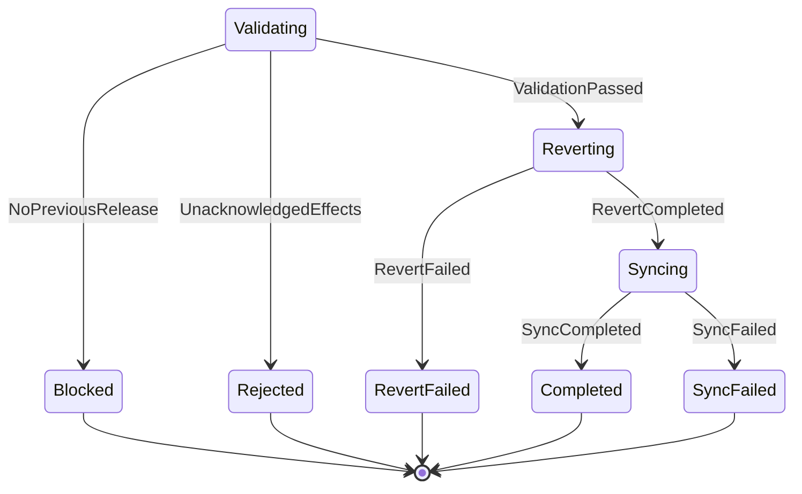

# What it is

The `Rollback` machine: **8 states, 7 transitions, 5 terminal**.
Declared in `pkg/statemachine/rollback.go` with a `*_typed.go` companion.[^sm-file]

Status is never assigned directly — a transition goes through `Transition(event)`, and an
**invalid transition panics**, because it is a programming error rather than a runtime condition.

Eight states of which **five are terminal**, the highest terminal ratio of any machine here. That
shape follows from what a rollback is: it either completes, or it stops somewhere that needs a
person.

`VALIDATING` has three exits and only one of them proceeds. `NoPreviousRelease` lands on
`BLOCKED`; `UnacknowledgedEffects` lands on `REJECTED` — the system refusing to revert past
changes whose side effects nobody has acknowledged.

# Schema

## States

| State | Go constant | Kind | Anchor |
|---|---|---|---|
| `BLOCKED` | `RollbackBlocked State = "BLOCKED"` | **terminal** | `pkg/statemachine/rollback.go:13` |
| `COMPLETED` | `RollbackCompleted State = "COMPLETED"` | **terminal** | `pkg/statemachine/rollback.go:11` |
| `REJECTED` | `RollbackRejected State = "REJECTED"` | **terminal** | `pkg/statemachine/rollback.go:12` |
| `REVERTING` | `RollbackReverting State = "REVERTING"` | — | `pkg/statemachine/rollback.go:9` |
| `REVERT_FAILED` | `RollbackRevertFailed State = "REVERT_FAILED"` | **terminal** | `pkg/statemachine/rollback.go:14` |
| `SYNCING` | `RollbackSyncing State = "SYNCING"` | — | `pkg/statemachine/rollback.go:10` |
| `SYNC_FAILED` | `RollbackSyncFailed State = "SYNC_FAILED"` | **terminal** | `pkg/statemachine/rollback.go:15` |
| `VALIDATING` | `RollbackValidating State = "VALIDATING"` | — | `pkg/statemachine/rollback.go:8` |

## Transitions

| From | To | Event |
|---|---|---|
| `Reverting` | `RevertFailed` | `RevertFailed` |
| `Reverting` | `Syncing` | `RevertCompleted` |
| `Syncing` | `Completed` | `SyncCompleted` |
| `Syncing` | `SyncFailed` | `SyncFailed` |
| `Validating` | `Blocked` | `NoPreviousRelease` |
| `Validating` | `Rejected` | `UnacknowledgedEffects` |
| `Validating` | `Reverting` | `ValidationPassed` |

# Relationships

- Declared in `pkg/statemachine`, described in
  [`/components/shared-go-libraries.md`](/components/shared-go-libraries.md) — 6,951 lines over
  48 files, imported by the API, the operators and the ops binary.
- The other ten machines: [`LoopZeroApplication`](/entities/state-machine-application.md), [`Build`](/entities/state-machine-build.md), [`Domain`](/entities/state-machine-domain.md), [`Environment`](/entities/state-machine-environment.md), [`ExposedRoute`](/entities/state-machine-exposedroute.md), [`PlatformBootstrap`](/entities/state-machine-platformbootstrap.md), [`PreviewEnvironment`](/entities/state-machine-preview.md), [`Promotion`](/entities/state-machine-promotion.md), [`Release`](/entities/state-machine-release.md), [`Tenant`](/entities/state-machine-tenant.md).

# Evidence

[^sm-file]: `pkg/statemachine/rollback.go:13`
[^s-blocked]: `pkg/statemachine/rollback.go:13`
[^s-completed]: `pkg/statemachine/rollback.go:11`
[^s-rejected]: `pkg/statemachine/rollback.go:12`
[^s-revert_failed]: `pkg/statemachine/rollback.go:14`
[^s-reverting]: `pkg/statemachine/rollback.go:9`
[^s-sync_failed]: `pkg/statemachine/rollback.go:15`
