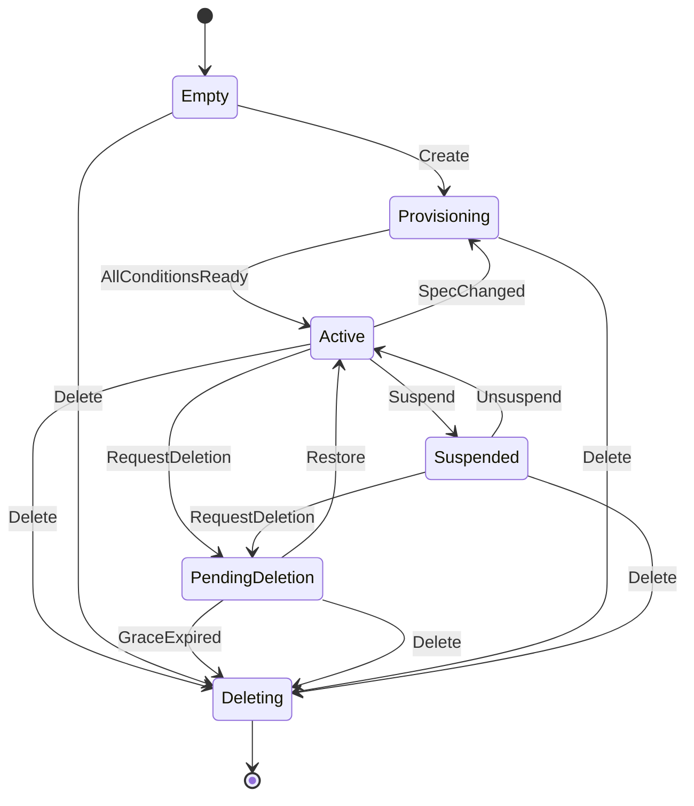

# What it is

The `Tenant` machine: **6 states, 14 transitions, 1 terminal**.
Declared in `pkg/statemachine/tenant.go` with a `*_typed.go` companion.[^sm-file]

Status is never assigned directly — a transition goes through `Transition(event)`, and an
**invalid transition panics**, because it is a programming error rather than a runtime condition.

`PendingDeletion` is a grace state, not a failure: it is reachable from `Active` and `Suspended`,
and it can go **back** to `Active` on `Restore`. Only `GraceExpired` or an explicit `Delete`
moves it forward.

The empty phase is an entry node — a CR whose `.status.phase` has never been written. Four of the
eleven machines model that explicitly rather than treating an unset phase as an error.

# Schema

## States

| State | Go constant | Kind | Anchor |
|---|---|---|---|
| `(empty phase)` | `TenantEmpty State = ""` | entry | `pkg/statemachine/tenant.go:9` |
| `Active` | `TenantActive State = "Active"` | — | `pkg/statemachine/tenant.go:11` |
| `Deleting` | `TenantDeleting State = "Deleting"` | **terminal** | `pkg/statemachine/tenant.go:14` |
| `PendingDeletion` | `TenantPendingDeletion State = "PendingDeletion"` | — | `pkg/statemachine/tenant.go:13` |
| `Provisioning` | `TenantProvisioning State = "Provisioning"` | — | `pkg/statemachine/tenant.go:10` |
| `Suspended` | `TenantSuspended State = "Suspended"` | — | `pkg/statemachine/tenant.go:12` |

## Transitions

| From | To | Event |
|---|---|---|
| `Active` | `Deleting` | `Delete` |
| `Active` | `PendingDeletion` | `RequestDeletion` |
| `Active` | `Provisioning` | `SpecChanged` |
| `Active` | `Suspended` | `Suspend` |
| `Empty` | `Deleting` | `Delete` |
| `Empty` | `Provisioning` | `Create` |
| `PendingDeletion` | `Active` | `Restore` |
| `PendingDeletion` | `Deleting` | `GraceExpired` |
| `PendingDeletion` | `Deleting` | `Delete` |
| `Provisioning` | `Active` | `AllConditionsReady` |
| `Provisioning` | `Deleting` | `Delete` |
| `Suspended` | `Active` | `Unsuspend` |
| `Suspended` | `Deleting` | `Delete` |
| `Suspended` | `PendingDeletion` | `RequestDeletion` |

# Relationships

- Declared in `pkg/statemachine`, described in
  [`/components/shared-go-libraries.md`](/components/shared-go-libraries.md) — 6,951 lines over
  48 files, imported by the API, the operators and the ops binary.
- The other ten machines: [`LoopZeroApplication`](/entities/state-machine-application.md), [`Build`](/entities/state-machine-build.md), [`Domain`](/entities/state-machine-domain.md), [`Environment`](/entities/state-machine-environment.md), [`ExposedRoute`](/entities/state-machine-exposedroute.md), [`PlatformBootstrap`](/entities/state-machine-platformbootstrap.md), [`PreviewEnvironment`](/entities/state-machine-preview.md), [`Promotion`](/entities/state-machine-promotion.md), [`Release`](/entities/state-machine-release.md), [`Rollback`](/entities/state-machine-rollback.md).

# Evidence

[^sm-file]: `pkg/statemachine/tenant.go:11`
[^s-active]: `pkg/statemachine/tenant.go:11`
[^s-deleting]: `pkg/statemachine/tenant.go:14`
[^s-empty-phase]: `pkg/statemachine/tenant.go:9`
[^s-pendingdeletion]: `pkg/statemachine/tenant.go:13`
[^s-provisioning]: `pkg/statemachine/tenant.go:10`
[^s-suspended]: `pkg/statemachine/tenant.go:12`
