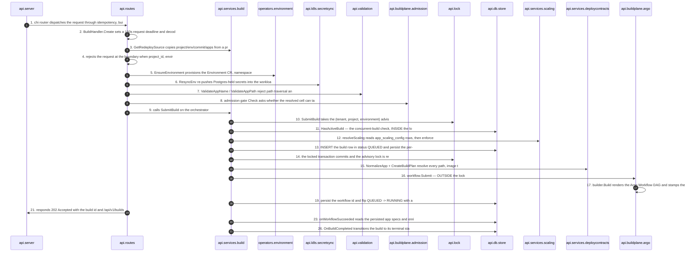

# What it is

**Deploy a container app (loopzero deploy → live URL)** — a `sequence` flow of 40 steps,
traced from the call site that starts it.[^flow-root]

| | |
|---|---|
| **Trigger** | POST /api/v1/builds with {project_id, environment, apps[]} — the CLI's `loopzero deploy` |
| **Outcome** | 202 Accepted with a build id + SSE stream URL; asynchronously the manifests reach the tenant GitOps repo, ArgoCD syncs them, and deploy.completed is emitted on the stream |

The whole of `loopzero deploy`, from the HTTP request to the URL the CLI prints: **40 steps** across
eleven components, two clusters and one git repository.

Three structural facts carry the rest of it.

**The environment lock opens at step 10 and closes at step 14.** Inside it: the concurrent-build
check, scaling resolution, and the `QUEUED` insert. Outside it: the Argo Workflow submission, so
Argo latency never blocks another deploy on the same environment. Moving the concurrent-build
check outside that boundary is the documented mistake this ordering exists to prevent.

**The request returns at step 21 and the work finishes at step 39.** `POST /api/v1/builds`
answers 202 in seconds; everything after it runs across a reconcile loop, a git push, an ArgoCD
sync and a convergence poll. The user's only view of those eighteen steps is one SSE channel.

**Nothing is activated on a promise.** The release stays `PENDING` until a convergence loop
confirms Synced + Healthy + the expected revision. `deploy.completed` is retried three times
because the CLI blocks on it.

# Schema

The steps, in order. Every row is anchored to the line that performs it.

| # | Actor | Step | Hands to | Condition | Data | Anchor |
|---|---|---|---|---|---|---|
| 1 | `api.server` | chi router dispatches the request through idempotency, builds-per-month rate cap and build-cost cap middleware to the handler | `api.routes` | — | `*http.Request with UserContext, Idempotency-Key` | `api/internal/server/router.go:487` |
| 2 | `api.routes` | BuildHandler.Create sets a 150s request deadline and decodes createBuildRequest from the body | `api.routes` | — | `createBuildRequest{ProjectID, Environment, CommitSHA, Apps, RedeployOf, NoCache}` | `api/internal/routes/builds/builds.go:280` |
| 3 | `api.routes` | GetRedeploySource copies project/env/commit/apps from a prior build | `api.services.build` | req.RedeployOf != "" | `the source build's ProjectID, Environment, CommitSHA, Apps` | `api/internal/routes/builds/builds.go:302` |
| 4 | `api.routes` | rejects the request at the boundary when project_id, environment or apps[] is missing or the environment is not lowercase | `api.routes` | req.ProjectID == "" \|\| req.Environment == "" \|\| len(req.Apps) == 0 \|\| !environmentRegex.Match | `400 MISSING_FIELD / INVALID_ENVIRONMENT LoopZeroError` | `api/internal/routes/builds/builds.go:345` |
| 5 | `api.routes` | EnsureEnvironment provisions the Environment CR, namespace and ArgoCD App on first deploy to a new env (no-op for existing) | `operators.environment` | h.envEnsurer != nil | `tenantID, projectID, environment` | `api/internal/routes/builds/builds.go:392` |
| 6 | `api.routes` | ResyncEnv re-pushes Postgres-held secrets into the workload namespace as ExternalSecrets (best-effort, logged not fatal) | `api.k8s.secretsync` | h.secretResync != nil | `tenantID, projectID, environment` | `api/internal/routes/builds/builds.go:422` |
| 7 | `api.routes` | ValidateAppName / ValidateAppPath reject path traversal and shell injection before app values reach build scripts | `api.validation` | — | `app.Name, app.Path` | `api/internal/routes/builds/builds.go:437` |
| 8 | `api.routes` | admission gate Check asks whether the resolved cell can take another build; fails open on query error | `api.buildplane.admission` | h.admission != nil | `cellID (from cellResolver.GetTenantCellID), tenantID -> admitted, retryAfter` | `api/internal/routes/builds/builds.go:471` |
| 9 | `api.routes` | calls SubmitBuild on the orchestrator | `api.services.build` | — | `SubmitBuildInput{TenantID, ProjectID, Environment, CommitSHA, Apps, CreatedBy, CorrelationID}` | `api/internal/routes/builds/builds.go:494` |
| 10 | `api.services.build` | SubmitBuild takes the (tenant, project, environment) advisory lock — everything below step 14 runs inside it | `api.lock` | — | `db.DBTX bound to the locked transaction` | `api/internal/services/build/build_orchestrator_submit.go:56` |
| 11 | `api.services.build` | HasActiveBuild — the concurrent-build check, INSIDE the lock (Unbreakable Rule 6) | `api.db.store` | hasActive -> return ErrDeployInProgress | `bool hasActive` | `api/internal/services/build/build_orchestrator_submit.go:58` |
| 12 | `api.services.build` | resolveScaling reads app_scaling_config rows, then enforceScaling applies the plan replica cap and the KEDA scale-to-zero gate | `api.services.scaling` | replicas and autoscaling both set -> ErrScalingAmbiguous | `resolved []AppSpec` | `api/internal/services/build/build_orchestrator_submit.go:73` |
| 13 | `api.services.build` | INSERT the build row in status QUEUED and persist the per-app spec | `api.db.store` | — | `db.Build{...} -> buildID; []db.BuildAppSpec` | `api/internal/services/build/build_orchestrator_submit.go:122` |
| 14 | `api.services.build` | the locked transaction commits and the advisory lock is released — the build exists as QUEUED and Argo latency no longer blocks other deploys | `api.lock` | — | `buildID` | `api/internal/services/build/build_orchestrator_submit.go:152` |
| 15 | `api.services.build` | NormalizeApp + CreateBuildPlan resolve every path, image tag and language strategy before the pipeline sees them | `api.services.deploycontracts` | normalization fails -> failQueuedBuild immediately so the environment is unblocked | `deploycontracts.BuildPlan + WorkflowSpec{Namespace: "argo"}` | `api/internal/services/build/build_orchestrator_submit.go:165` |
| 16 | `api.services.build` | workflow.Submit — OUTSIDE the lock | `api.buildplane.argo` | — | `WorkflowSpec` | `api/internal/services/build/build_orchestrator_submit.go:197` |
| 17 | `api.buildplane.argo` | builder.Build renders the Argo Workflow DAG and stamps loopzero.io/trace-id + span-id annotations on it | `api.buildplane.argo` | — | `unstructured Workflow object` | `api/internal/buildplane/argo/workflow_submitter.go:150` |
| 18 | `api.buildplane.argo` | CREATE the Workflow CR in namespace argo on the build cluster, retrying only on 5xx-class k8s errors | `orch.argo_workflows` | IsServerTimeout \|\| IsServiceUnavailable \|\| IsTooManyRequests \|\| IsInternalError -> retry | `workflow name` | `api/internal/buildplane/argo/workflow_submitter.go:186` |
| 19 | `api.services.build` | persist the workflow id and flip QUEUED -> RUNNING with a conditional UPDATE (lock-free CAS) | `api.db.store` | UpdateStatusIfCurrent returns nil -> another writer already advanced the build; reconcile owns it | `workflowID, BPEventStarted` | `api/internal/services/build/build_orchestrator_submit.go:219` |
| 20 | `api.services.build` | append the build.started SSE event with the app names | `api.events` | — | `{"build_id","status":"running","apps":[...]}` | `api/internal/services/build/build_orchestrator_submit.go:240` |
| 21 | `api.routes` | responds 202 Accepted with the build id and /api/v1/builds/{id}/stream | `api.server` | — | `SubmitBuildResponse{BuildID, StreamURL}` | `api/internal/routes/builds/builds.go:509` |
| 22 | `api.services.build` | the build reconcile loop ticks, claims the build across replicas via a PG claim, and polls the workflow's phase in the build cluster | `orch.argo_workflows` | — | `WorkflowStatus{Phase, FinishedAt, Nodes}` | `api/internal/services/build/build_reconcile_single.go:55` |
| 23 | `api.services.build` | onWorkflowSucceeded reads the persisted app specs and enriches each AppRelease with the cosign digest the sign-image-{app} step produced | `api.db.store` | status.Phase == "Succeeded" | `[]AppRelease with ImageDigestSHA256` | `api/internal/services/build/build_reconcile_complete.go:30` |
| 24 | `api.manifests` | Render produces the Rollout/Deployment, Services, TraefikService and AnalysisTemplate YAML, pinning images by digest rather than tag | `api.manifests` | ProgressiveDeliveryEnabled() -> Rollout + canary steps; else a plain Deployment | `rendered manifest YAML (string)` | `api/internal/services/build/build_reconcile_complete.go:101` |
| 25 | `api.services.build` | ensureApplicationCRs creates the LoopZeroApplication CRs on the control plane (non-fatal) | `operators.app` | — | `LoopZeroApplication CRs` | `api/internal/services/build/build_reconcile_complete.go:126` |
| 26 | `api.services.build` | OnBuildCompleted transitions the build to its terminal state under the lock, emits build.succeeded, then re-fetches outside it | `api.db.store` | result.Status == "failed" -> emit build.failed and stop here | `BuildCallbackRequest{Status, Apps, Manifests}` | `api/internal/services/build/build_orchestrator_complete.go:32` |
| 27 | `api.services.build` | writeStaticRoutingEntries writes the Cloudflare KV routing entries for static apps BEFORE container activation, so the Worker serves the new version immediately | `ext.cloudflare.kv` | app is a static/rendering app | `KV keys per static app` | `api/internal/services/build/build_orchestrator_complete.go:169` |
| 28 | `api.services.build` | delivery.Activate hands the release to the container delivery activator | `api.services.release` | — | `ActivationBuild + BuildCallbackRequest` | `api/internal/services/build/build_orchestrator_complete.go:171` |
| 29 | `api.services.release` | phase A, under the lock: INSERT the release row in status READY | `api.db.store` | — | `db.Release{Apps, Artifacts{manifests}}` | `api/internal/release/container_delivery.go:103` |
| 30 | `api.services.release` | phase B, no lock, 60s budget: push the rendered manifests to the tenant GitOps repo | `api.gitops` | — | `GitOpsPushOpts{TenantID, ProjectID, Environment, Manifests, BuildID, ReleaseID}` | `api/internal/release/container_delivery.go:109` |
| 31 | `api.gitops` | validateManifests rejects resource kinds known to wedge an ArgoCD sync (Certificate CRs caused a 50-minute production stall) | `api.gitops` | a forbidden kind is present -> push aborts before any git work | `manifest YAML` | `api/internal/gitops/gitea_pusher.go:75` |
| 32 | `api.gitops` | clone {tenant}-gitops (depth 5), write {environment}/{projectID}/manifests.yaml, commit with Release-ID / Correlation-ID / Build-ID trailers | `ds.gitea` | clone fails -> git init + remote add (first push); "nothing to commit" -> reuse HEAD, idempotent | `manifests.yaml on disk in the clone` | `api/internal/gitops/gitea_pusher.go:140` |
| 33 | `api.gitops` | push to HEAD:refs/heads/main, fetch+rebase and retry up to 3 attempts on conflict | `ds.gitea` | push fails and attempt == 2 -> error out after 3 attempts | `gitops commit SHA` | `api/internal/gitops/gitea_pusher.go:174` |
| 34 | `api.services.release` | phase C, under the lock: record the delivery result — PENDING on success, GIT_MIRROR_FAILED on push error | `api.db.store` | pushErr != nil -> release GIT_MIRROR_FAILED and build stays RELEASING for retry | `commitSHA` | `api/internal/release/container_delivery.go:111` |
| 35 | `api.services.release` | triggerSyncWithRetry resolves the ArgoCD app name via naming.ArgoAppName and asks ArgoCD to sync | `api.argocd` | error contains "not found" -> stay PENDING for the convergence loop; other errors -> finalize as failed | `argoAppName` | `api/internal/release/container_delivery.go:133` |
| 36 | `api.argocd` | hard-refresh the app to drop the repo-server's cached comparison error, then POST /api/v1/applications/{app}/sync with {"prune": true} | `orch.argocd` | 401/403 -> notify the token provider to mint a fresh token | `Bearer token; {"prune": true}` | `api/internal/release/argocd/sync_client.go:190` |
| 37 | `api.services.release` | append deploy.verifying — the release stays PENDING and activation becomes asynchronous | `api.events` | — | `{"deploy_id","status":"verifying","app"}` | `api/internal/release/container_delivery.go:159` |
| 38 | `api.services.release` | the release convergence loop (10s poll) confirms Synced + Healthy + revision and calls activateRelease; the ArgoCD notification callback is the fast path and the reaper the 10m backstop | `api.services.release` | synced && healthy && revision verified | `release row` | `api/internal/release/container_delivery.go:122` |
| 39 | `api.services.release` | ActivateReleaseKernel flips the release ACTIVE, sets the environment target, stages deploy.succeeded and emits deploy.completed with the per-app URLs — retried 3x because the CLI blocks on it | `api.events` | emit fails -> 100ms backoff, 3 attempts | `{"deploy_id","status":"success","duration_seconds","apps":[{name,status,url}]}` | `api/internal/release/release_activator.go:275` |
| 40 | `api.sse` | the CLI's open /api/v1/builds/{id}/stream receives deploy.completed and prints the URL | `api.server` | — | `SSE frames from the events table` | `api/internal/sse/stream_handler.go:49` |

# Relationships

- Entry point: `cap.deploy` in [`/entities/api-capabilities.md`](/entities/api-capabilities.md).
- Steps 1–9 run in [`/components/control-plane-api.md`](/components/control-plane-api.md);
  10–23 in [`/components/build-orchestration.md`](/components/build-orchestration.md);
  24–39 in [`/components/release-delivery.md`](/components/release-delivery.md);
  step 40 in [`/components/event-stream.md`](/components/event-stream.md).
- The rows written are `builds`, `releases` and `sse_events` in
  [`/entities/database-schema.md`](/entities/database-schema.md).
- The states traversed are [`Build`](/entities/state-machine-build.md) and
  [`Release`](/entities/state-machine-release.md).
- The experience of running this as a person is
  [`/flows/developer-first-app-live.md`](/flows/developer-first-app-live.md).

# Evidence

Every step in the table above carries the `file:line` that performs it. The `sources` block below lists the flow's own anchor and the first ten steps; steps 11 to 40 are anchored in the table only.

[^flow-root]: `api/internal/server/router.go:487`
[^step-1]: `api/internal/server/router.go:487`
[^step-2]: `api/internal/routes/builds/builds.go:280`
[^step-3]: `api/internal/routes/builds/builds.go:302`
[^step-4]: `api/internal/routes/builds/builds.go:345`
[^step-5]: `api/internal/routes/builds/builds.go:392`
[^step-6]: `api/internal/routes/builds/builds.go:422`
[^step-7]: `api/internal/routes/builds/builds.go:437`
[^step-8]: `api/internal/routes/builds/builds.go:471`
[^step-9]: `api/internal/routes/builds/builds.go:494`
[^step-10]: `api/internal/services/build/build_orchestrator_submit.go:56`
