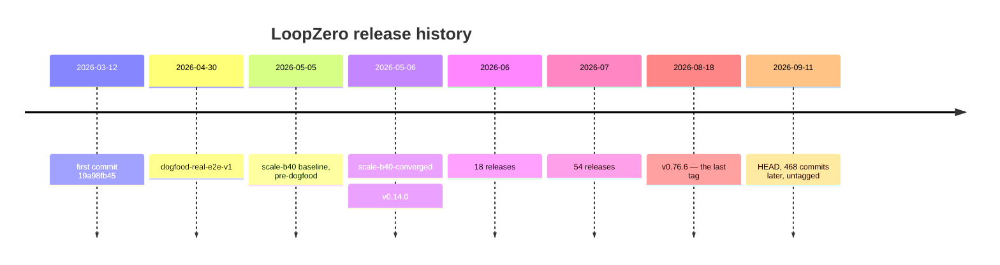

# What it is

86 dated events read from git: one first commit, four milestone tags, 80 semver releases, and
the interval between the newest tag and HEAD.

# Schema

## The shape

| | |
|---|---|
| First commit | **2026-03-12**, `19a98fb45`[^tl-first] |
| First semver tag | `v0.14.0`, **2026-05-06** — 55 days in[^tl-rel] |
| Last semver tag | `v0.76.6`, **2026-08-18** |
| Tags in that window | **80**, over 66 days — about 1.2 per day |
| HEAD | `6c22c4ecf`, 2026-09-11 |
| Commits since the last tag | **468** of 5,288 = **8.9%** of all history[^tl-head] |
| Days since the last tag | **24** |

## Releases per month

| Month | Tags |
|---|---|
| 2026-05 | 1 |
| 2026-06 | 18 |
| 2026-07 | 54 |
| 2026-08 | 7 |
| 2026-09 | **0** |

## Milestone tags — the non-semver ones

| Tag | From | To |
|---|---|---|
| `dogfood-real-e2e-v1` | 2026-04-30 | 2026-04-30 |
| `scale-b40-baseline-20260505` | 2026-04-30 | 2026-05-05 |
| `scale-b40-pre-dogfood-20260505` | 2026-05-05 | 2026-05-05 |
| `scale-b40-converged-20260506` | 2026-05-05 | 2026-05-06 |

These four are not releases. They mark validation runs — a real end-to-end dogfood, and three
points of a scale exercise — and they all sit in the eight days before the first semver tag. The
repository was tagging *what it had proved* before it started tagging *what it shipped*.

# What the gap means, and what it does not

The tag series is **dense and then absent**: 1.2 tags a day for 66 days, then 24 days of nothing
while 468 commits landed.[^tl-gap]

This is a fact about the release process rather than a defect in the code. What it costs is
specific: **a repository whose released artifact is 468 commits behind its trunk cannot answer
"what is deployed" from a tag.**

The cause is **not established here**. A deliberate pause, an unshipped milestone and a broken
release path are all consistent with the evidence, and the map does not pick between them.

## The CHANGELOG says the same thing from the other side

`CLAUDE.md:21` asserts this repository's `CHANGELOG.md` *"has 4,567 lines"*. Measured, it has
**48**.[^tl-changelog] The file itself explains why, and explains it correctly: the previous
changelog held 4,802 lines and was removed in `4f728eb7a` — and
`git show 4f728eb7a~1:CHANGELOG.md | wc -l` returns exactly 4,802.

So the repository's own changelog documents its truncation accurately, while the file that
points readers at it carries a third figure matching neither. A reader following that pointer
for the dated engineering history finds 48 lines, one `[Unreleased]` section, and no versioned
entries — against 84 tags that exist.

# Relationships

- The commit distribution behind these 5,288 commits is
  [`/operations/codebase-metrics.md`](/operations/codebase-metrics.md).
- Who authored them is [`/operations/ownership.md`](/operations/ownership.md).
- The other documents that disagree with the repository are
  [`/operations/contradictions.md`](/operations/contradictions.md).

# Evidence

[^tl-first]: `git rev-list --max-parents=0 HEAD`
[^tl-rel]: `git tag --sort=creatordate --format='%(refname:short)|%(creatordate:short)'`
[^tl-head]: `git rev-list --count v0.76.6..HEAD`
[^tl-gap]: `CHANGELOG.md:1`
[^tl-changelog]: `CLAUDE.md:21`
