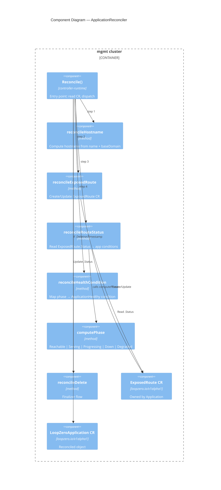

# Application — Component Diagram (ApplicationReconciler)

## Overview

`ApplicationReconciler` em `operators/internal/app/application_controller.go` é o controlador da CRD `LoopZeroApplication`. Reconcile loop traduz spec do app deploy em ExposedRoute + status convergence baseado em route reachability.

## Diagram



## Components

| Component | File | Responsibility | Key Fact |
|-----------|------|----------------|----------|
| `Reconcile()` | `application_controller.go:53` | Dispatch to sub-reconcilers | controller-runtime entry |
| `reconcileHostname` | `:146` | Compute hostname | Pure function |
| `reconcileExposedRoute` | `:162` | Create/Update ExposedRoute CR | Owned by app (cleanup automatic) |
| `reconcileRouteStatus` | `:204` | **READS ExposedRoute.Status, sets app conditions** | Critical for phase convergence (F-6) |
| `reconcileHealthCondition` | `:250` | Map phase to ApplicationHealthy condition | Derived from phase |
| `computePhase` | `:301` | Phase decision tree | See below |
| `reconcileDelete` | `:263` | Finalizer flow for deletion | Verify-then-remove |

## `computePhase` Decision Tree (CURRENT)

```
if app.Status.Reachable               → Reachable
elif app.Status.EndpointsReady         → Serving
elif Conditions[RouteReachable]==False:
    case Reason==Failed                → Down
    case Reason==Degraded              → Degraded
    case _ (Waiting / unknown)         → Progressing
else                                   → Progressing  (default)
```

Source: `application_controller.go:301-329`.

## Why 9 CRs stuck in Progressing (F-6)

`app.Status.Reachable = route.Status.Phase == ExposedRoutePhaseReachable`. Em local k3d:
- ExposedRouteController must converge ExposedRoute to `Reachable` phase.
- Reachable depende de Traefik route propagation + DNS + cert.
- Local: cert-manager `letsencrypt-prod` não consegue ACME challenge para `*.loopzero.local` (sem DNS público). Self-signed CA fills gap, mas ExposedRouteController pode não reconhecer essa cert como Ready.
- Result: `route.Status.Phase != Reachable` → `app.Status.Reachable=false` → `EndpointsReady=false` → phase=Progressing eternamente.

## Key Decisions

### Decision 1: Application phase é derived, NOT eventful

- **Context:** State machine vs derived state.
- **Decision:** Application Phase é DERIVED do ExposedRoute (read-only fan-in). NÃO é state machine canonical.
- **Alternatives rejected:** Application como state machine completa (overkill — ExposedRoute já tem state).
- **Consequences:** Application phase só convergir se ExposedRoute convergir. F-6 expõe esse acoplamento como risco em local sem DNS público.

### Decision 2: Owner refs garantem cleanup automático

- **Context:** App delete deve cleanup ExposedRoute + Service + cert.
- **Decision:** ExposedRoute owned by Application (via `metadata.ownerReferences`). K8s GC cleans on app delete.
- **Alternatives rejected:** Manual cleanup em finalizer (more code, more bugs).
- **Consequences:** Trust K8s. Funciona.

## Plan v1.1 Proposal (T4.2)

Adicionar fast-path: se workload Pod Ready=true (cell-aware via CellAwareRuntimeClientFactory), set `EndpointsReady=true` independente de ExposedRoute.Reachable. Phase passa de `Progressing → Serving` sem esperar DNS/cert.
