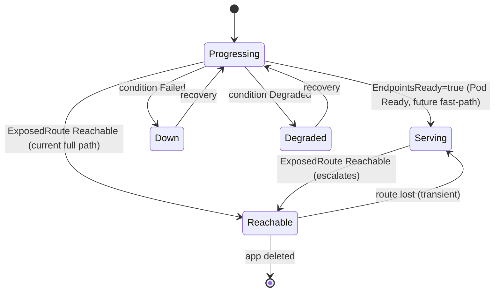
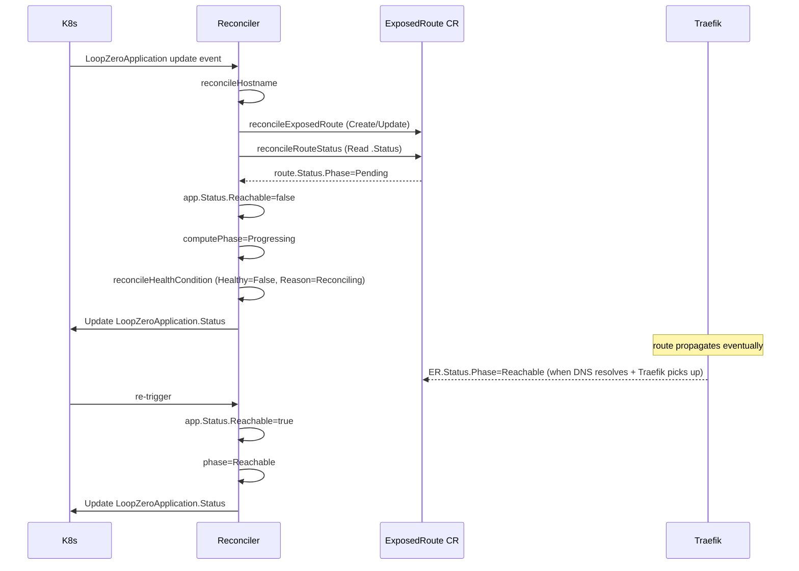
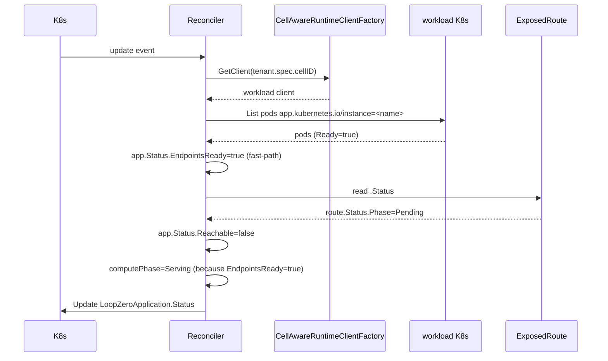

# Application — Deep Dive

## Problem Statement

`LoopZeroApplication` CRD é a representação K8s-native de um app deployed (1 app = 1 service runnable). Operator precisa: (a) prover hostname canonical, (b) criar ExposedRoute para Traefik, (c) reportar status accurate (Healthy / Degraded / Down) para CLI status command + dashboard, (d) cleanup em delete.

## Design Decisions

### Decision 1: Application Phase derived from ExposedRoute Reachable

- **Context:** Pod Ready nem sempre significa user-reachable (DNS, cert, Traefik route propagation podem falhar). ExposedRoute encapsula essa concern.
- **Decision:** `Reachable` é fonte de verdade. `Reachable=true` → phase=Reachable.
- **Alternatives rejected:** Pod Ready é fonte de verdade (insuficiente — Pod Ready mas DNS broken = user can't reach).
- **Consequences:** Em ambiente sem DNS público (local k3d), ExposedRoute pode nunca convergir. App fica eternamente Progressing mesmo com Pod Ready (F-6).

### Decision 2: ExposedRoute owned by Application (K8s GC)

- **Context:** Cleanup determinístico em app delete.
- **Decision:** OwnerReferences. K8s ReplicaSet style.
- **Alternatives rejected:** Finalizer manual cleanup.
- **Consequences:** Trust K8s. Funciona. Cascade delete correto.

### Decision 3 (PROPOSED in plan v1.1, T4.2): Fast-path Healthy on Pod Ready

- **Context:** Local k3d permanently lacks public DNS. Application phase nunca convergir local sem fast-path.
- **Decision:** Read workload pod status via `CellAwareRuntimeClientFactory`. If Pod Ready=true, set `EndpointsReady=true` regardless of ExposedRoute Reachable.
- **Alternatives rejected:** Fix ExposedRoute reachability check em local (tries to use `*.loopzero.local` DNS — won't work).
- **Consequences:** Phase passes `Progressing → Serving` once Pod Ready. Final convergence to Reachable still requires ExposedRoute Reachable (preserves prod semantics).

## State Machine: Application Phase (Derived)

## Failure Modes

| Failure | Detection | Recovery | Impact |
|---------|-----------|----------|--------|
| ExposedRoute never Reachable (local DNS) | App stuck Progressing 30+ min | Plan v1.1 T4.2 fast-path | UX confusing, status command shows wrong info |
| Pod Ready but cert-manager pending | ExposedRoute condition CertificateIssued=false | Wait for cert (prod) or self-signed CA (local) | Phase=Progressing during cert issuance |
| Workload cluster unreachable (cell down) | Reconcile error during T4.2 fast-path read | Graceful degrade — keep current phase + RequeueAfter 30s | No crash; status stale |
| Pod NotReady→Ready→NotReady flapping | Multiple reconciles | controller-runtime resync built-in | Status accurate after debounce |
| App delete with finalizer stuck | Operator logs reconcileDelete error | Manual `kubectl patch finalizers=[]` (operator override) | Cleanup blocked |

## Sequence: Reconcile (CURRENT — full path)

## Sequence: Reconcile (PROPOSED v1.1 — with T4.2 fast-path)

## Performance Characteristics

| Metric | Target | Current |
|--------|--------|---------|
| Reconcile period | 30s (controller-runtime default) | 30s |
| Phase convergence (prod) | < 90s post-deploy | ~60s typical |
| Phase convergence (local k3d) | n/a (stuck Progressing) | F-6 — fixed by T4.2 |

## Open Questions

- T4.1 vai investigar empiricamente por que ExposedRoute nunca atinge Reachable em local. Pode ser Traefik route propagation, cert acceptance, ou bug no ExposedRouteController.
- T4.2 fast-path is non-breaking change para prod (Pod Ready é mais conservador que ExposedRoute Reachable, então phase só "antecipa"). Validate via envtest.
