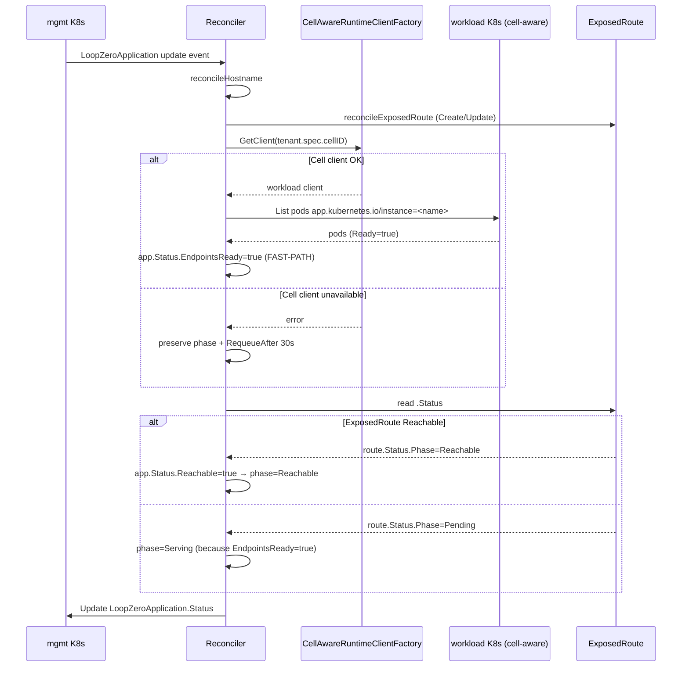

<!-- PROPOSED STATE — Generated from plan: dogfood-2026-05-08-fixes -->
<!-- Date: 2026-05-08 -->
<!-- Status: PENDING APPROVAL -->
<!-- To promote: replace parent docs with these after implementation is validated -->

# Application — Deep Dive (PROPOSED)

## Changes vs AS-IS

| Concern | AS-IS | PROPOSED (post v1.1) |
|---------|-------|----------------------|
| Path to phase=Serving | Requires ExposedRoute Reachable (which depends on DNS+cert+Traefik prop) | Fast-path: workload Pod Ready → EndpointsReady → phase=Serving |
| Cell-awareness | n/a (no workload read) | `CellAwareRuntimeClientFactory` resolves correct workload cluster from `tenant.spec.cellID` (EC-5) |
| Workload cluster unreachable | n/a | Graceful degrade — keep current phase + RequeueAfter 30s (EC-9) |
| Local k3d convergence | Stuck Progressing 30+ min | Converges to Serving when pod Ready (~60s post-deploy) |

## New Decision (ADR D6 from plan v1.1)

### D6 — Fast-path Healthy on Pod Ready (cell-aware)

`reconcileRouteStatus` (or new `reconcileWorkloadStatus`):
1. Resolve workload K8s client via `CellAwareRuntimeClientFactory.GetClient(tenant.spec.cellID)`.
2. List pods with label `app.kubernetes.io/instance=<app-name>` em workload cluster.
3. If any pod Ready=true: set `app.Status.EndpointsReady=true`.
4. If workload cluster unreachable (timeout 5s): preserve current phase + RequeueAfter 30s.

Rationale (D6): Pod respondendo `/health` é fonte de verdade real. ExposedRoute Reachable depende de fatores ortogonais (DNS, cert) que podem atrasar minutos sem indicar app falhando.

## Updated `computePhase` Decision Tree (UNCHANGED logic, but EndpointsReady now arrives via fast-path)

```
if app.Status.Reachable               → Reachable    [requires ExposedRoute reachable — full path]
elif app.Status.EndpointsReady         → Serving      [now arrives via fast-path within ~60s]
elif Conditions[RouteReachable]==False:
    case Reason==Failed                → Down
    case Reason==Degraded              → Degraded
    case _                             → Progressing
else                                   → Progressing
```

The decision tree itself is **unchanged** — logic stays identical. What changes is HOW `EndpointsReady` becomes true.

## Updated Sequence: Reconcile (PROPOSED with fast-path)



## Failure Modes (NEW)

| Failure | Detection | Recovery |
|---------|-----------|----------|
| Workload cluster down (cell-1 inaccessible) | `Factory.GetClient` timeout 5s | Graceful degrade — keep phase, RequeueAfter (EC-9) |
| Pod selector match 0 pods | `EndpointsReady` stays false | Falls back to existing ExposedRoute Reachable path |
| ClusterCredential token expired | `Factory.GetClient` 401 | Triggers H13/H15 token refresh (existing) |

## Performance Impact

| Metric | AS-IS | PROPOSED |
|--------|-------|----------|
| Phase convergence (local) | ∞ (stuck Progressing) | ~60s post-pod-Ready |
| Phase convergence (prod) | ~60s typical (waits ExposedRoute) | ~30s (Pod Ready arrives first, ExposedRoute escalates later) |
| Reconcile loop duration | ~50ms | ~150ms (added cross-cluster pod list, with 5s timeout) |

## Open Items

- T4.1 will determine WHY ExposedRoute never reaches Reachable in local k3d. Findings drive whether to ALSO fix ExposedRouteController, or just rely on fast-path locally.
