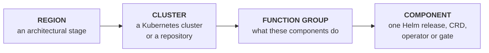
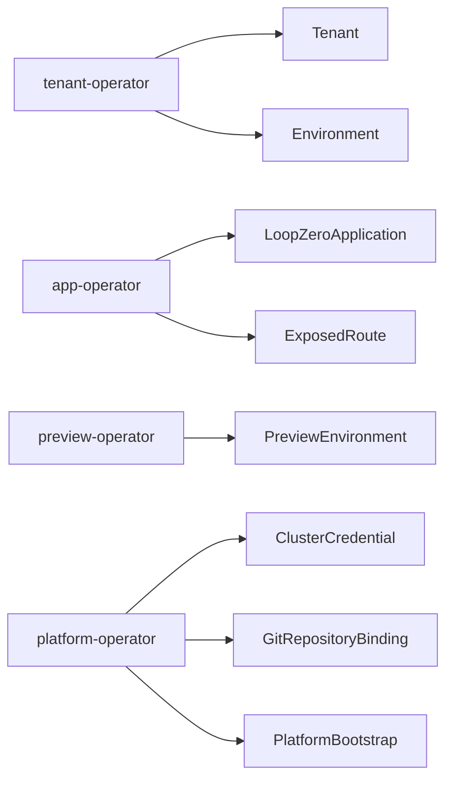
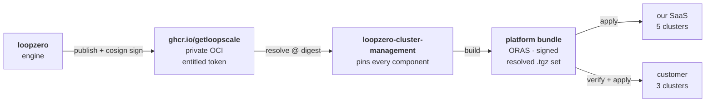
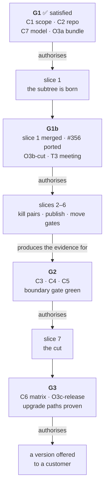
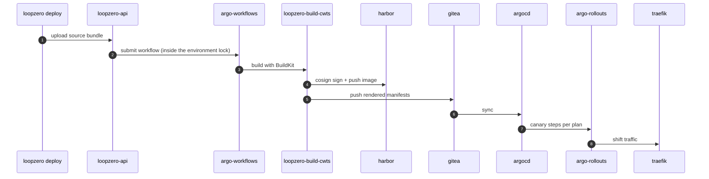
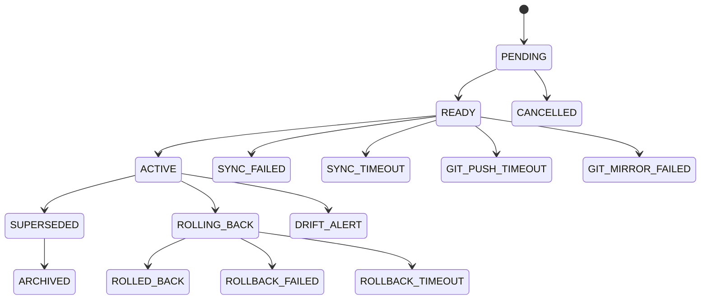
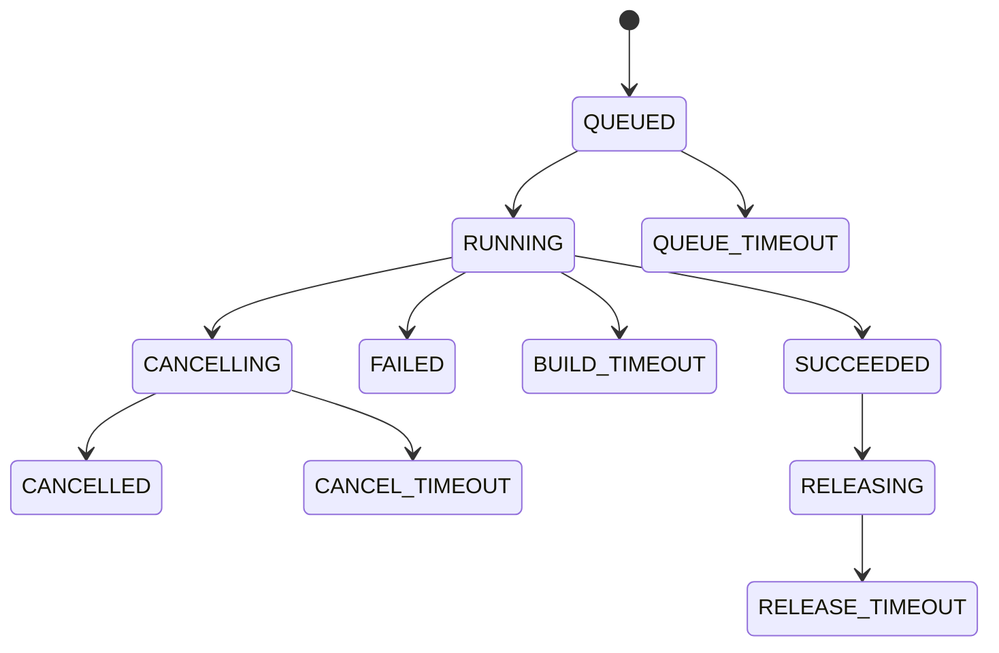
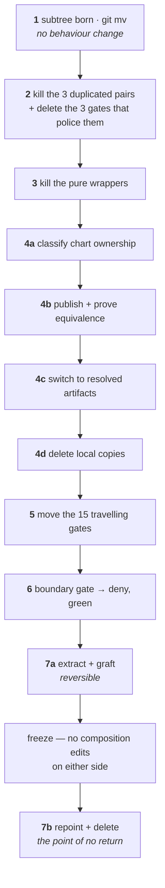
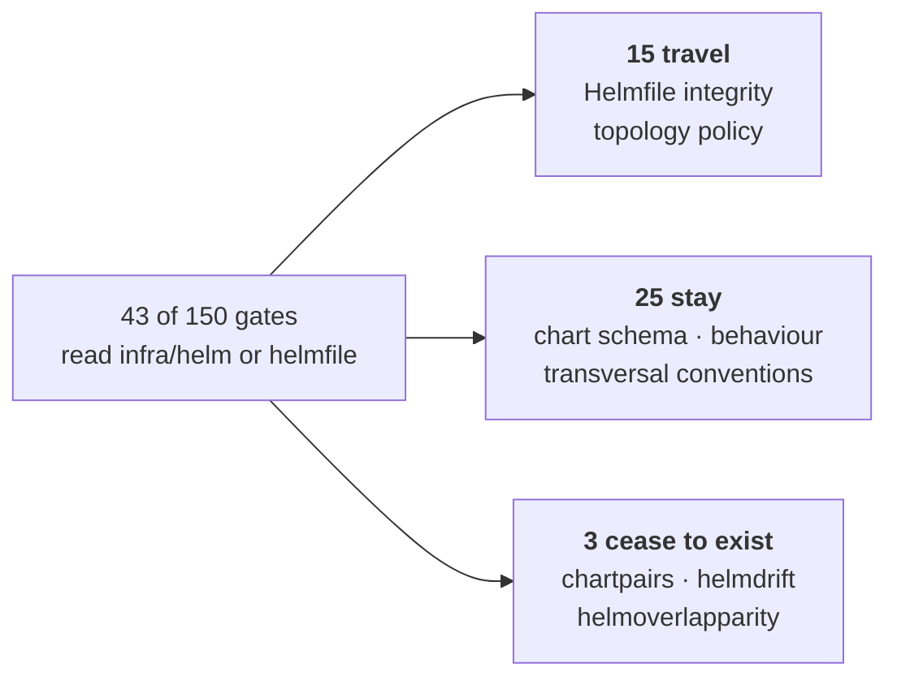

# Reading the architecture canvas

- **Companion to:** the interactive React Flow canvas (250 nodes) and
  `cluster-management-extraction-rfc.md`
- **Date:** 2026-09-10
- **Measured against:** `e031f173a` on branch `workspace`

> Every name in the canvas and in this document was extracted from the tree, not recalled. Release
> names come from `awk` over the `releases:` key of each Helmfile; CRDs from `operators/api/v1/*_types.go`;
> state machines from `pkg/statemachine/`; controller-to-binary wiring from each operator's `main.go`.

---

## 1 · How the canvas is organised

The canvas nests **four levels**, and the nesting is the point — a component's position states what it
belongs to:



Three regions, read in order:

| # | Region | What it holds |
|---|---|---|
| 1 | **Source of truth** | The two repositories, the supply chain, the stage gates, the deploy path |
| 2 | **Our SaaS topology** | 5 clusters · 59 releases |
| 3 | **A self-host customer** | 3 clusters · 44 releases · their own external dependencies |

Regions 2 and 3 sit **side by side** because they are the same composition producing two different
installations — the comparison is the argument.

### Visual encoding

Every mark carries information; none is decoration.

| Mark | Meaning | Count |
|---|---|---|
| **Accent (orange) name** | A chart LoopZero owns and publishes | 27 |
| Plain name | An upstream chart we pin | — |
| **Struck through, amber** | Excluded from the self-host offering by C1 | 10 nodes / 9 distinct releases |
| Muted name | An internal of region 1 — not a chart | 64 |
| **Blue numbered dot** | This component executes that step of `loopzero deploy` | 8 |
| Solid orange edge | Artifact flow — publish, pin, apply |
| Solid blue edge | Registry traffic and the deploy path |
| Dashed edge | Optional or external connection |

The `isolate the deploy path` toggle dims everything not on the deploy path — the density stays, but
one reading can be pulled out of it.

---

## 2 · Region 1 — source of truth

### 2.1 `loopzero` — the engine

Six function groups, 26 internals. This is what produces artifacts; it installs nothing itself.

| Group | Contents |
|---|---|
| **HTTP surface** | `api/` — 43 route files · `withEnvironmentLock` · `Idempotency-Key` |
| **Operators — 4 binaries** | tenant · app · preview · platform |
| **CRDs — 8** | tenant · environment · application · exposedroute · preview · platformbootstrap · gitrepositorybinding · clustercredential |
| **State machines — 11** | build · release · deploy · tenant · environment · application · exposedroute · preview · promotion · rollback · domain |
| **Published charts** | `charts/` OCI · `values.schema.json` · `existingSecret` floor |
| **Quality gates — 150** | 25 stay · 15 travel with the composition · 3 die with the pairs |

**Which binary reconciles which CRD** — measured from each `main.go`, and one row surprises people:



There is no `environment-operator`. The **`tenant-operator` registers the Environment controller**
(`operators/cmd/tenant-operator/main.go:289`, via `SetupEnvironmentControllerWithFactory`). Eight
controllers, eight CRDs, four binaries.

### 2.2 `loopzero-cluster-management` — the composition

| Group | Contents |
|---|---|
| **Composition** | `compose/` — 4 Helmfiles · `values/` — 55 files · `environments/` — 7 |
| **Release contract** | `platform.lock` · `ociDigest` (provenance) · `contentHash` (integrity) · `upgradePaths[]` |
| **Delivery** | `installer/` · `cluster-templates/` · `onboarding/` — customer IAM |

It **declares which chart at which version**. It never contains what a chart contains, and it never
publishes a chart — it publishes exactly one artifact, the bundle.

### 2.3 Supply chain



**Why the bundle carries resolved charts rather than references** — this was measured, not preferred:

| Path | Result |
|---|---|
| `helm pull oci://…@sha256:…` | works |
| `helmfile chart: oci://…@sha256:…` | **rejected** — *"the version for OCI charts should be semver compliant"* |
| `helmfile chart: ./chart.tgz` | works |

Helm accepts digests; Helmfile 1.1.6 does not. So resolution and verification happen once, at bundle
build time, and Helmfile then sees local paths.

**Two digests, and they answer different questions.** The OCI manifest digest proves *provenance* —
this is the artifact the publisher signed, in that registry. The resolved tarball's content hash proves
*integrity* — the bytes applied are the bytes resolved. A bundle with only the first could be altered
after resolution and still cite a legitimate origin.

### 2.4 Stage gates



**G1b exists because the previous revision had a cycle.** Slices 2–6 *produce* the evidence G2 needs,
so requiring G2 to start them was circular. G1b separates *may we continue moving* from *may we cut*.

### 2.5 The deploy path

Eight steps, each landing on the component that executes it. On the canvas these are the blue numbered
dots.



The environment lock matters: **the concurrent-build check sits inside `withEnvironmentLock`**, not
before it. Step 2 is where that invariant lives.

---

## 3 · Region 2 — our SaaS topology

**5 clusters · 59 releases.** Every one appears on the canvas by name.

| Cluster | Releases | Kube context | Multiplicity |
|---|---|---|---|
| `loopzero-core` | 31 | `k3d-loopzero-core` | singleton |
| `loopzero-build` | 7 | `LOOPZERO_BUILD_CONTEXT` | singleton |
| `loopzero-cell-0` | 15 | `requiredEnv LOOPZERO_CELL_CONTEXT` | **once per cell** |
| `loopzero-cell-1` | 15 | idem | idem |
| `loopzero-secrets` | 6 | `k3d-loopzero-secrets` | singleton, gated off by default |

`cell` is the only composition whose context is `requiredEnv` — because it is the only one that is
multiplied. `loopzero-cell-0` and `loopzero-cell-1` are the **same 15 releases applied twice**, which is why
the canvas shows them as two instances rather than two different things.

### 3.1 `loopzero-core` — 31 releases by function

| Function | Releases |
|---|---|
| **LoopZero product** | `loopzero-crds` · `loopzero-api` · `loopzero-tenant-operator` · `loopzero-app-operator` · `loopzero-preview-operator` · `loopzero-platform-operator` · `loopzero-cloud` |
| **GitOps** | `gitea-redis` · `gitea` · `argocd` |
| **Ingress & TLS** | `cert-manager` · `traefik` |
| **Identity** | `ory-kratos` · `ory-hydra` |
| **Policy & secrets** | `external-secrets` · `admission-policies-mgmt` |
| **State & artifacts** | ~~`nfs-server-provisioner`~~ · ~~`postgresql`~~ · ~~`minio`~~ · ~~`harbor-redis`~~ · ~~`harbor`~~ |
| **Observability** | `metrics-server` · `prometheus` · `grafana` · ~~`opencost`~~ · `tempo` · `otel-collector` · `blackbox-exporter` |
| **Backup** | `velero` |
| **Our ops tooling** | ~~`chaos-mesh`~~ · ~~`smoke-test`~~ |

Struck through = excluded from self-host by C1. Eight of the nine excluded releases live here.

### 3.2 `loopzero-build` — 7 releases

| Function | Releases |
|---|---|
| **Build pipeline** | `argo-workflows` · `loopzero-build-cwts` · `argo-ci-namespace` · `argo-events` · `argo-events-bus` |
| **Observability** | `loki` · `promtail` |

### 3.3 `loopzero-cell-0` / `loopzero-cell-1` — 15 releases each

| Function | Releases |
|---|---|
| **Workload runtime** | `keda` · `keda-http-addon` · `argo-rollouts` · `rbac` · `static-assets` |
| **Ingress & TLS** | `cert-manager` · `traefik` · `cluster-issuer` · ~~`cloudflared`~~ |
| **Policy & secrets** | `external-secrets` · `policy-controller` · `admission-policies` |
| **Observability** | `metrics-server` · `kube-state-metrics` · `promtail` |

`cloudflared` is the ninth excluded release — a tunnel that is our operational plumbing, not product.

### 3.4 `loopzero-secrets` — 6 releases

| Function | Releases |
|---|---|
| **Ingress & TLS** | `cert-manager` · `cluster-issuer` |
| **Policy & secrets** | `openbao-cert` · `openbao` · `openbao-init` · `openbao-snapshot-agent` |

**This composition is conditional and already was.** Four releases sit behind
`installed: {{ .Values | get "openbaoEnabled" false }}` — default off — and the flag is set in **1 of 8**
environment files. The canvas draws the cluster because it exists in our topology; the customer region
omits it because their profile is external.

---

## 4 · Region 3 — a self-host customer

**3 clusters · 44 releases.** The arithmetic, explicitly:

```
59  releases in the full SaaS topology
 −9  excluded by C1 (8 from core, cloudflared from cell)
 −6  the secrets composition, absent with an external backend
────
 44  releases the customer installs
```

| Cluster | Releases | Difference from ours |
|---|---|---|
| `core` | 23 | −8 — state, artifacts and our ops tooling removed |
| `build` | 7 | identical — C1 included the build plane |
| `cell` | 14 | −1 — `cloudflared` removed; **×1 today**, N as evolution |

### 4.1 What the customer brings

| Dependency | Why it is theirs |
|---|---|
| **Managed PostgreSQL** | They already operate one well; we would be operating it across N clouds |
| **Object storage (S3/GCS)** | And this one is not negotiable — see below |
| **Corporate IdP (OIDC)** | Ory stays embedded but federates to it; Enterprise SSO is usually a purchase condition |
| **Container registry** | Their build produces their images; the artifacts stay with them |

**The object-storage row is a boundary, not a preference.** Measured: `loopzero-builds` is the bucket where
`POST /source/upload` deposits customer source, and where the build clones from
(`infra/helm/minio/values.yaml`). Centralising object storage in our infrastructure would move
proprietary source out of their account **on every deploy**, voiding the reason they bought self-host.

### 4.2 Why not manage it all for them

Two external data points, retrieved 2026-09-10 — evidence, not proof:

| Source | What it says |
|---|---|
| [GitLab docs](https://docs.gitlab.com/install/cloud-services/) | Bundled PostgreSQL, Redis and MinIO are **for evaluation purposes only**; production requires external services |
| [Gitpod](https://www.gitpod.io/blog/self-hosted-not-self-managed) · [devclass](https://www.devclass.com/devops/2022/12/09/gitpod-abandons-self-hosted-product-in-favor-of-dedicated-cloud/1629631) | Sunset self-hosted after three years; named cause was targeting every managed Kubernetes provider; reported cost seven figures of revenue and 28% of staff |

---

## 5 · State machines

Eleven of them. Two shown, because their shape carries a rule the canvas cannot.

**Release** — note that failure and timeout are *states*, not exceptions:



**Build**:



**The rule these encode:** status is never assigned directly. Transitions go through `Transition(event)`,
and an invalid transition **panics** — it is a programming error, not a runtime condition.

---

## 6 · The extraction, in one picture

What the canvas shows is the *destination*. Getting there is seven slices:



**Slice 2 carries an ordering constraint that inverts the outcome if missed.** Killing the
`admission-policies` pair makes the *published* chart the only copy — and that copy is missing the
`exclude-system-actors` exemption its bootstrap twin carries (issue **#356**). Port the exemption first,
then kill the pair. Done the other way round, the merge eliminates the correct side.

### The 43 gates, by destination



The three that die exist to police the duplicated pairs slice 2 kills. They are deleted **inside** that
slice — earlier, and the only checks on a still-live divergence go first.

**Class D is empty**, and that is the most important gap in the picture: nothing today tests
chart-versus-composition compatibility, because there was no seam to test. The split creates the need
for that class, and it does not exist yet.

---

## 7 · Reference — every release, one table

| Release | core | build | cell | secrets | Owner | In self-host |
|---|:--:|:--:|:--:|:--:|---|:--:|
| `admission-policies` | | | ● | | loopzero | ✅ |
| `admission-policies-mgmt` | ● | | | | loopzero | ✅ |
| `argo-ci-namespace` | | ● | | | loopzero | ✅ |
| `argo-events` | | ● | | | upstream | ✅ |
| `argo-events-bus` | | ● | | | upstream | ✅ |
| `argo-rollouts` | | | ● | | upstream | ✅ |
| `argo-workflows` | | ● | | | upstream | ✅ |
| `argocd` | ● | | | | upstream | ✅ |
| `blackbox-exporter` | ● | | | | upstream | ✅ |
| `cert-manager` | ● | | ● | ● | upstream | ✅ |
| `chaos-mesh` | ● | | | | upstream | ❌ our ops |
| `cloudflared` | | | ● | | upstream | ❌ our ops |
| `cluster-issuer` | | | ● | ● | loopzero | ✅ |
| `external-secrets` | ● | | ● | | upstream | ✅ |
| `gitea` | ● | | | | upstream | ✅ |
| `gitea-redis` | ● | | | | upstream | ✅ |
| `grafana` | ● | | | | upstream | ✅ |
| `harbor` | ● | | | | upstream | ❌ theirs |
| `harbor-redis` | ● | | | | upstream | ❌ theirs |
| `keda` | | | ● | | upstream | ✅ |
| `keda-http-addon` | | | ● | | upstream | ✅ |
| `kube-state-metrics` | | | ● | | upstream | ✅ |
| `loki` | | ● | | | upstream | ✅ |
| `metrics-server` | ● | | ● | | upstream | ✅ |
| `minio` | ● | | | | upstream | ❌ theirs |
| `nfs-server-provisioner` | ● | | | | upstream | ❌ theirs |
| `openbao` | | | | ● | upstream | ⚪ profile |
| `openbao-cert` | | | | ● | loopzero | ⚪ profile |
| `openbao-init` | | | | ● | loopzero | ⚪ profile |
| `openbao-snapshot-agent` | | | | ● | loopzero | ⚪ profile |
| `opencost` | ● | | | | upstream | ❌ our ops |
| `ory-hydra` | ● | | | | upstream | ✅ federated |
| `ory-kratos` | ● | | | | upstream | ✅ federated |
| `otel-collector` | ● | | | | upstream | ✅ |
| `policy-controller` | | | ● | | upstream | ✅ |
| `postgresql` | ● | | | | upstream | ❌ theirs |
| `prometheus` | ● | | | | upstream | ✅ |
| `promtail` | | ● | ● | | upstream | ✅ |
| `rbac` | | | ● | | loopzero | ✅ |
| `smoke-test` | ● | | | | loopzero | ❌ our ops |
| `static-assets` | | | ● | | loopzero | ✅ |
| `tempo` | ● | | | | upstream | ✅ |
| `loopzero-api` | ● | | | | loopzero | ✅ |
| `loopzero-app-operator` | ● | | | | loopzero | ✅ |
| `loopzero-build-cwts` | | ● | | | loopzero | ✅ |
| `loopzero-cloud` | ● | | | | loopzero | ✅ |
| `loopzero-crds` | ● | | | | loopzero | ✅ |
| `loopzero-platform-operator` | ● | | | | loopzero | ✅ |
| `loopzero-preview-operator` | ● | | | | loopzero | ✅ |
| `loopzero-tenant-operator` | ● | | | | loopzero | ✅ |
| `traefik` | ● | | ● | | upstream | ✅ |
| `velero` | ● | | | | upstream | ✅ |

**Legend:** ✅ ships to the customer · ❌ excluded by C1 (with the reason) · ⚪ present only under the
OpenBao profile.

Distinct release names: **52**. Total release instances across the four compositions: **59**. The
difference of 7 is six charts installed into more than one cluster: `cert-manager` (3×), `traefik` (2×),
`external-secrets` (2×), `metrics-server` (2×), `promtail` (2×) and `cluster-issuer` (2×).

---

## 8 · What this canvas does not show

Stated so nobody reads absence as completeness:

- **The data plane.** `loopzero-data-cells` and the CNPG shards are a different repository and a different
  plane; nothing here draws them.
- **The AWS re-platform.** L1 cloud primitives are moving DigitalOcean/Pulumi → AWS/Terraform in sibling
  repositories. The canvas shows the in-cluster layer, which that migration does not change.
- **Cluster API.** The cell lifecycle machinery is designed and `PROPOSED`; it has no code, so it has no
  components to name.
- **Network topology.** No VPCs, subnets, ports or protocols — this is a component map, not a network
  diagram.
- **The runtime of a tenant's application.** The canvas ends at `traefik` shifting traffic; what runs
  behind it belongs to the tenant.
