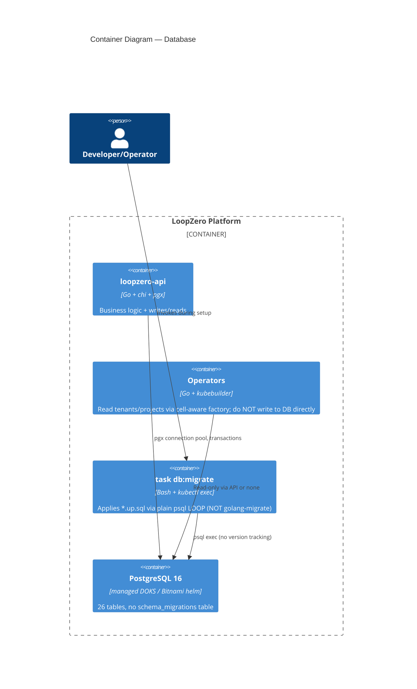

# Database — Container Diagram

## Overview

PostgreSQL 16 single instance (DOKS managed em prod, Bitnami chart em local) é o store de estado operacional do LoopZero. 26 tabelas em schema `public` cobrindo tenants, projects, builds, releases, secrets, audit, idempotency, scaling, e observability events.

## Diagram



## Containers

| Container | Technology | Responsibility | Owner |
|-----------|-----------|----------------|-------|
| `loopzero-api` | Go 1.25 + chi + pgx | Sole writer of business state | api-engineer |
| Operators (tenant/app/preview/platform) | Go + kubebuilder | Reconcile state from CRD; do NOT write to PG directly | operator-engineer |
| `task db:migrate` | Bash + kubectl exec | Apply migrations | infra-engineer |
| PostgreSQL 16 | managed (DO) / Bitnami (local) | State store | infra-engineer |

## Data Flow (write path — `loopzero deploy`)

1. CLI POST `/api/v1/builds` → API
2. API `withEnvironmentLock(tenant, project, env)` — acquires `pg_advisory_xact_lock`
3. API `INSERT INTO builds (...)` inside tx
4. API `INSERT INTO build_apps (...)` linking apps
5. API `INSERT INTO sse_events (...)` for client streaming
6. Tx commit → lock released
7. API responds 202

## Migration Flow (CURRENT — plain psql loop)

```
operator runs `task db:migrate`
  → for f in migrations/*.up.sql; do
      kubectl exec -n loopzero-system postgresql-0 -- psql < $f
    done
  → NO schema_migrations table
  → NO version tracking
  → re-run = re-applies all (relies on IF NOT EXISTS in each .up.sql)
```

## Tables (26)

`tenants`, `projects`, `environment_targets`, `builds`, `build_apps`, `releases`, `release_app_attestations`, `secrets`, `tenant_members`, `tenants_pending_deletion`, `tenant_tombstones`, `subscriptions`, `plan_limits`, `app_scaling_config`, `cells`, `circuit_breakers`, `custom_domains`, `github_installations`, `github_webhook_deliveries`, `idempotency_keys`, `leader_generations`, `preview_environments`, `project_repositories`, `audit_log`, `sse_events`, `webhook_events`.

**Notably absent:** `schema_migrations` (golang-migrate canonical) and `build_events` (referenciada em `build_gc_store.go:54` mas nunca criada).
