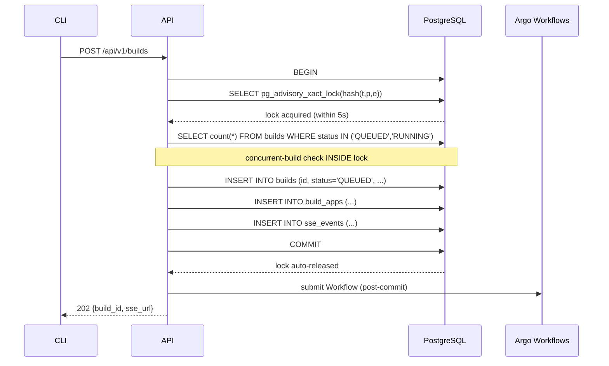

# Database — Deep Dive

## Problem Statement

LoopZero precisa persistir estado operacional autoritativo (build status, release pointer, tenant placement decision, audit log, idempotency keys) com garantias ACID. Múltiplos `loopzero-api` replicas competem por mutações ao mesmo `(tenant, project, environment)` — concorrência precisa ser controlada via locks.

## Design Decisions

### Decision 1: PostgreSQL como sole-writer-of-business-state

- **Context:** Operators reconcile state from CRDs; if operators ALSO wrote to PG, ownership ambiguous.
- **Decision:** Apenas `loopzero-api` escreve em PG. Operators leem (cell-aware factory) ou não tocam PG.
- **Alternatives rejected:** etcd (LoopZero CRDs already store CR state), Redis (no ACID), CockroachDB (overkill).
- **Consequences:** Single point of write. Read replicas viáveis para escala. Operators não podem fast-path business decisions.

### Decision 2: `pg_advisory_xact_lock` — transaction-scoped advisory lock

- **Context:** Connection pool (`pgx`) pode reusar conexão entre transações; session-scoped advisory locks (`pg_advisory_lock`) podem vazar.
- **Decision:** Sempre `pg_advisory_xact_lock(hash(tenant, project, env))` dentro de `BEGIN; ... COMMIT;`.
- **Alternatives rejected:** Application-level mutex (não funciona multi-replica), Redis lock (mais infra), row-level lock (granular demais — bloquearia leituras).
- **Consequences:** Lock auto-released em commit/rollback. 5s timeout configurável. Concurrent-build check MUST estar dentro do lock.

### Decision 3 (CURRENT BUG): `task db:migrate` faz `psql < $f` em loop

- **Context:** `api/Dockerfile:25` instala golang-migrate binary, mas Taskfile foi escrito antes ou ignorou essa dependência.
- **Decision (atual):** Plain psql, sem version tracking.
- **Alternatives that should have been chosen:** golang-migrate canonical (binary já existe).
- **Consequences:** Forward-only frágil; cada migration deve usar `IF NOT EXISTS`; sem rollback; sem audit. Bug F-1 do dogfood 2026-05-08.

### Decision 4 (CURRENT BUG): `build_events` GC referencia tabela inexistente

- **Context:** Histórico desconhecido. Possivelmente migration removida + scheduler não atualizado.
- **Decision (atual):** `DeleteOldEvents` em `build_gc_store.go:54` chama tabela ausente.
- **Consequences:** Log ERROR a cada GC tick. Bug F-3 do dogfood 2026-05-08.

## State Machine: NONE (database é estado, não state machine)

Estado machines vivem em `pkg/statemachine/` e são aplicadas em colunas de tabelas (e.g., `builds.status`, `releases.state`).

## Failure Modes

| Failure | Detection | Recovery | Impact |
|---------|-----------|----------|--------|
| PG instance down | Connection pool errors | DOKS managed: failover automático ~30s. Local: `task k3d:heal` | API 5xx até recovery |
| Migration fails midway | psql exit code != 0 in loop | Manual fix + re-run (atual) / golang-migrate dirty=true block (futuro) | Schema inconsistente |
| Lock timeout (5s) | API retries advisory lock | Cliente recebe 409 "already in progress" | Rule 3 mensagem product-language |
| Forward-only migration violou (`DROP`) | Code review + lint | Explicit sign-off required | Data loss potencial |

## Sequence: Happy Path — `loopzero deploy`

## Performance Characteristics

| Metric | Target | Current | Notes |
|--------|--------|---------|-------|
| Connection pool size | 25 (default pgx) | 25 | Configurable via env |
| Lock acquire timeout | 5s | 5s | Hard-coded em withEnvironmentLock |
| Migration runtime (10 files) | < 30s | < 60s | Local k3d limited disk IO |
| GC scheduler tick | every 1h | every 1h | `services/build_gc.go` |

## Open Questions

- Plan v1.1 (`dogfood-2026-05-08-fixes-plan.md`) addresses F-1 (golang-migrate adoption) e F-3 (delete `build_events` GC). Após implementação, Decisões 3+4 serão revertidas.
- Production migration mechanism: a verify in T1.4. Se prod já usa golang-migrate via Pulumi job, parity restaurada local↔prod sem trabalho extra.
