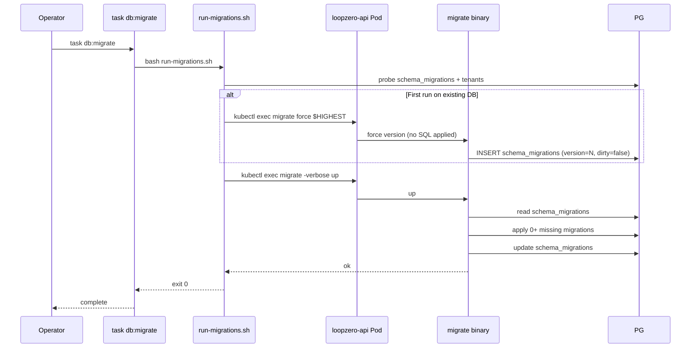

<!-- PROPOSED STATE — Generated from plan: dogfood-2026-05-08-fixes -->
<!-- Date: 2026-05-08 -->
<!-- Status: PENDING APPROVAL -->
<!-- To promote: replace parent docs with these after implementation is validated -->

# Database — Deep Dive (PROPOSED)

## Changes vs AS-IS

| Concern | AS-IS | PROPOSED (post v1.1) |
|---------|-------|----------------------|
| Migration mechanism | `psql < $f` em loop, sem version tracking | `golang-migrate up` canonical via wrapper script |
| `schema_migrations` table | Ausente | Presente, populada (versions 1-10 registradas) |
| `build_events` GC | Tries to delete inexistente; ERROR a cada tick | DELETED (method + caller removed) |
| Idempotência re-run | Depende de `IF NOT EXISTS` em cada SQL | golang-migrate detecta versão; skip applied |
| Backfill em DBs existentes | Não-existe | `migrate force <highest>` automatic via heal H17 |
| ConfigMap de migrations | n/a | initContainer copia de `/app/migrations` (image) para emptyDir, ou ConfigMap se < 900KB (EC-1) |

## New Decision (ADR D1 + D2 from plan v1.1)

### D1 — Adopt golang-migrate canonical via task db:migrate

`task db:migrate` invoca `bash infra/scripts/run-migrations.sh` que:
1. Detect mgmt context.
2. Compute HIGHEST migration dynamically (`ls migrations/*.up.sql | sort -V | tail -1` — EC-2).
3. If first run on existing DB (schema_migrations absent + tenants exists): `migrate force $HIGHEST`.
4. `kubectl exec -n loopzero-system deploy/loopzero-api -- migrate -path /migrations -database "$DSN" -verbose up`.

### D2 — Delete `build_events` GC method

`build_gc_store.go:DeleteOldEvents` removed. Caller scheduler em `services/build_gc.go` updated. Tests cleaned. ZERO references to `build_events` em codebase.

## Updated Sequence: `task db:migrate`

## New Failure Modes (mitigated)

| Failure | Detection | Recovery |
|---------|-----------|----------|
| ConfigMap > 1MB limit | Helm install fails | initContainer fallback path |
| `schema_migrations.dirty=true` | golang-migrate refuses subsequent up | Manual `migrate force <N>` after fix |
| HIGHEST detection fails (no migrations dir) | Script exits 1 with clear msg | Fix mount or rebuild image |

## Open Items

- T1.4 verify production parity (whether prod already uses golang-migrate). If not, file follow-up plan separately — production migrations remain UNCHANGED in scope of v1.1.
