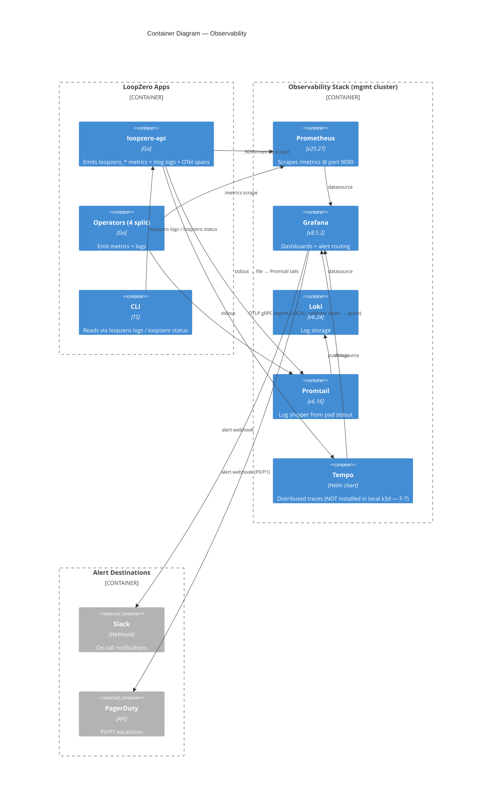

# Observability — Container Diagram

## Overview

LoopZero expõe 43+ métricas Prometheus (`loopzero_*`), traces OTel via Tempo, logs estruturados via Loki+Promtail, dashboards Grafana. SLO alerts em Prometheus rules. Local k3d carrega TODA stack mgmt-side (Prometheus, Grafana, Loki, Tempo) MENOS o OTel collector receiver — daí o spam de "rpc error" (F-7).

## Diagram

## Containers

| Container | Tech | Responsibility |
|-----------|------|----------------|
| `loopzero-api` | Go + slog + prom client_golang + OTel SDK | Emits all 3 telemetry types |
| Prometheus | mgmt cluster Helm | Metrics storage + alert eval |
| Grafana | mgmt | Dashboards (multi-cell, deploy, build, tenant), alert routing |
| Loki | mgmt | Log indexed storage |
| Promtail | DaemonSet | Tails container stdout, ships to Loki |
| Tempo | mgmt (prod only) | OTel trace collector — **NOT installed locally → F-7 spam** |

## Metrics Inventory (43+ `loopzero_*` + 4 cell metrics)

Selected critical metrics:
- `loopzero_api_request_duration_seconds_bucket{method, path, status}` — chi router-templated paths (good cardinality)
- `loopzero_cell_tenant_count{cell_id}` — placement decision visibility
- `loopzero_build_total{tenant, status}` — build pipeline visibility
- `loopzero_deploy_duration_seconds_bucket` — SLO histogram
- `loopzero_idempotency_replay_total` — duplicate detection signal
- `loopzero_circuit_breaker_state{breaker}` — graceful degrade visibility

**Plan v1.1 will add:** `loopzero_secret_externalsecret_total{result}` — F-2 instrumentation (T2.3 — bounded cardinality, no tenant label per EC-3).

## SLO Alerts (7 multi-cell + others)

Defined in `infra/helm/monitoring/manifests/prometheusrule-multi-cell.yaml`. Examples:
- `LoopZeroCellTenantCountStuck` — tenant count not changing for 24h (placement broken)
- `LoopZeroApiP95LatencyHigh` — p95 > 1s for 10m
- `LoopZeroArgoCDAppDegraded` — App.health=Degraded for 5m
- `LoopZeroBuildBacklog` — QUEUED > 5min count > 10

## Tracing Configuration (F-7 in local)

`api/internal/tracing/tracing.go`:
- `LOOPZERO_TRACING_ENABLED` env (default true em dev, false em prod) — feature flag
- `OTEL_EXPORTER_OTLP_ENDPOINT` env — collector address
- Local k3d: nem flag nem endpoint setados → tries default `localhost:4317` → fails every 5s → log spam
- Plan v1.1 T0.1: set `LOOPZERO_TRACING_ENABLED=false` em Tilt deployment YAML default
