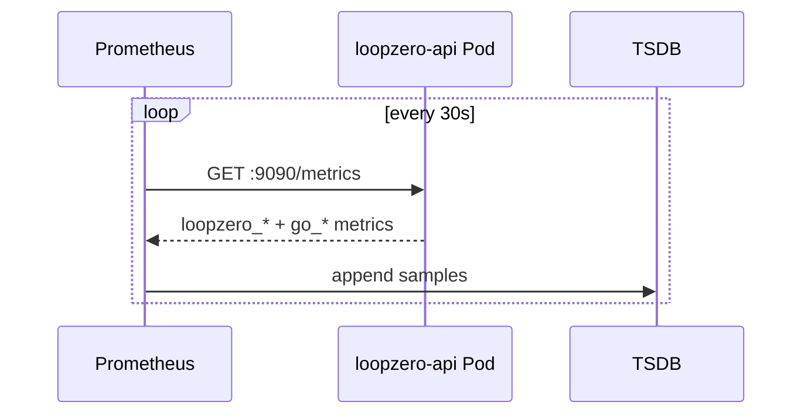
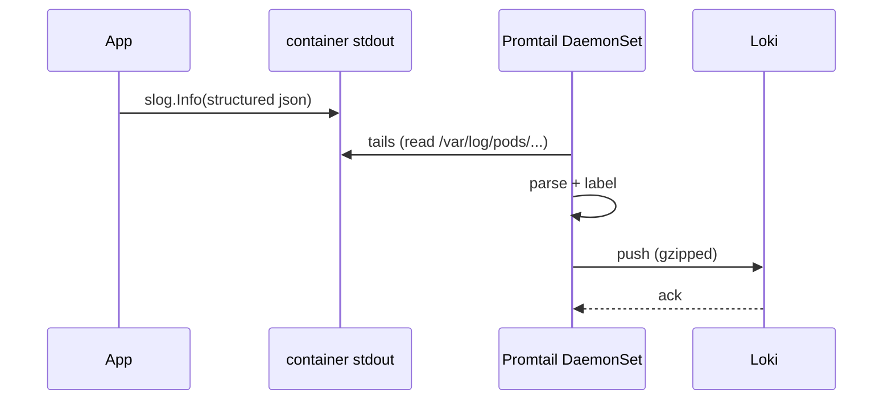
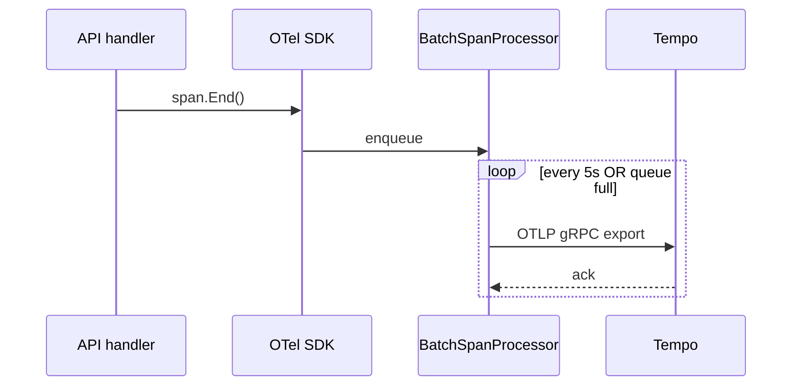
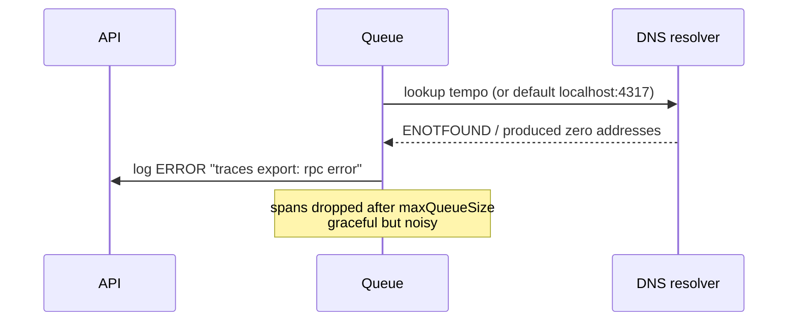

# Observability — Deep Dive

## Problem Statement

Operadores precisam (a) saber se o sistema está saudável, (b) diagnose root cause em incidentes <30min, (c) audit trail para compliance, (d) visibilidade de business metrics (tenants, builds, deploys). Stack precisa ser self-hosted (no SaaS lock-in) e cost-effective.

## Design Decisions

### Decision 1: Prometheus + Grafana + Loki + Tempo (LGTM stack)

- **Context:** Industry standard, Helm-installable, mgmt-cluster centralized.
- **Decision:** LGTM stack 100% open-source.
- **Alternatives rejected:** Datadog (cost), New Relic (cost + lock-in), Honeycomb (great traces but expensive at scale).
- **Consequences:** Operator complexity (manage Prom storage, Loki index). 32+ Helm charts pinned.

### Decision 2: chi router-templated paths em métricas (cardinality control)

- **Context:** `/api/v1/projects/foo` vs `/api/v1/projects/bar` é mesma route — distinct labels = cardinality explosion.
- **Decision:** chi middleware extracts route pattern (`/api/v1/projects/{name}`) before metric label.
- **Alternatives rejected:** Raw URL (cardinality unbounded), regex normalization (fragile).
- **Consequences:** ~50 unique route templates. Manageable.

### Decision 3 (CURRENT BUG F-7): Local k3d emits OTel spans without collector

- **Context:** `tracing.go:Init` reads `OTEL_EXPORTER_OTLP_ENDPOINT` (default `localhost:4317`). Tilt local has no Tempo running.
- **Decision (atual):** Default-on tracing in dev. OTel exporter retries every 5s → ERROR log spam.
- **Alternatives that should have been chosen:** `LOOPZERO_TRACING_ENABLED=false` por default em local.
- **Consequences:** Logs polluted. F-7 do dogfood 2026-05-08. Plan v1.1 T0.1 corrige.

### Decision 4: Build GC scheduler runs per-hour deletes from `builds`, `sse_events`, `webhook_events`, AND `build_events` (NON-EXISTENT)

- **Context:** `build_gc_store.go` calls `DeleteOldEvents` from `build_events` table.
- **Decision (atual, BUG): Scheduler tries to delete from a table that doesn't exist.
- **Consequences:** ERROR log every GC tick. F-3 do dogfood. Plan v1.1 T1.1 deletes the dead method.

## State Machine: NONE

Observability não tem state machine canonical — é cross-cutting concern.

## Failure Modes

| Failure | Detection | Recovery | Impact |
|---------|-----------|----------|--------|
| Prometheus disk full | TSDB ingestion errors | Increase PVC + tune retention | Metrics gap |
| Loki ingestion 429 | Promtail retry queue | Increase Loki ingestion rate | Logs delayed |
| OTel collector down | Spans dropped after queue exhaustion (graceful) | Restart Tempo | Traces gap |
| OTel collector down em LOCAL (F-7) | Log spam every 5s | Set `LOOPZERO_TRACING_ENABLED=false` | Log unreadable, no functional impact |
| Promtail DaemonSet OOM | Kubelet restarts | Increase resources | Brief log gap |
| Grafana datasource auth fail | Dashboard "no data" | Re-create datasource secret | Dashboard broken |

## Sequence: Metric Scrape (Happy Path)

## Sequence: Log Ship (Happy Path)

## Sequence: Trace Export (PROD Happy Path)

## Sequence: Trace Export Failure (LOCAL F-7)

## Performance Characteristics

| Metric | Target | Current |
|--------|--------|---------|
| Prom scrape interval | 30s | 30s |
| Prom retention | 15d | 15d (configurable) |
| Loki ingestion rate | 10MB/s | sufficient for current load |
| OTel batch interval | 5s | 5s (`tracing.go:exportTimeout`) |
| OTel queue size | 2048 spans | `maxQueueSize` const |
| Alert evaluation period | 1m | 1m |

## Open Questions

- Plan v1.1 T0.1 desliga OTel local default. Future plan: install Tempo locally via Helmfile L2 to enable parity.
- 4 cell metrics validados em Sprint 8. Adicionais para split-binary operators podem ser needed.
- T2.3 vai adicionar `loopzero_secret_externalsecret_total` — primeira métrica explicita para ESO sync path.
