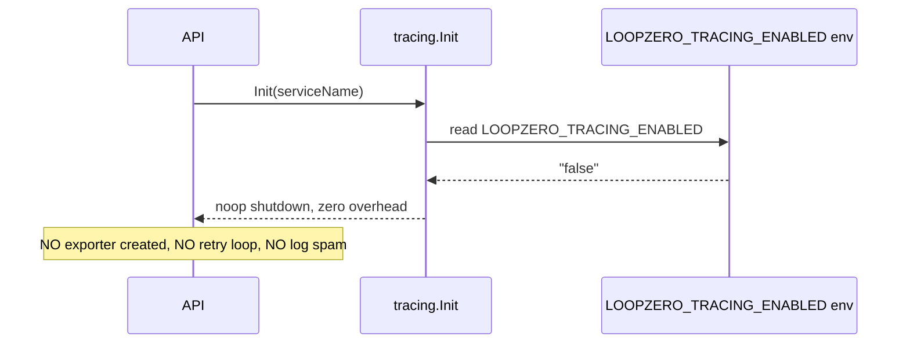

<!-- PROPOSED STATE — Generated from plan: dogfood-2026-05-08-fixes -->
<!-- Date: 2026-05-08 -->
<!-- Status: PENDING APPROVAL -->
<!-- To promote: replace parent docs with these after implementation is validated -->

# Observability — Deep Dive (PROPOSED)

## Changes vs AS-IS

| Concern | AS-IS | PROPOSED (post v1.1) |
|---------|-------|----------------------|
| Local OTel exporter | Default-on; spam ERROR every 5s when collector absent | `LOOPZERO_TRACING_ENABLED=false` default em Tilt deployment YAML + Helm chart |
| Production tracing | Default-on em prod chart `charts/loopzero-api` | UNCHANGED |
| `loopzero_secret_externalsecret_total` metric | Não existe | Exists with single label `result="success|fail|skip"` (cardinality bound, EC-3) |
| `build_events` GC ERROR log | Constant noise | DELETED (T1.1 removes method) |
| Slog secret value leak risk | LoopZeroretical | Test asserts value never em capturado log (EC-8) |

## New Decisions (ADR D7 + D3 from plan v1.1)

### D7 — Disable OTel exporter locally by default

`infra/tilt/api-deployment.yaml`: adicionar env `LOOPZERO_TRACING_ENABLED=false`.
`infra/helm/loopzero-api/values.yaml`: `tracing: {enabled: false}`.
`infra/helm/loopzero-api/templates/deployment.yaml`: gate `LOOPZERO_TRACING_ENABLED` env via `.Values.tracing.enabled`.

**Production chart (`charts/loopzero-api`) UNCHANGED** — `tracing.enabled: true` por default. Operadores podem override em values customizados.

### D3 — Cardinality-safe metric for ESO sync

`api/internal/metrics/metrics.go`:
```go
loopzeroSecretExternalSecretTotal := promauto.NewCounterVec(
    prometheus.CounterOpts{Name: "loopzero_secret_externalsecret_total"},
    []string{"result"}, // ONLY result; NO tenant — would explode cardinality
)
```

3 time series total: `result=success`, `result=fail`, `result=skip`. Mesmo padrão do existing `loopzero_idempotency_replay_total`.

## Updated Sequence: Local trace export (PROPOSED)



When operator wants tracing locally: `export LOOPZERO_TRACING_ENABLED=true && tilt up` + ensure Tempo running.

## New Failure Modes (mitigated)

| Failure | Detection | Recovery |
|---------|-----------|----------|
| Operator forgets to install Tempo locally + sets ENABLED=true | Existing graceful degrade (queue exhaustion) | `unset LOOPZERO_TRACING_ENABLED` (back to default false) |
| Production chart accidentally inherits dev default | Helm template diff fails | CI guard via existing helm-chart-drift validation |

## Updated Metrics Inventory

NEW (post v1.1):
- `loopzero_secret_externalsecret_total{result="success|fail|skip"}` — F-2 instrumentation. 3 time series.

REMOVED (post v1.1):
- (none — `build_events` GC removal eliminates ERROR log noise but doesn't impact metrics inventory)

## Performance Impact

| Metric | AS-IS | PROPOSED |
|--------|-------|----------|
| API CPU (local) | +X% from OTel retry loop | Same minus retry loop overhead |
| API log volume (local) | ~12 ERROR/min from OTel + ~1/h from build_events | ~0 ERROR baseline |
| Prom storage growth | 100 MB/d | + 1 KB/d from new metric (3 time series @ 30s scrape) |

## Open Items

- Future plan: install Tempo locally via Helmfile L2 to enable parity dev↔prod for tracing.
- Future plan: SLO alert para `loopzero_secret_externalsecret_total{result="fail"}` rate spike — out of v1.1 scope.
