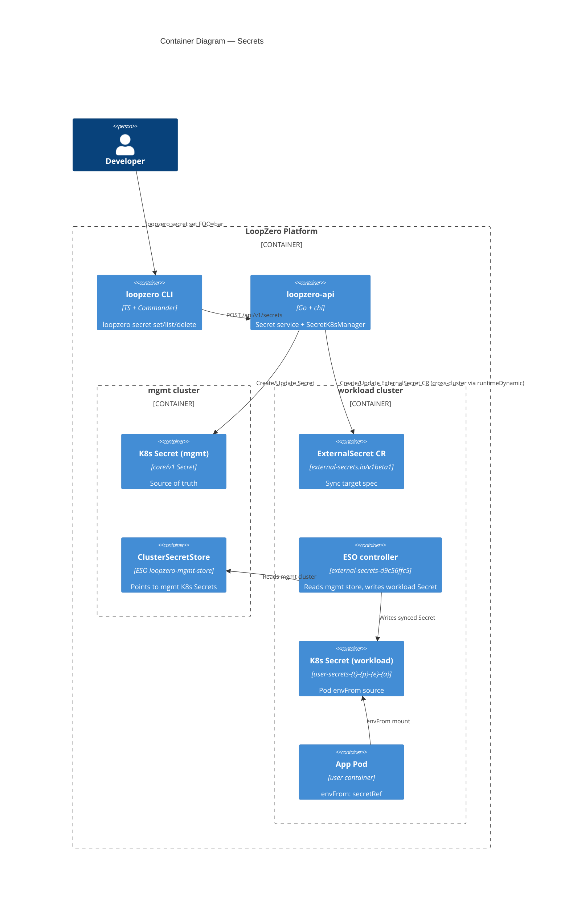

# Secrets — Container Diagram

## Overview

LoopZero gerencia secrets via flow CLI → API → mgmt cluster (K8s Secret) + workload cluster (ExternalSecret CR via ESO sync). Pod monta secret por `envFrom: secretRef:` referenciando `user-secrets-{tenant}-{project}-{env}-{app}`.

## Diagram

## Containers

| Container | Tech | Responsibility |
|-----------|------|----------------|
| `loopzero CLI` | TypeScript | Validates args, makes HTTP request |
| `loopzero-api` | Go + chi + pgx + dynamic | Validation, audit, K8s + ESO CR creation |
| `SecretK8sManager` | Go struct | Wraps mgmt + runtime K8s clients |
| K8s Secret (mgmt) | core/v1 | Stores actual secret value |
| ClusterSecretStore | ESO CR | Tells ESO where to fetch (loopzero-mgmt-store points at mgmt) |
| ExternalSecret | ESO CR | Spec for what to sync to workload Secret |
| ESO controller | Helm-deployed | Reconciles ExternalSecret → workload Secret |

## Data Flow (`loopzero secret set API_KEY=topsecret`)

1. CLI → API: `POST /api/v1/secrets {name, value, env, app}`
2. API validates + audit log INSERT
3. API `mgmtClient.CoreV1().Secrets(loopzero-system).Create("loopzero-{tenantID}-{name}", value)` — K8s Secret on mgmt
4. API `runtimeDynamic.Resource(externalSecretGVR).Namespace(workloadNS).Create(externalSecret)` — ExternalSecret CR on workload
5. ESO controller (workload) reconciles ExternalSecret → fetches from mgmt → writes Secret `user-secrets-{tenant}-{project}-{env}-{app}` in workload namespace
6. Next deploy: pod mounts via `envFrom: secretRef`

## Where it's quebrado em local (F-2)

Step 4 silently skipped. Pod stuck CreateContainerConfigError aguardando Secret nunca criado. Causa-raiz não diagnosticada — T2.1 vai investigar.
