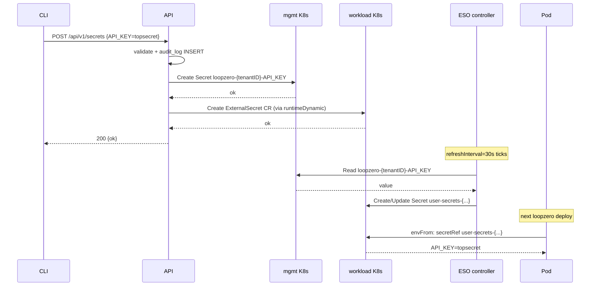
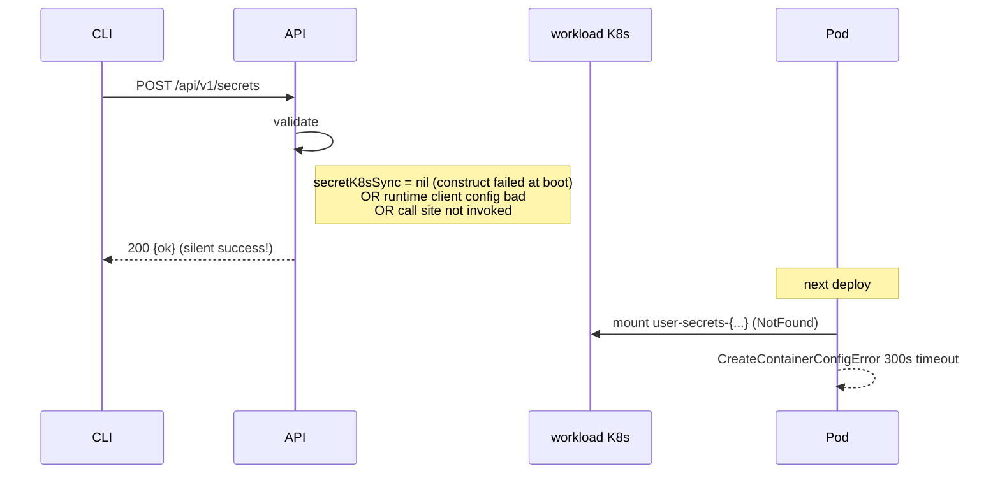

# Secrets — Deep Dive

## Problem Statement

User apps need env vars (DATABASE_URL, API_KEY, etc.) injected as container env. LoopZero deve oferecer (a) interface CLI Vercel-grade simples, (b) sem que valores sejam committed em Git, (c) sem ZERO knowledge dos termos K8s/ESO leakando para usuário (Rule 3).

## Design Decisions

### Decision 1: ESO sync mgmt→workload, NÃO direct cross-cluster Secret apply

- **Context:** LoopZero é multi-cluster (mgmt + workload + runtime-2). Pod precisa de Secret no mesmo cluster onde ele roda.
- **Decision:** API escreve Secret em mgmt (canonical source), ExternalSecret CR em workload, ESO sync.
- **Alternatives rejected:** API escreve diretamente no workload (acoplamento maior, risco de drift); SealedSecrets em Git (não atende Vercel-DX).
- **Consequences:** Secret só fica disponível ~5-30s pós `loopzero secret set` (ESO refreshInterval=30s). Adequado.

### Decision 2: Naming canonical `user-secrets-{tenant}-{project}-{env}-{app}`

- **Context:** Pod manifest gerado em `renderer_deployment.go:90` precisa referenciar Secret por nome.
- **Decision:** Naming determinístico via `pkg/naming` (ou inline via `fmt.Sprintf` em `secret_k8s_manager.go:159`, `renderer_deployment.go:90`, `renderer_rollout.go:384`).
- **Alternatives rejected:** UUID (não traceable em kubectl), tenant-id only (collision em multi-app).
- **Consequences:** `kubectl get secret user-secrets-...` é human-readable. Naming logic duplicada em 3 lugares — fragile. Já registrado em "Common Mistakes".

### Decision 3: SecretK8sManager construct silent-fails para warn-log apenas

- **Context:** API needs both mgmt + runtime K8s clients. Em local, runtime kubeconfig pode não estar montado.
- **Decision:** `setup_k8s.go:38` `if mgr, err := NewSecretK8sManager(...); err != nil { logger.Warn("ESO sync disabled") } else { secretK8sSync = mgr }`.
- **Alternatives rejected:** Fatal error (bloqueia API boot — não desejado em modos dev).
- **Consequences:** **Silent skip mascara bug** se runtime kubeconfig é mal configurado. F-2 do dogfood 2026-05-08 — métrica + log adicionais em T2.3 mitigam.

## State Machine: NONE

Secrets não têm state machine canonical. Estados implícitos: `desired (mgmt Secret) → ESO syncing → present (workload Secret)`.

## Failure Modes

| Failure | Detection | Recovery | Impact |
|---------|-----------|----------|--------|
| `SecretK8sManager` construct fails | API logs warn "ESO sync disabled" | Verify `RUNTIME_KUBECONFIG` mount + `RUNTIME_KUBE_CONTEXT` env | All secret CLI silently no-op |
| ExternalSecret CR creation fails | API logs error (atual: SEM log) | T2.3 instrumentation alerta | Pod stuck CreateContainerConfigError |
| ESO controller down em workload | `kubectl get pods -n external-secrets` not Running | Restart ESO Helm release | Sync atrasa ou para |
| ClusterSecretStore mis-config | ESO controller logs `auth failed` | Verify `loopzero-mgmt-store` Secret + RBAC | Sync rejected |
| User secret value contains `\0` ou non-UTF8 | Validation in API | 400 Bad Request | Reject early |

## Sequence: Happy Path — `loopzero secret set`

## Sequence: Error Path — Silent ESO Skip (F-2)

## Performance Characteristics

| Metric | Target | Current | Notes |
|--------|--------|---------|-------|
| Set roundtrip (CLI→Pod consumes) | < 60s | ~30s + next deploy | ESO refresh + redeploy required |
| ESO refresh interval | 30s | 30s | `secret_k8s_manager.go:155` |
| API call duration | < 1s | < 500ms | Dominated by 2 K8s CR creates |

## Open Questions

- T2.1 vai diagnosticar por que ExternalSecret nunca é criado em local. Hipóteses: (a) RUNTIME_KUBECONFIG mount missing → manager nil at boot, (b) call site secret_service NÃO invoca CreateOrUpdate, (c) ESO ClusterSecretStore mis-configured.
- AppSecret CRD existe mas não tem controller (CLAUDE.md: "ESO works directly, no lifecycle automation — YAGNI until rotation/drift-detection needed"). Plan futuro pode resgatar AppSecret se rotação for needed.
