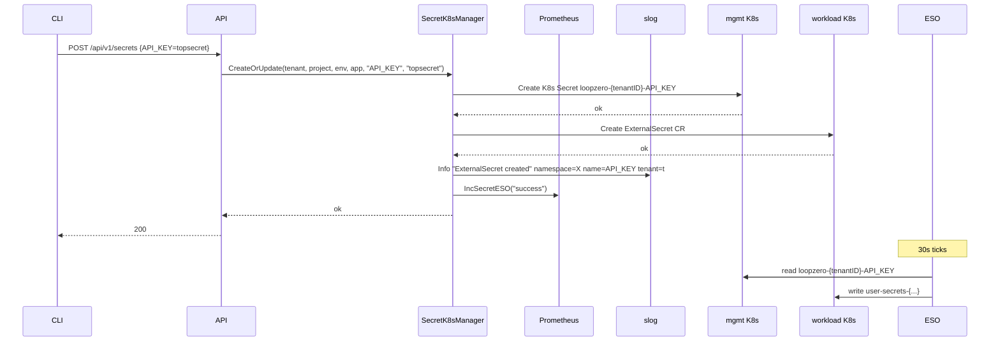

<!-- PROPOSED STATE — Generated from plan: dogfood-2026-05-08-fixes -->
<!-- Date: 2026-05-08 -->
<!-- Status: PENDING APPROVAL -->
<!-- To promote: replace parent docs with these after implementation is validated -->

# Secrets — Deep Dive (PROPOSED)

## Changes vs AS-IS

| Concern | AS-IS | PROPOSED (post v1.1) |
|---------|-------|----------------------|
| ESO instrumentation | ZERO log/metric on ExternalSecret create path | Structured log + metric `loopzero_secret_externalsecret_total{result}` |
| Silent skip detection | Invisible (Journey 03 timeout reveals after 5min) | Metric emit + log trace before/after CR Create |
| Cardinality safety | n/a (no metric) | Label apenas `result="success|fail|skip"` (EC-3) |
| Secret value PII | risk loopzeroretical | Test asserts value never em log/metric (EC-8) |
| Root cause of F-2 silent skip | Unknown (T2.1 will diagnose) | Documented post-T2.1 |

## New Decision (ADR D3 from plan v1.1)

### D3 — Instrument SecretK8sManager with structured log + metric, NOT changing flow

Path `secret_k8s_manager.go:CreateOrUpdate`:
1. Increment `loopzeroSecretExternalSecretTotal{result="success"}` em sucesso; `"fail"` em erro.
2. `slog.Info("ExternalSecret created", "namespace", ns, "name", name, "tenant", tenantID)` — name é Secret name (ex.: `API_KEY`); valor NUNCA aparece.
3. Test scaffolding em `secret_k8s_manager_test.go` valida que value não vaza.

## T2.1 + T2.2 — Diagnose-Driven Fix

T2.2 fix scope é OPEN — depende de evidência colhida em T2.1 via `infra/scripts/dogfood-diagnose-eso.sh`. Hipóteses listadas:
- (a) `RuntimeKubeconfig` env not mounted → manager nil at boot
- (b) `secret_service.go` não chama `secret_k8s_manager.CreateOrUpdate`
- (c) `ClusterSecretStore loopzero-mgmt-store` mis-configured

Plan v1.1 explicitamente reconhece via ADR-0022 trigger if T2.2 evidencia mudança em interface contracts.

## Updated Sequence: `loopzero secret set` (PROPOSED)

## Updated Failure Modes (with instrumentation)

| Failure | Detection (NEW) | Recovery |
|---------|-----------------|----------|
| ExternalSecret CR Create fails | Metric `result="fail"` rate spike + slog Error line | Alert fires, operator investigates |
| Manager nil at boot (silent skip) | `loopzeroSecretExternalSecretTotal` stays at 0 despite secret API calls | New alert: "ESO sync disabled in API" |
| ClusterSecretStore mis-config | ESO controller log + Workload Secret never appears | Existing recovery (Helm reconfigure) |

## Open Items

- T2.2 closes after T2.1 evidence drives fix.
- AppSecret CRD remains unimplemented (CLAUDE.md "ESO works directly, YAGNI") — out of v1.1 scope.
