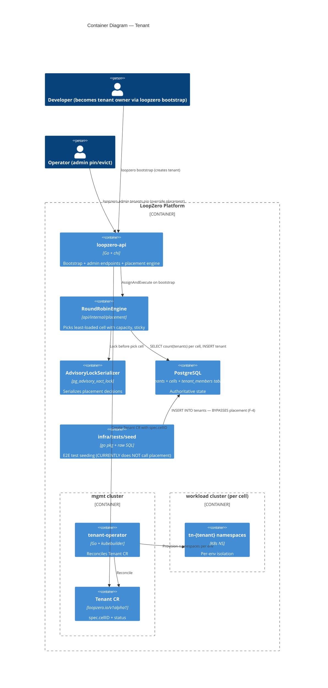

# Tenant — Container Diagram

## Overview

Tenant é a unidade de isolamento e billing do LoopZero. Cada tenant tem `cell_id` decidido uma única vez (placement decision sticky), namespace dedicado por env, e Plan attached para enforcement.

## Diagram



## Containers

| Container | Tech | Responsibility |
|-----------|------|----------------|
| `loopzero-api` bootstrap handler | Go | Path canonical de criação de tenant para usuários reais |
| `RoundRobinEngine` | Go | Bin-packing — pick cell with FEWEST tenants among non-full |
| `AdvisoryLockSerializer` | pgx + advisory lock | Serializes concurrent bootstraps |
| `PostgreSQL.tenants` | DB table | `cell_id` is canonical placement |
| `PostgreSQL.cells` | DB table | Capacity, status (active/draining/maintenance/retired), region |
| `Tenant CR` | K8s CRD | `spec.cellID` mirrored from DB; status from operator |
| `tenant-operator` | Go split-binary | Reconcile namespace + RBAC + TenantCondition |
| `infra/tests/seed` | Go pkg + SQL | **Currently INSERTs tenant WITHOUT cell_id (F-4)** |

## Data Flow (`loopzero bootstrap` — happy path)

1. CLI POST `/api/v1/auth/bootstrap` (after Hydra OAuth)
2. API authenticates JWT
3. API calls `placement.AssignAndExecute(ctx, func(txCtx, cellID) { ... })`:
   - Acquire `pg_advisory_xact_lock` (serializer)
   - Query `cells` table for active, non-full
   - Pick FEWEST-tenant cell (bin-packing)
   - INSIDE same tx: INSERT tenant with `cell_id`
4. API creates Tenant CR with `spec.cellID = picked`
5. tenant-operator reconciles → creates namespaces `tn-{slug}` em workload cluster
6. API returns 200 + tenant info

## Data Flow (`loopzero admin tenants pin` — operator override)

1. Operator runs `loopzero admin tenants pin --tenant X --cell Y`
2. CLI POST `/api/v1/admin/tenants/X/pin {cell_id: Y}` with `LOOPZERO_SERVICE_AUTH`
3. API `CellPinner.Pin`: capacity check + atomic UPDATE tenants.cell_id + Tenant CR MergePatch
4. Operator reconcile re-emits ArgoCD App with destination.name=Y

## Data Flow (E2E seed path — CURRENT BUG F-4)

```
infra/tests/seed/seed.go:74
  → INSERT INTO tenants (id, display_name, slug, owner_id) VALUES (...) ON CONFLICT (id) DO NOTHING
  → cell_id NOT included
  → ON CONFLICT DO NOTHING means: existing row with NULL cell_id stays NULL
```

Result: `e2e-tenant` em DB com `cell_id IS NULL`. Edge multi-cell test failed in dogfood 2026-05-08.

## Capacity (default 500/cell)

`MaxTenantsPerCell` configurável via env. Quando todas as cells full → bootstrap retorna 503. Solução operator-driven: provisionar nova cell.
