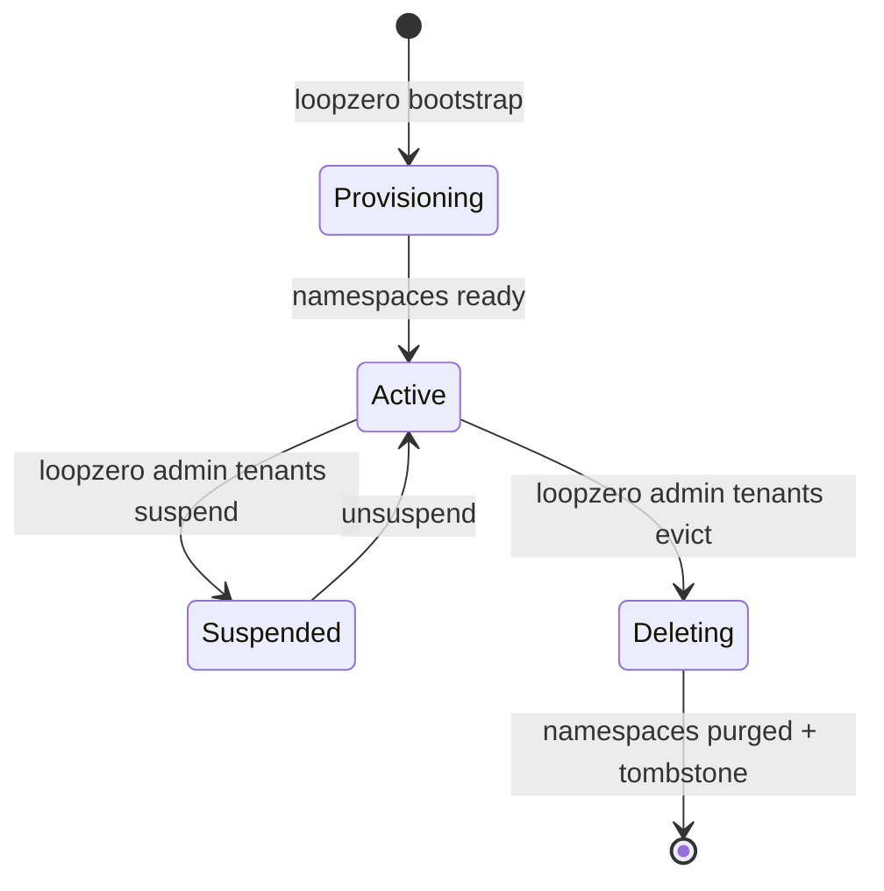

# Tenant — Deep Dive

## Problem Statement

Multi-tenancy via shared K8s cluster precisa: (a) isolar workloads (namespaces + RBAC + NetworkPolicy), (b) decidir EM QUAL workload cluster o tenant roda (multi-cell), (c) enforce plan limits, (d) bilhar via Stripe. Decisão de cell é sticky (placement once).

## Design Decisions

### Decision 1: Placement once + sticky thereafter (ADR-0008 + ADR-0021)

- **Context:** Migration auto entre cells é complexa (DNS, state, ArgoCD App, ESO). Hot-spots indicam upgrade tier, NÃO migration signal.
- **Decision:** `RoundRobinEngine.AssignAndExecute` chama-se UMA vez no `loopzero bootstrap`. Thereafter, `tenants.cell_id` é fonte de verdade canônica e nunca muda automaticamente. Operator override via `loopzero admin tenants pin`.
- **Alternatives rejected:** Auto-rebalancing (opaco, viola auditabilidade), placement per-deploy (DNS continuity quebra).
- **Consequences:** Hot-spot é ativador para upgrade tier OU drain manual. `cells.status='draining'` não move tenants — operator precisa pin.

### Decision 2: `cell_id` em tenants table é canonical, NOT em CRD

- **Context:** Tenant CR + DB ambos têm `cellID`. Disagreement possível.
- **Decision:** DB `tenants.cell_id` wins. Tenant CR `spec.cellID` mirrors. Em conflict, DB sync para CR.
- **Alternatives rejected:** CRD canonical (operator down → no tenant operations possible).
- **Consequences:** API canonical owner. Se Tenant CR for deleted accidentally, controller recria from DB.

### Decision 3 (CURRENT BUG): Seed path bypassa placement

- **Context:** Test infrastructure roda em SQL puro (psql exec) — não usa API HTTP.
- **Decision (atual):** `seed.go` faz INSERT direto sem `cell_id`.
- **Alternatives that should have been chosen:** Either (a) hardcode `cell-default` em seed SQL, (b) call placement engine via Go SDK.
- **Consequences:** F-4 do dogfood 2026-05-08. Plan v1.1 corrige via T3.1 — hardcode `cell-default` no INSERT (ADR-0008 default cell).

## State Machine: Tenant



Source: `pkg/statemachine/tenant.go`.

## Failure Modes

| Failure | Detection | Recovery | Impact |
|---------|-----------|----------|--------|
| All cells full | Bootstrap returns 503 | Operator provisions new cell | New tenants blocked |
| `pg_advisory_xact_lock` timeout | API logs lock timeout | Retry (idempotent) | One bootstrap delayed |
| Tenant CR deleted manually | tenant-operator reconcile | Recreates from DB row | Brief reconcile loop |
| `tenants.cell_id` set to invalid cell | Pin endpoint validates | Returns 400 if cell not in `cells.status='active'` | Pin rejected |
| Seed path runs before `cells` populated | INSERT FK violation if FK exists | Migration 000006 should populate cell-default; `task k3d:heal` H17 (proposed) | E2E setup broken (F-4) |

## Sequence: Bootstrap

```mermaid
sequenceDiagram
    participant Dev
    participant CLI
    participant API
    participant Placement
    participant PG
    participant Operator
    participant K8s as workload cluster

    Dev->>CLI: loopzero bootstrap
    CLI->>API: POST /api/v1/auth/bootstrap (JWT)
    API->>Placement: AssignAndExecute(ctx)
    Placement->>PG: BEGIN; pg_advisory_xact_lock
    Placement->>PG: SELECT cell_id, count FROM tenants GROUP BY cell_id
    Placement->>PG: pick fewest non-full
    Placement->>PG: INSERT tenants(id, slug, ..., cell_id)
    Placement->>PG: COMMIT
    PG-->>API: tenant created
    API->>Operator: Create Tenant CR (spec.cellID=picked)
    Operator->>K8s: kubectl create ns tn-{slug}-production
    Operator->>K8s: kubectl create ns tn-{slug}-staging
    K8s-->>Operator: ok
    Operator-->>API: Tenant.status.phase=Active
    API-->>CLI: 200 {tenantID, cellID}
```

## Sequence: Admin Pin Override

```mermaid
sequenceDiagram
    participant Op as Operator
    participant CLI
    participant API
    participant Pinner as CellPinner
    participant PG
    participant TenantCtrl as tenant-operator
    participant ArgoCD

    Op->>CLI: loopzero admin tenants pin --tenant X --cell Y
    CLI->>API: POST /api/v1/admin/.../pin (X-Service-Auth)
    API->>Pinner: Pin(tenantID, newCell)
    Pinner->>PG: capacity check Y
    Pinner->>PG: BEGIN; UPDATE tenants SET cell_id=Y WHERE id=X
    Pinner->>API: PATCH Tenant CR spec.cellID=Y (atomic with DB tx)
    Pinner->>PG: COMMIT
    Pinner-->>API: ok
    API-->>CLI: 200
    Note over TenantCtrl: reconciles
    TenantCtrl->>ArgoCD: Application destination.name=Y
    ArgoCD->>ArgoCD: cluster Secret label resolves to Y kubeconfig
```

## Performance Characteristics

| Metric | Target | Current |
|--------|--------|---------|
| Bootstrap end-to-end | < 5s | ~3s (lock + INSERT + CR + ns reconcile) |
| Pin override | < 2s | ~1s |
| Capacity per cell | 500 (configurable) | 500 |
| Cells supported | unlimited | 3 active (default + cell-1 + cell-2) |

## Open Questions

- T3.1 (plan v1.1) corrige seed path. Não há outras questões abertas no domain tenant.
- Production-canary stages 4-5 para cell-2 (1 customer 7-day → 10/50/100%) pendentes Sprint 9.
