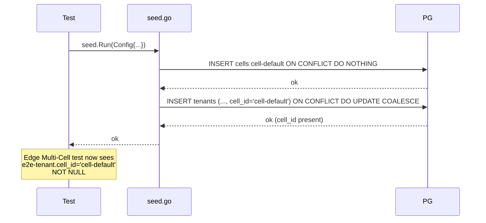

<!-- PROPOSED STATE — Generated from plan: dogfood-2026-05-08-fixes -->
<!-- Date: 2026-05-08 -->
<!-- Status: PENDING APPROVAL -->
<!-- To promote: replace parent docs with these after implementation is validated -->

# Tenant — Deep Dive (PROPOSED)

## Changes vs AS-IS

| Concern | AS-IS | PROPOSED (post v1.1) |
|---------|-------|----------------------|
| Seed path placement | `INSERT INTO tenants (...) NO cell_id` | INSERT includes `cell_id='cell-default'` + COALESCE preserve |
| FK guard in seed | n/a (FK violation possible) | Pre-INSERT: ensure `cell-default` row exists em cells table |
| Pin preservation on re-seed | DO NOTHING masks ON CONFLICT | DO UPDATE SET cell_id = COALESCE(tenants.cell_id, EXCLUDED.cell_id) — preserves manual pins |
| `tenants.cell_id` constraint | Possibly nullable (verify) | NOT NULL after backfill (T3.2) |

## New Decision (ADR D4 from plan v1.1)

### D4 — Seed path injects `cell_id='cell-default'` via SQL (not via placement engine)

`infra/tests/seed/seed.go` updates SQL template:

```sql
-- Step 1 (NEW): ensure cell-default exists in cells table (EC-4 mitigation)
INSERT INTO cells (cell_id, status, region) VALUES ('cell-default', 'active', 'local')
ON CONFLICT (cell_id) DO NOTHING;

-- Step 2 (UPDATED): tenant insert with cell_id + preserve-on-conflict
INSERT INTO tenants (id, display_name, slug, owner_id, cell_id)
VALUES ('e2e-tenant', 'E2E Test Tenant', 'tn-e2etest', 'github-e2e-user', 'cell-default')
ON CONFLICT (id) DO UPDATE SET cell_id = COALESCE(tenants.cell_id, EXCLUDED.cell_id);
```

Rationale: Test fixture, hardcoded `cell-default` aceitável. Testes específicos de Multi-Cell continuam fazendo placement explicit via `loopzero admin tenants pin`.

## T3.2 — NOT NULL invariant

Migration 000011 (conditional): `ALTER TABLE tenants ALTER COLUMN cell_id SET NOT NULL`.

Defense-in-depth: any future path that bypasses placement decision will fail loud at INSERT time, not later at query time.

## Updated Sequence: E2E seed (PROPOSED)



## Other Tenant Concerns: UNCHANGED

- `loopzero bootstrap` (real users) continues calling `RoundRobinEngine.AssignAndExecute` (canonical path).
- `loopzero admin tenants pin` continues working as documented.
- Multi-cell isolation unchanged.
- DOKS production behavior unchanged.

## Open Items

- None.
